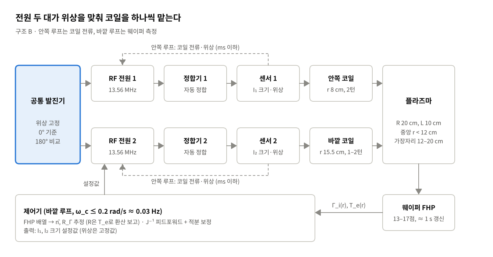

# 중앙부·가장자리 플라즈마 밀도의 독립 제어

플라즈마 전자공학 IC-PBL 프로젝트 — **주제 3**

하나의 ICP 챔버에서 중앙부와 가장자리의 전자 밀도를 독립적으로 조절할 수 있는 소스 구조와 구동 방식을 설계한다. 두 영역을 함께 올리고 내리는 것이 아니라, 밀도비

```math
R = \frac{n_{e,\mathrm{center}}}{n_{e,\mathrm{edge}}}
```

를 원하는 값으로 맞추는 것이 목표다.

## 1차 발표 결정 (2026-11-05, 같은 날 검토 반영)

동심 코일 2개(r ≈ 8 / 15.5 cm)를 같은 주파수의 **독립 RF 전원 2대**로 따로 구동하고, 공통 발진기로 **위상을 0°에 고정**하는 구조(B)를 골랐다.

- 설계 챔버(반지름 20 cm, 창–웨이퍼 간격 10 cm)에서 R 0.8–1.2 전 범위는 **20–30 mTorr에서 여유 있게, 15 mTorr에서는 경계**로 닿는다(2-영역 0D 계산, 코일 선택도 포함, 절대 범위는 검증 전). 그 아래 압력에서는 자기장 보조(C)를 검토한다.
- 수동 공진(A)은 범위가 아니라 **독립성(L1)** 때문에 기준에서 뺐다. KC20에서는 50 mTorr 공진으로 R 0.39까지 내려갔지만, 공진점이 부하에 따라 움직이고 커패시터 하나가 n̄와 R을 함께 움직인다. 전원이 1대뿐일 때의 대안으로 남긴다.
- 180°는 비교 조건(가설 H6)이다. 0°는 위상 허용 오차(±19–38° vs ±4–12°), 효율(0.95–0.96 vs 0.85–0.91), 같은 전력의 코일 전류에서 앞서고, 180°는 경계 분리와 정합 리액턴스 변화에서 앞선다.
- 제어는 FHP가 직접 재는 이온 선속비 R_Γ로 하고, R은 T_e로 환산해 보고한다.



- 문서: [`docs/04_1차발표_정리.md`](docs/04_1차발표_정리.md) (질문별 답, 발표 구성안) · [`docs/05_1차_결정보고서.md`](docs/05_1차_결정보고서.md) (결정 8개) · [`docs/06_상세설계보고서.md`](docs/06_상세설계보고서.md) (유도·수치·위험·백로그)
- 검토에서 고친 오류와 확인된 수치: [`docs/07_검토결과_2026-11-05.md`](docs/07_검토결과_2026-11-05.md)
- 결정 기록: [`docs/design/결정기록/`](docs/design/결정기록/README.md) ADR-001–008 · 후보 비교: [`docs/design/후보비교.md`](docs/design/후보비교.md)
- 아이디어 백로그: [`docs/09_아이디어백로그.md`](docs/09_아이디어백로그.md) · 진행 기록: [`docs/08_진행기록.md`](docs/08_진행기록.md)
- 1차 발표 슬라이드는 `presentations/` 폴더에 있다.

## 제출 결과물

| # | 결과물 | 주로 답하는 검토 사항 | 위치 | 상태 |
|---|---|---|---|---|
| ① | 영역별 소스·구동부 구성도 | 1. 수단 선택·영향 영역 | `figures/presentation1_drive_architecture_B.png`, 상세설계보고서 결정 3·4, ADR-003·004 | ✅ 초안 |
| ② | 조작 변수와 밀도 응답의 관계 | 1, 2. 상호 영향의 원인 | 상세설계보고서 핵심 물리 근거·결정 1, `sim/presentation1_estimates.py jacobian` | ✅ 0D 계산 (V1에서 압력·위상별 J 표) |
| ③ | 목표 밀도비 조정 절차 | 3. 한쪽 유지·다른 쪽 변경 | [`docs/조정절차.md`](docs/조정절차.md) | ✅ 초안 |
| ④ | 독립 제어 여부를 확인할 측정 계획 | 4. 전체 밀도 vs 분포 변화 구분 | [`docs/측정계획.md`](docs/측정계획.md), `sim/jacobian_fit.py` | ✅ 초안 |

설계 가정, 대안의 장단점, 예상 부작용, 검증 방법(과제 공통 검토 방향)은 상세설계보고서의 「가정과 위험 등록부」, 「후보 비교표」, 「예측과 검증 계획」(가설 H1–H7)에 있다.

## 저장소 구조

```
.
├── README.md
├── docs/
│   ├── 00_과제정의.md            과제 원문, 결과물↔검토 사항 대응, "독립 제어"의 정의, 결정 필요 사항
│   ├── 01_배경이론.md            밀도 분포 형성 경로, 표피 깊이·확산 스케일, 결합 경로 C1~C8, 작업 가설 H1~H5
│   ├── 02_선행연구.md            제어 수단별 선행연구 [P1]~[P4], [J1]~[J5], [C1]~[C6], 측정 방법, 시사점
│   ├── 03_작업계획.md            단계별 계획·상태, 일정(W0~W6), 역할, 작업 규칙
│   ├── 04_1차발표_정리.md        질문별 답, 물리 근거, 아키텍처 비교, 발표 구성안
│   ├── 05_1차_결정보고서.md      결정 8개와 근거, 가정·위험, 팀 합의 사항
│   ├── 06_상세설계보고서.md      유도 과정, 정합기 상호작용, 위험 등록부, 백로그, 일정, 수치 재현 방법
│   ├── 07_검토결과_2026-11-05.md 문서 검토에서 고친 오류와 확인된 수치
│   ├── 08_진행기록.md            날짜별 진행, 현재 결정 요약, 팀 합의 6건
│   ├── 09_아이디어백로그.md      미해결 문제·아이디어 B01~B19와 상태
│   ├── 조정절차.md               제출물 ③: 제어 구조, J⁻¹ 피드포워드, 6단계 절차, 과도 대응
│   ├── 측정계획.md               제출물 ④: 진단, FHP 배치, 불확도, 실험 매트릭스, 판정 기준
│   └── design/
│       ├── 후보비교.md           구조 A/B/C/D 비교, 위상 0°/180°, 수단별 영향 영역
│       └── 결정기록/             ADR-001~008 (맥락·결정·근거·대안·결과·확인 방법)
├── sim/
│   ├── README.md                 모델링 로드맵 (M0~M4), 실행 명령
│   ├── scale_estimates.py        M0: 1차 스케일 추정
│   ├── two_zone_icp.py           M1·M2a: 2-영역 0D + 코일 회로 모델
│   ├── run_two_zone.py           M1·M2a: KC20 검증, sweep, jacobian, sensitivity
│   ├── presentation1_estimates.py  1차 발표 수치 (scales / phase / jacobian / range)
│   ├── presentation1_figures.py  1차 발표 그림 (R 범위, 사슬, 구성도)
│   ├── two_source_phase.py       M1a: 두 전원 위상·교환 전력·정합 리액턴스 (phase와 같은 ΔZ)
│   └── jacobian_fit.py           M4: FHP 섭동 실험 → a0/a1 회귀 → J, 누설, κ, RGA
├── figures/                      그림과 CSV (생성 코드는 sim/, 목록은 figures/README.md)
└── requirements.txt
```

## 진행 현황

- [x] 저장소 구성, 과제 정의 정리
- [x] 배경 이론·선행연구 초안, 스케일 추정
- [x] 기준 챔버·운전 조건, center/edge 정의, 목표 밀도비 범위 — 제안값 (팀 합의 6건 남음: `docs/08_진행기록.md`)
- [x] 후보 설계 비교·선택 → B (독립 전원 2대, 위상 0°), 검토 반영 `docs/07`
- [x] 2-영역 0D + 회로 모델 V0: KC20 비공진 급전 전류 검증(±9%), 압력별 R 범위, J 삼각 구조 (공진 상태 재현은 미완, B19)
- [ ] V1: KC20 공진 상태 재현 확인 → 전원 2개·위상·다중 턴으로 확장, J(p, φ) 표, H1·H3·H4·H6·H7 판정
- [ ] V2: 축대칭 2D 확산 모델(M2), H2·H5, 측정 위치 환산
- [x] 조정 절차, 측정 계획 — 초안 (V1 결과로 갱신)
- [ ] 보고서·발표 자료 (1차 문서·슬라이드 완료, 2차 준비)

## 시작하기

```bash
python -m pip install -r requirements.txt
python sim/scale_estimates.py
python sim/presentation1_estimates.py all
python sim/two_source_phase.py
python sim/jacobian_fit.py
```

전체 실행 명령은 `sim/README.md`, 보고서 수치의 재현 순서는 `docs/06_상세설계보고서.md` 부록 E.

## 문헌·수치 표기

문헌은 `docs/02_선행연구.md`에 ID로 등록하고 다른 문서에서는 ID로 인용한다. 수치 옆 표기: (문헌) / (계산) / (추정) / (가정).
