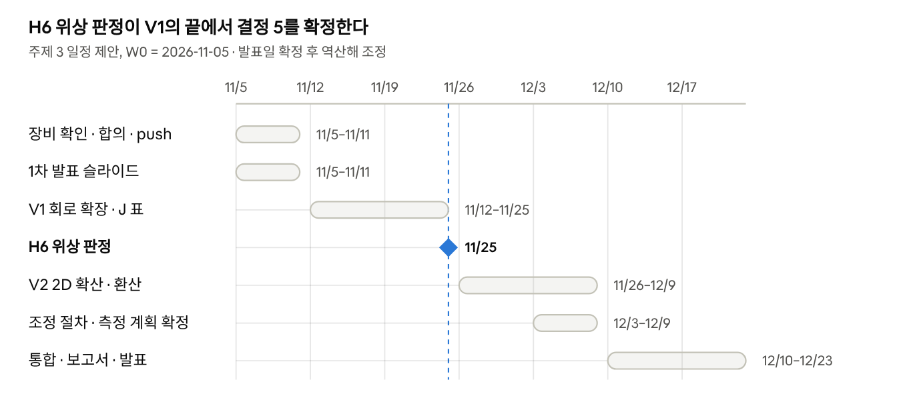

# 03. 작업 계획

## 1. 단계별 계획

| 단계 | 내용 | 산출물 | 검토 사항 | 상태 |
|---|---|---|---|---|
| 0. 준비 | 저장소 구성, 과제 정의, 배경 이론·선행연구 초안, 스케일 추정 | `docs/00~03`, `sim/scale_estimates.py` | — | ✅ |
| 1. 문제 정의 확정 | 기준 챔버·운전 조건, center/edge 위치, 목표 밀도비 범위, 독립성 판정 기준 확정 | `docs/00` 4절의 제안값 → ADR-001, `05_1차_결정보고서.md` 결정 1 | 공통 | ✅ 제안값 확정 (팀 합의 6건 남음, `08_진행기록.md`) |
| 2. 후보 설계 비교 | 후보 A/B/C/D를 같은 기준으로 비교하고 하나를 선택 | `docs/design/후보비교.md`, ADR-004·005, 구성도(`figures/presentation1_drive_architecture_B.png`) | 1 | ✅ B 선택 (2026-11-05) |
| 3. 모델링 | 2-영역 0D + 회로 모델(M1·M2a)로 J·제어 폭 계산, 2D 확산 모델(M2)로 검증 (검증 단계 V1·V2) | `sim/`, J 표, 압력별 R 범위 | 1, 2 | 🔄 V0 완료 (KC20 공진 상태 재현은 미완, B19), V1 진행 |
| 4. 조정 절차 | 목표 밀도비로 가는 조작 순서·보상 규칙, 반복 절차 | `docs/조정절차.md`, ADR-006 | 3 | 🔄 초안 (V1의 J 표로 갱신) |
| 5. 검증 계획 | 진단 선택·배치, 실험 매트릭스, 전체 밀도 vs 분포 변화 분리, 독립성 지표 | `docs/측정계획.md`, ADR-007, `sim/jacobian_fit.py` | 4 | 🔄 초안 (장비 확인 후 확정) |
| 6. 정리·발표 | 결과물 4종 + 가정·대안·부작용·한계 정리 | `docs/04`–`07`, 발표 자료(`presentations/`) | 전체 | 🔄 1차 보고서·슬라이드 완료, 2차 준비 |

## 2. 검토 사항별 접근

### 검토 사항 1 — 수단 선택과 영향 영역
- 각 수단을 "사슬의 어느 단계(01 문서 1절)를 바꾸는가"로 분류: 회로(전류비·위상·공진) / 장(코일 배치·페라이트) / 가열(주파수) / 수송(자기장).
- 서로 다른 단계를 바꾸는 수단끼리 조합할수록 응답 행렬이 대각에 가까워질 것이라는 가설(H4, H5)을 비교 기준으로 사용.
- 산출물: 수단별 영향 영역 표 + 단면 그림(어느 r, z에서 무엇이 바뀌는지).

### 검토 사항 2 — 상호 영향의 원인
- 01 문서 5절의 결합 경로 C1~C8을 **측정·계산으로 분리하는 순서**를 정리: 코일 전류·위상을 직접 측정해 회로 결합(C1~C4)을 먼저 확인 → 남은 결합을 플라즈마 내부 결합(C6, C7)으로 해석.
- 2D 확산 모델로 간격 $L$, 압력, 체적 손실에 따른 확산 결합의 크기를 계산(H2).
- 산출물: 결합 경로별 크기 추정과 "제거 가능 / 보상만 가능" 구분.

### 검토 사항 3 — 한쪽 유지, 다른 쪽 변경
- 응답 행렬 $J$를 측정(또는 계산)하고 $\Delta\mathbf u = J^{-1}\Delta\mathbf y$로 보상 조작을 구함.
- 조작 순서 규칙 초안: ① 총 전력으로 평균 밀도 설정 → ② 전류비(또는 위상)로 밀도비 조정 → ③ 정합 재조정 → ④ 측정 후 $J$ 갱신·반복.
- 비선형 대응: 한 번에 큰 변화 대신 작은 단계로 나누어 이동, E–H 전이 근처 동작 금지 범위 설정.
- 산출물: 조정 흐름도, 목표 도달까지의 예상 반복 횟수, 실패 조건.

### 검토 사항 4 — 측정과 검증
- 출력 정의: 평균 밀도 $\bar n$과 정규화 분포 $n(r)/\bar n$을 따로 보고, 밀도비 $R$은 정규화 분포에서 읽음 → 전체 밀도 변화와 분포 변화를 분리.
- 실험 매트릭스: 동작점 주변에서 조작 변수 하나씩 ±5~10% 섭동 → $J$의 각 열 측정, 반복 측정으로 불확도 추정.
- 독립성 지표: 비대각/대각 비, 조건수, "한쪽 유지" 조작 시 유지 영역 밀도의 변화량.
- 진단 후보: 반경 방향 랑뮤어 탐침(기준) + 교란이 작은 다점 진단(부유 고조화 탐침 배열 또는 컷오프 탐침) — 02 문서 4절.
- 산출물: 측정 위치도, 실험 순서표, 판정 기준표.

## 3. 후보 설계 초안 (단계 2에서 비교)

| 후보 | 구성 | 조작 변수 | 기대 | 우려 |
|---|---|---|---|---|
| A | 안쪽·바깥쪽 평판 코일, 단일 전원 + LC 공진 전류 분배 | 총 전력, 분배 커패시터 | 단순, 넓은 전류비 범위 | 회로 결합(C1) 잔존, 공진점 민감도 |
| B | 영역별 독립 전원 2대 + 위상 고정 | 영역별 전류, 위상차 | 진폭·위상 2자유도, 보상 용이 | 상호 인덕턴스로 전원 간 간섭, 비용 |
| C | A 또는 B + 약한 축 방향 자기장(코일 또는 영구자석) | (A/B 변수) + 자기장 세기 | 소스와 다른 성격의 손잡이로 대각화 | 이온 플럭스·에너지 분포 동반 변화, 비대칭 |

비교 결과(넷째 안 D 포함)와 선택 이유는 `docs/design/후보비교.md`와 ADR-004·005에 있다.

평가 기준(안): ① 밀도비 조절 범위 ② 독립성(응답 행렬 조건수) ③ 평균 밀도 유지 능력 ④ 구현 복잡도·비용 ⑤ 부작용(E 모드 성분, 이온 에너지 변화, 비대칭) ⑥ 검증 가능성.

## 4. 일정 (제안 — 발표일 확정 후 역산해 조정, W0 = 2026-11-05)

> 2026-11-06 갱신: 외부 검토를 반영해 V1 앞에 판정 기준 통일·한쪽 유지 시험·KC20 재비교(P1–P3)를 넣었다. 새 일정과 관문 G1–G3은 [`10_후속계획.md`](10_후속계획.md)를 따른다. 아래 표는 원안이다.

| 주차 | 기간 | 목표 | 완료 기준 |
|---|---|---|---|
| W0 | 11/5–11/11 | 장비 확인(B01), 팀 합의 6건, 저장소 push, 1차 발표 슬라이드 | 합의 상태표 갱신 |
| W1–W2 | 11/12–11/25 | V1: KC20 공진 상태 재현 확인(B19) → 회로 모델에 전원 2개·위상·다중 턴 → 자기일관 동작점, J(p, φ) 표, 정합 위치 표 | H1·H3·H4·H6·H7 판정, **H6 위상 판정 (11/25)** |
| W3–W4 | 11/26–12/9 | V2: 축대칭 2D 확산·장 계산, 측정 위치 환산 계수 | H2·H5 판정, 0D 결과 확인 |
| W4 | 12/3–12/9 | 조정 절차·측정 계획 확정 (V1 J 표 반영) | `조정절차.md`, `측정계획.md` 갱신 |
| W5–W6 | 12/10–12/23 | 통합, 2차 보고서, 발표 자료 | 제출물 4종 + 공통 항목 |
| (장비 확보 시) | — | V3 측정: J 측정값, 가설 최종 판정 | 측정 J로 이득 표 덮어쓰기 |

## 5. 역할 분담 (팀 구성 확정 후 기입)

| 역할 | 담당 | 범위 | 이번 단계의 일 |
|---|---|---|---|
| 소스·회로 | | 코일 배치, 전원·정합, 회로 모델(M1) | V1: 공진 상태 재현(B19), 전원 2개·위상·다중 턴 확장 (B02·B05·B06) |
| 플라즈마 모델링 | | 2D 확산 모델(M2), 응답 행렬 | V2: 축대칭 2D, 환산 계수 (B09·B10), λε 브리지 꼴 (B04) |
| 진단·검증 | | 측정 계획, 실험 매트릭스 | 장비 확인(B01), `측정계획.md` 확정, `jacobian_fit.py` 섭동 시퀀스 (B16) |
| 문서·발표 | | 문서 통합, 그림, 발표 | 슬라이드(20장 구성안), ADR·백로그 상태 관리 |

## 6. 작업 규칙

- **값의 출처를 구분해 표기**: (가정) / (추정·스케일) / (계산·모델) / (문헌) / (측정). 공통 검토 방향의 "예상과 실제 확인 결과 구분"에 대응.
- 문헌은 `docs/02_선행연구.md`에 ID([P1], [J1], [C1] …)로 등록하고 다른 문서에서는 ID로 인용.
- 그림은 `figures/`에, 그림을 만드는 코드는 `sim/`에 두어 다시 만들 수 있게 한다.
- 브랜치: `topic/<내용>` (예: `topic/circuit-model`), 작은 단위로 커밋하고 PR로 합친다. 한 일은 `docs/08_진행기록.md`에 날짜별로 남긴다.
- 결정은 `docs/design/결정기록/ADR-NNN.md`에 남기고, 뒤집을 때는 새 ADR을 쓰고 이전 ADR을 "대체됨"으로 표시한다.
- 백로그 항목(`docs/09_아이디어백로그.md`)은 그 표에서만 상태를 바꾼다. 발표·보고서는 그 표를 인용한다.
- 보고서의 수치는 스크립트 이름과 부명령(`presentation1_estimates.py scales|phase|jacobian|range`, `two_source_phase.py`, `jacobian_fit.py`)을 함께 적는다.
- 문서를 고친 뒤에는 `docs/07_검토결과_2026-11-05.md`의 수정 목록과 어긋나는 옛 수치가 없는지 확인한다.
