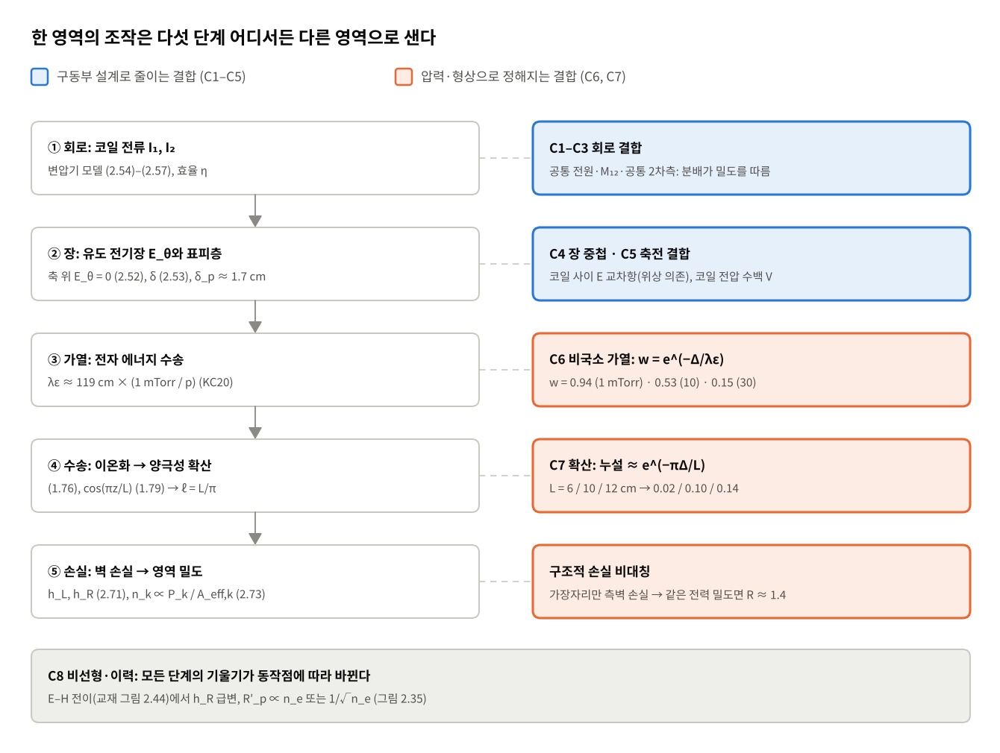
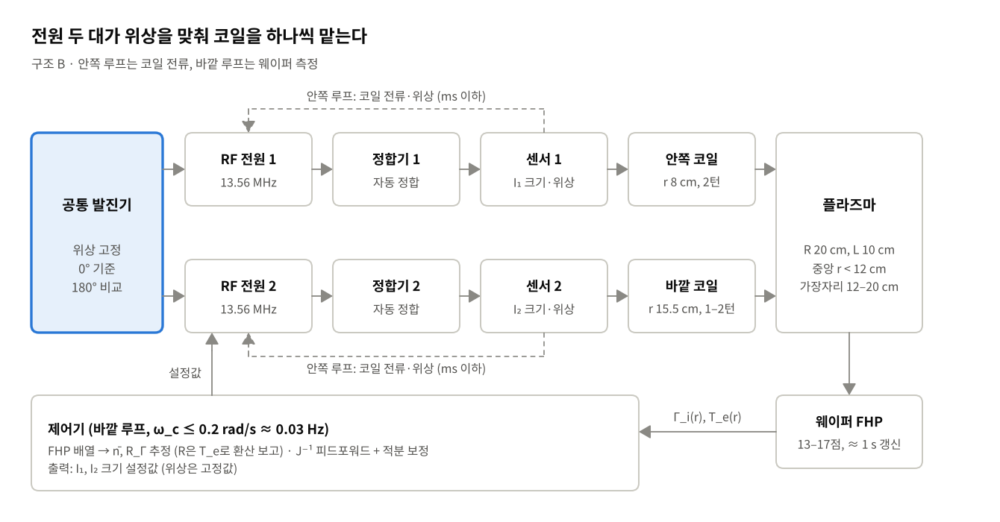
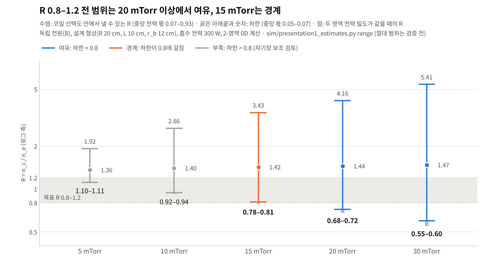

# 주제 3 · 1차 발표 정리: 중앙·가장자리 밀도비 독립 제어의 이론 근거와 검증 계획

> 원본: claude.ai 문서 (https://claude.ai/artifact/9LvxLzWnjEhEFYNJrc9oTT, 비공개). 이 파일은 저장소 보관용 사본이며, 수식은 GitHub에서 렌더링되도록 math 블록으로 옮겼다.

2026-11-05 · 2026-11-05 검토 결과 반영

## 요약

- **선택한 구조.** 같은 주파수의 독립 RF 전원 2대가 동심 코일 2개(안쪽 r ≈ 8 cm, 바깥 r ≈ 15.5 cm)를 하나씩 구동한다. 공통 발진기로 위상을 고정하는데, 기준은 0°이고 팀이 검토하던 180°는 비교 조건으로 둔다. 안쪽 루프는 코일 전류를, 바깥 루프는 웨이퍼 FHP 배열로 잰 n̄와 R을 맞춘다. 약한 축 방향 자기장(약 3 G)은 15 mTorr 아래로 운전할 때만 더하는 선택 사항이다.
- **근거 1 — 독립성은 두 길이 척도로 정해진다.** 전자 에너지 완화 길이 λε ≈ 119 cm·(1 mTorr/p)가 코일 간격 Δ = 7.5 cm보다 짧아야 하고(p\* ≈ 16 mTorr), 확산 퍼짐 길이 ℓ = L/π ≈ 3.2 cm가 Δ보다 짧아야 한다(누설 e^(−πΔ/L) ≈ 0.10). 이 둘은 구동 방식과 무관하다.
- **근거 2 — 누설은 대부분 회로에서 온다.** T\_e가 전력과 무관하다는 H 모드 가정에서, 플라즈마만 보면 응답 행렬은 (총 전력, 분배) 좌표에서 삼각형이다(교재 식 2.70, 2.73). 분배를 설정값으로 정하는 독립 전원은 회로 누설을 크게 줄인다(0°에서 분배의 밀도 의존 0.10 이하).
- **근거 3 — 다른 후보의 한계.** 수동 공진(가변 C)은 범위로는 기각되지 않는다. KC20에서 50 mTorr 공진만으로 R이 0.39까지 내려갔다. 대신 공진점이 플라즈마 부하에 따라 움직이고 커패시터 하나가 n̄와 R을 함께 움직여 독립성이 L1에 머문다. 독립 전원의 위상은 전원 간 교환 전력이 sin φ에 비례해서 0°나 180° 근처에 고정한다. 180°는 분배 이득이 3–4배 크고 경계 분리가 좋지만, 같은 전력에 코일 전류가 2–3배 크고 분배가 밀도에 민감해서, 독립성 기준으로는 0°가 앞선다.
- **예측.** 설계 형상에서 R 0.8–1.2 전 범위는 20 mTorr 이상에서 여유 있게 닿고 15 mTorr는 경계다. 그때 n̄ 변화는 ±5% 안이다(2-영역 0D 계산, 코일 선택도 포함). 바깥 루프는 측정 지연 때문에 0.03 Hz 안팎으로 느리지만, 플라즈마 응답(약 0.1–0.2 ms)이 훨씬 빨라 피드포워드와 안쪽 전류 루프로 충분하다.
- **검증 계획.** 가설 7개를 수식 예측과 판정 기준으로 적었다. 다음 단계(V1)는 회로 모델을 전원 2개·위상으로 확장해 J(p, φ)를 구하는 것이다.

## 문제 정의

과제가 요구하는 것은 밀도를 올리고 내리는 손잡이가 아니라 **밀도비 R = n\_e,center / n\_e,edge를 원하는 값으로 맞추는 손잡이**다. 밀도비만 보면 전체 밀도가 같이 움직여도 알 수 없으므로, 출력은 평균 밀도 n̄와 밀도비 R 두 개로 잡는다.

```math
\Delta \mathbf{y} = J\,\Delta \mathbf{u},\qquad \mathbf{y} = \begin{bmatrix}\ln \bar n\\ \ln R\end{bmatrix},\qquad \mathbf{u} = \begin{bmatrix}\text{조작 변수 1}\\ \text{조작 변수 2}\end{bmatrix}
```

"독립 제어"는 응답 행렬 J의 모양으로 판정한다.

| 수준 | 의미 | 판정 기준 (제안값) |
| --- | --- | --- |
| L0 동반 변화 | 두 영역이 함께 오르내림 | J의 두 열이 거의 평행 (조건수 매우 큼) |
| L1 보상 가능한 독립 | 조작은 섞이지만 보상 조작으로 한쪽 유지 가능 | J가 가역, 조건수가 측정 오차 대비 충분히 작음 |
| L2 구조적 독립 | 한 조작이 다른 출력을 거의 안 움직임 | 각 열의 비대각/대각 비 ≤ 0.1 |

분석 대상 운전 상황(질문 4-1)은 **정상 상태 동작점에서 R의 설정값을 바꾸는 상황**이다. 공정 레시피 한 단계 안에서 n̄는 거의 유지한 채 R만 바꾸는 준정적 문제이며, 빠른 외란 억제는 1차 범위에서 뺀다. 과도 상황(점화, E–H 전이, 레시피 변경)은 따로 다룬다.

| 항목 | 제안값 | 근거 |
| --- | --- | --- |
| 기체·주파수 | Ar, 13.56 MHz | 교재·문헌 조건과 비교 가능 |
| 압력 | 5–30 mTorr (확장 1–50 mTorr) | 공정 영역이면서 국소/비국소 전이가 일어나는 구간 (밀도 분포 사슬 절) |
| 전력 | 수백 W \~ 1 kW, H 모드 | E 모드에서는 분포가 가열 위치보다 축전 결합을 따름 (Park 2017) |
| 중앙/가장자리 위치 | 중앙 r ≤ 25 mm 평균, 가장자리 r = 135–140 mm | 300 mm 웨이퍼의 가장자리 제외 영역 고려 |
| 측정 높이 | 웨이퍼 면 위 1–2 cm | 공정 결과와 직접 연결되는 위치 |
| 목표 범위 | R = 0.8–1.2 연속 조정, R 조정 중 n̄ 변화 ±5% 이내 | 측정 불확도(±2–3%)보다 커야 의미가 있음 |

목표 범위와 판정 기준의 수치는 팀 합의가 필요한 제안값이다.

## 밀도 분포가 정해지는 사슬과 영역 간 결합 경로

코일 전류에서 영역 밀도까지는 다섯 단계를 거친다. 단계마다 한 영역의 조작이 다른 영역으로 새는 경로가 있고(01\_배경이론의 C1–C8), 그 크기는 단계별 길이 척도를 코일 간격 Δ ≈ 7.5 cm와 견주어 어림할 수 있다. 수치 옆의 (문헌)·(계산)·(추정)·(가정)은 저장소 규칙의 출처 표시다.



*그림: 밀도 분포 사슬 · 5단계와 결합 경로*

**① 회로.** 교재의 변압기 모델(식 2.54–2.56)에서 플라즈마는 두 코일이 함께 쓰는 2차측이다. 코일 1의 전압에는 코일 2의 전류가 상호 인덕턴스 M₁₂와 플라즈마 반사 임피던스 ΔZ₁₂를 거쳐 들어온다.

```math
V_1 = \left(R_1 + j\omega L_1 + \Delta Z_{11}\right) I_1 + \left(j\omega M_{12} + \Delta Z_{12}\right) I_2,\qquad \eta = \frac{R'_p}{R_a + R'_p}\ \ (2.57)
```

플라즈마 반사 저항 R′\_p는 저밀도에서 n\_e에, 고밀도에서 1/√n\_e에 비례한다(교재 그림 2.35). 전원 하나를 두 코일에 나누는 구조에서는 밀도만 바뀌어도 전류 분배가 바뀐다는 뜻이다(C1, C3). 설계 형상의 단일 턴 코일 기준으로 M₁₂ ≈ 91 nH(ωM₁₂ ≈ 7.8 Ω), 결합 계수 0.16이다(계산).

**② 장.** 유도 전기장은 축 위에서 0이고(식 2.52는 솔레노이드형의 E\_θ ∝ r이지만 축 위 0은 평판 코일에도 같다), 플라즈마 안으로는 표피 깊이만큼만 들어간다.

```math
\delta = \left(\frac{2}{\omega\mu_0\sigma}\right)^{1/2}\ (2.53),\qquad \delta_p = \frac{c}{\omega_p} \approx 1.7\ \mathrm{cm}\ \ (n_e = 10^{11}\ \mathrm{cm^{-3}})
```

두 코일의 장은 코일 사이에서 겹치고, 시간 평균 전력의 교차항 2Re(E₁E₂\*)는 두 전류의 위상차에 따라 부호가 바뀐다(C4). 코일 전압은 창을 통해 축전 결합한다(C5). 크기는 아키텍처 비교 절에서 계산한다.

**③ 전자 가열과 에너지 수송.** 흡수된 전력이 어디서 이온화로 쓰이는지는 전자가 에너지를 잃기 전에 움직이는 거리 λε가 정한다(KC20). 한 영역에 넣은 전력 중 다른 영역에서 쓰이는 몫을 w라 하면(2-영역 모델의 λε 브리지와 같은 꼴, 가정) 다음과 같다.

```math
\lambda_\varepsilon = \sqrt{\lambda_m\lambda^*/3} \approx 119\ \mathrm{cm}\times\frac{1\ \mathrm{mTorr}}{p},\qquad w = e^{-\Delta/\lambda_\varepsilon},\qquad g_R = \frac{\partial \ln R/\partial(\text{분배})}{(\text{완전 국소일 때의 값})} = 1 - w
```

g\_R = 1 − w는 동작점이 두 영역의 전력 밀도가 같은 점일 때 브리지 식에서 정확히 나온다(계산). g\_R은 전력 분배가 R을 움직이는 힘이 완전 국소일 때의 몇 배인지를 뜻한다.

| p \[mTorr\] | λε \[cm\] | w | g\_R | 의미 |
| --- | --- | --- | --- | --- |
| 1 | 119 | 0.94 | 0.06 | 분배를 바꿔도 R이 거의 안 변함 |
| 5 | 24 | 0.73 | 0.27 | 제어 폭이 좁음 |
| 10 | 12 | 0.53 | 0.47 | 전이 구간 |
| 20 | 6.0 | 0.28 | 0.72 | 국소 쪽 |
| 30 | 4.0 | 0.15 | 0.85 | 거의 국소 |

Park et al. (2017)이 쓴 3, 10, 25, 50 mTorr의 값(39, 12, 4.7, 2.4 cm)도 1/p를 따르지만, KC20 Fig. 5처럼 계산값이라 독립적인 실험 검증은 아니다(문헌). 이 식의 비 g\_R(1)/g\_R(30) ≈ 0.07이 앞선 모델의 제어 폭 비 ln 1.05 / ln 1.82 ≈ 0.08과 비슷한 것도 모델 안에 같은 λε 브리지가 들어 있기 때문이라 검증이 아니다. KC20 측정에서 같은 비는 0.13–0.21이다. 저압에서 R 제어가 어려운 원인은 구동 방식이 아니라 전자 에너지 수송이므로, 어떤 아키텍처를 골라도 g\_R은 그대로 남는다. 예외는 자기장 보조뿐이다(아키텍처 절).

**④ 입자 수송.** 이온화로 생긴 입자는 양극성 확산(식 1.68, 1.76)으로 퍼진다. 축 방향 기본 모드가 cos(πz/L)(식 1.79)이면 고리 모양 소스는 반경 방향으로 ℓ = L/π 길이로 퍼진다(챔버 크기 절). 따라서 소스에서 Δ 떨어진 곳의 밀도는 소스 위치의 대략 e^(−Δ/ℓ)배다(추정, 원거리 근사).

```math
\text{확산 누설} \approx e^{-\Delta/\ell} = e^{-\pi\Delta/L} = 0.02,\ 0.05,\ 0.10,\ 0.14\qquad (L = 6,\ 8,\ 10,\ 12\ \mathrm{cm})
```

ℓ는 압력과 무관하므로 이 누설은 L로만 정해진다. L = 10 cm에서 약 0.10으로, L2 판정 기준의 경계에 있다.

**⑤ 벽 손실과 영역 밀도.** 영역마다 입자 균형(식 2.69)과 전력 균형(식 2.73)을 쓰면, 영역 밀도는 그 영역에 들어간 전력에 비례한다.

```math
n_k \approx \frac{P_k}{e\,u_B\,\varepsilon_T\,A_{\mathrm{eff},k}},\qquad A_{\mathrm{eff},c} = 2\pi r_b^2 h_L,\qquad A_{\mathrm{eff},e} = 2\pi\left(R^2 - r_b^2\right)h_L + 2\pi R L\,h_R\ \ (2.71),\,(2.72)
```

```math
\ln R = \ln\frac{P_c}{P_e} + \ln\frac{\varepsilon_{T,e}\,u_{B,e}\,A_{\mathrm{eff},e}}{\varepsilon_{T,c}\,u_{B,c}\,A_{\mathrm{eff},c}}
```

여기서 두 가지가 나온다.

1. **총 전력은 n̄를, 전력 분배는 R을 움직인다.** 교재 식 2.70대로 T\_e는 기체 밀도와 크기로 정해지고 전력과 무관하다. 그래서 분배를 고정하고 총 전력만 바꾸면 R은 변하지 않는다. 2-영역 모델은 이 가정을 그대로 담고 있어, 영역 전력을 직접 지정하면 ∂ln R/∂ln P = 0이 된다. 계산 결과라기보다 가정의 귀결이다. 교재도 2.4.2절 끝에서 실제 T\_e는 밀도·압력·면적 대 부피 비의 함수라고 적고 있고, KC20의 50 mTorr 비공진 R도 50 → 150 W에서 3.33 → 2.54로 변했다(E–H 전이가 섞였을 가능성). 그래서 J₂₁ ≈ 0은 가설 H4로 측정해 확인한다. 앞선 모델에서 수동 공진 구조의 전력 열 누설 0.29–0.43은 전부 ① 회로 단계에서 생긴 것이다.
2. **가장자리에는 측벽 손실이 더해진다.** 같은 전력 밀도를 주면 중앙이 높아 R = 1.36–1.47이다(설계 형상, 5–30 mTorr, 계산). R = 1을 만들려면 가장자리에 더 많은 전력을 줘야 하고, 그 과정에서 n̄도 조금 움직인다(∂ln n̄/∂ln R ≈ 0.10, 계산). 5 mTorr에서는 중앙 전력을 거의 0으로 줄여도 R = 1에 닿지 않는다(계산, 모델 절대값은 보정 전).

| 결합 경로 | 단계 | 크기 어림 | 무엇으로 줄이나 |
| --- | --- | --- | --- |
| C1 공통 전원 | ① | 수동 공진 구조의 전력 열 누설 0.29–0.43 (계산, 앞선 모델) | 영역별 독립 전원 |
| C2 상호 인덕턴스 | ① | ωM₁₂ ≈ 7.8 Ω, 결합 계수 0.16 (계산, 단일 턴) | 위상을 0° 또는 180°로 고정 |
| C3 플라즈마 공통 2차측 | ① | R′\_p가 n\_e 또는 1/√n\_e를 따름 (교재 그림 2.35) | 코일 전류 기준 제어 |
| C4 장 중첩 | ② | 교차 저항이 자기 저항과 비슷한 크기 (아키텍처 절, 계산) | 위상 선택, 코일 간격 |
| C5 축전 결합 | ② | 코일 전압 수백 V (추정) | 턴 수, 패러데이 차폐, 위상 |
| C6 비국소 가열 | ③ | w = 0.94 (1 mTorr) → 0.15 (30 mTorr) | 압력, 약한 축 방향 자기장 |
| C7 확산 | ④ | e^(−πΔ/L) ≈ 0.10 (L = 10 cm) | L, 자기장 |
| 손실 비대칭 | ⑤ | 같은 전력 밀도에서 R ≈ 1.4 (계산) | 가장자리 전력을 늘려 보상 |
| C8 비선형·이력 | 전 단계 | E–H 전이에서 h\_R 급변 (Park 2017) | H 모드 유지, 조작 순서 규칙 |

C1–C5는 구동부 설계로 줄일 수 있지만 C6, C7은 압력과 L로 정해진다. 그래서 다음 절의 아키텍처 비교는 회로 결합을 얼마나 없애는가로 판단하고, 운전 가능한 압력 범위는 g\_R과 e^(−πΔ/L)로 판단한다.

## 챔버 모델링 선택 (질문 1-1 \~ 1-4)

1차 단계에서는 2-영역 0D 모델과 회로 모델을 결합해 응답 행렬 J의 모양을 먼저 본다. 축대칭 2D (r, z) 모델은 그 결과를 검증하고, 영역 평균값을 측정 위치의 값으로 바꾸는 데 쓴다. 단일 영역 0D 모델은 R을 아예 계산하지 못하므로 쓰지 않는다.

| 모델 | R 계산 | 결합 경로 (01\_배경이론 5절) | 비용 | 1차 발표에서의 역할 |
| --- | --- | --- | --- | --- |
| 단일 영역 0D (Lee & Lieberman) | 불가. h-factor가 압력·치수만으로 정해짐 | 없음 | 수 초 | n̄ 크기 추정의 기준선 |
| 2-영역 0D + 회로 (M1 + M2a) | 영역 평균 R | C2, C3 (회로·플라즈마 부하), C6 (λε 브리지), C7 (영역 간 확산) | 동작점당 수 초 | 압력별 제어 폭, J, 조작 순서 예측 |
| 축대칭 2D 유체 + 전자기 (M2, M3) | n(r, z) 전체 | C1–C8 대부분, 단 비국소 가열은 모델에 따라 다름 | 동작점당 수 분\~수 시간 | 0D 예측의 검증, 측정 위치 R로 변환 |

**1-1. 2D만으로 충분한가.** 동심 코일 구조에서 R은 반경 방향의 양이므로, 축대칭 2D로 충분하다. 다만 이것이 성립하려면 코일이 방위각 방향으로 대칭이어야 한다. 1턴 코일의 급전부·끝단은 방위각 비대칭을 만들므로, 대칭 급전(다중 분할 코일 등)을 설계 요구 조건으로 둔다. 2D 유체 모델도 맥스웰 분포·국소장 근사를 쓰면 저압의 비국소 가열을 잘못 그린다. 2D만 믿지 말고 0D 결과와 교차 확인해야 하는 이유다.

**1-2. 0D에서 온도를 일정하다고 두면 무엇이 문제인가.** 단일 영역 0D의 h-factor는 압력과 치수로만 정해지고, 어디서 가열하는지는 들어가지 않는다. 그래서 어떤 코일에 전력을 넣어도 R이 그대로 나온다. Park et al. (2017)은 H 모드에서는 25–100 mTorr까지 이론 h-factor 비가 실측과 맞고, E 모드에서는 분포가 축전 결합을 따라 크게 어긋난다고 보고했다(3, 10 mTorr의 절대값 차이는 탐침 위치 때문). 단일 영역 0D의 문제는 H 모드에서 틀린다는 것이 아니라 가열 위치를 바꾸는 조작을 표현하지 못한다는 것이다. 가장자리 효과도 무시할 수 없다. 측벽 손실이 가장자리 영역에만 더해지고, 벽에 가까운 코일에서 가열된 전자는 이온화 전에 벽으로 빠져나간다(KC20).

**1-3. 내부를 나눠 h-factor로 모델링하는 것은 타당한가.** 아래 네 조건을 지키면 타당하다.

1. 영역 경계는 각 영역이 자기 안테나를 하나씩 갖도록 정한다(경계 = 두 안테나 반지름의 중간).
2. 벽 손실은 h-factor로, 영역 간 손실은 확산 플럭스로 따로 쓴다.
3. 영역 간 전자 에너지 수송을 λε로 나타낸다. 국소(λε ≪ 안테나 간격)에서는 영역별로, 비국소(λε ≫ 챔버)에서는 부피 비로 나눈다.
4. 안테나가 여러 개여도, 영역별 흡수 전력을 회로·전자기 모듈이 따로 계산해 주면 0D를 쓸 수 있다.

근거는 앞서 만든 2-영역 모델의 검증이다. 비공진 급전 전류가 보정 밖 세 점에서 ±9% 안으로 맞았고, 압력이 높을수록 R 제어 폭이 커지는 경향도 맞았다. 다만 공진 상태의 급전 전류는 74–85% 높게, 절대 밀도는 1.4–18배 높게 나오고, 50 mTorr 공진의 R 변화(측정 2.54 → 0.39)를 모델은 5.72 → 5.17로밖에 그리지 못한다. 경향만 맞고 크기는 맞지 않으므로 판정은 비로만 한다. 상세는 [2-영역 0D ICP 챔버 모델](https://claude.ai/artifact/EUPyuwnDHVjYPQz8cPX9wz)에 있다.

**1-4. 안테나가 여러 개일 때 전기장을 어떻게 다루나.** 0D 안에서 장을 풀지는 않는다. 대신 회로 모듈이 각 안테나 전류(크기·위상)를 구하고, 동축 루프와 플라즈마 반공간의 결합 해(Dodd & Deeds 1968)로 창 아래의 E\_θ(r)를 위상자로 더한다. 영역별 흡수 전력은 그 장으로 구한 포인팅 플럭스로 나눈다. 따라서 180° 위상차처럼 두 장이 간섭하는 경우도 |E₁ + E₂|²의 교차항으로 들어간다. 코일 사이 간극의 세밀한 장 모양이나 방위각 비대칭은 2D/3D 전자기 계산의 몫으로 남긴다.

## 챔버 크기와 안테나 배치 (질문 1-5, 2-3)

안테나는 동심 코일 2개로 둔다. 하나는 중앙 영역(r ≈ 8 cm), 하나는 웨이퍼 가장자리 위(r ≈ 15.5 cm)이고, 각 코일의 턴은 자기 영역 안에 모은다. 이 배치의 핵심 수치는 코일 간격 Δ ≈ 7.5 cm다. 이 값이 확산 퍼짐 길이 ℓ의 약 2.4배이고, λε가 Δ와 같아지는 압력(약 16 mTorr)이 "분포 제어가 시작되는 압력"의 1차 추정이 된다.

| 항목 | 제안값 | 근거 |
| --- | --- | --- |
| 웨이퍼 | 300 mm (r\_w = 15 cm) | 과제 조건 |
| 챔버 반지름 R | 20 cm | 웨이퍼 바깥으로 에지 링·배기 간극 5 cm. 바깥 코일–측벽 간격을 고압 λε(2–4 cm)보다 크게 확보 |
| 창–웨이퍼 간격 L | 10 cm (검토 범위 6–12 cm) | 아래 확산 길이 계산. KC20(L = 10 cm)과 같아 검증 데이터와 비교 가능 |
| 안쪽 코일 | r ≈ 8 cm, 2턴, 7–9 cm 띠 | 축 위는 E\_θ = 0이라 가열이 도넛 모양. 중앙 영역의 면적 이등분 반지름 근처 |
| 바깥 코일 | r ≈ 15.5 cm, 1–2턴, 15–16 cm 띠 | 웨이퍼 가장자리 바로 위. KC20처럼 측벽에서 1.5 cm만 떨어지면 가열 전자가 벽으로 빠져 총밀도가 손해를 봄 |
| 영역 경계 r\_b | ≈ 12 cm | 두 코일 반지름의 중간 |

창–웨이퍼 간격 L은 두 영역이 확산으로 섞이는 정도를 정한다. 교재 1.10절의 확산 방정식(식 1.76)에서 축 방향 해가 cos(πz/L)(식 1.79)이면, 반경 방향으로 고리 모양 소스가 퍼지는 길이는 다음과 같다.

```math
\ell = \left[\left(\frac{\pi}{L}\right)^2 + \frac{\nu_L}{D_a}\right]^{-1/2} \xrightarrow{\ \nu_L = 0\ } \frac{L}{\pi},\qquad \frac{1}{\Lambda^2} = \left(\frac{2.405}{R}\right)^2 + \left(\frac{\pi}{L}\right)^2
```

| L \[cm\] | ℓ = L/π \[cm\] | 확산 길이 Λ \[cm\] | 손실 중 위·아래 면 비중 |
| --: | --: | --: | --: |
| 6 | 1.9 | 1.9 | 95% |
| 8 | 2.5 | 2.4 | 91% |
| 10 | 3.2 | 3.0 | 87% |
| 12 | 3.8 | 3.5 | 83% |

ℓ는 체적 손실이 없으면 압력과 무관하게 L로만 정해진다. L = 10 cm면 코일 간격 7.5 cm가 약 2.4ℓ라서, 이온화가 국소적이기만 하면 확산만으로는 두 영역이 크게 섞이지 않는다. L을 줄이면 분리는 좋아지지만, 영역 안 균일도가 나빠지고 창–웨이퍼 축전 결합이 커진다.

이온화가 국소적인지는 λε가 정한다(밀도 분포 사슬 절). KC20 Fig. 5의 값(1 mTorr, 15.7 eV에서 119 cm)을 1/p로 늘리면 다음과 같다.

```math
\lambda_\varepsilon(p) \approx 119\ \mathrm{cm}\times\frac{1\ \mathrm{mTorr}}{p}\quad\Rightarrow\quad \lambda_\varepsilon = \Delta\ \text{이 되는 압력}\ \ p^* \approx \frac{119}{\Delta[\mathrm{cm}]}\ \mathrm{mTorr} \approx 16\ \mathrm{mTorr}\ (\Delta = 7.5\ \mathrm{cm})
```

**턴 수 (질문 2-3).** 평판 코일의 인덕턴스는 대략 턴 수의 제곱(L ∝ N²)에 비례하고, 플라즈마가 반사하는 저항도 N²에 비례한다. 그래서 N을 늘리면 같은 전력에 필요한 코일 전류가 줄어 코일 저항 손실(I²R\_coil)이 줄고, 전력 전달 효율이 오른다. 대신 코일 전압 V = ωL·I가 N에 비례해 커져 축전 결합(E 모드 성분, 결합 경로 C5)과 창 스퍼터링이 늘어난다. 정합 범위를 고려해 안쪽 2턴, 바깥 1–2턴을 출발점으로 잡는다.

턴을 반경 전체에 고르게 펼치는 것은 이 과제에 불리하다. 각 코일의 장 발자국은 대략 2(z\_gap + δ) 폭으로 퍼지는데, 턴이 고르게 퍼지면 두 영역의 가열이 겹쳐 누설이 커진다. 턴은 자기 영역 안의 좁은 띠에 모으고, 방위각 대칭은 대칭 급전으로 확보한다.

## 구동 아키텍처 비교와 선택 (질문 2-1, 2-2, 2-4, 3)

세 후보를 같은 기준으로 비교한다. 앞 절에서 본 대로 구동 방식이 바꿀 수 있는 것은 회로 단계의 결합(C1–C5)과 가장자리에 줄 수 있는 전력 몫이다. 플라즈마 단계의 결합(C6, C7)은 자기장 보조만 건드린다.

| 후보 | 구성 | 조작 변수 | 근거 |
| --- | --- | --- | --- |
| A 수동 공진 | 전원 1대가 안쪽 코일을 구동. 바깥 코일은 가변 커패시터로 닫은 공진 회로 | 전원 전력 P, 커패시턴스 C | KC20, 앞선 모델 |
| B 독립 전원 | 코일마다 전원·정합기. 공통 발진기로 위상 고정 | 코일 전류 I₁, I₂의 크기 (또는 P₁, P₂) | C1 대책 (01\_배경이론) |
| C 자기장·페라이트 보조 | A 또는 B에 약한 축 방향 자기장, 또는 코일 뒤 페라이트를 더함 | 위 + 자석 전류 | 교재 식 2.62, 가설 H5 |

**A — 분배를 공진점이 정해서 독립성이 L1에 머문다.** 바깥 코일 전류는 다음과 같다.

```math
I_2 = -\frac{j\omega M_{12} + \Delta Z_{12}}{R_2 + j\omega L_2 + \dfrac{1}{j\omega C} + \Delta Z_{22}}\,I_1
```

C로 공진(분모의 허수부 = 0)에 가까이 가면 I₂가 커지지만, 공진점이 플라즈마 부하에 따라 139 pF에서 156–180 pF로 움직이고 공진 근처 기울기가 가파르다(모델 계산, 측정 확인 전). 그래서 밀도가 바뀌면 분배가 같이 바뀌어 전력 열 누설 0.29–0.43, C 열 누설 0.14–0.19가 남는다(10 mTorr 이상, 계산). 판정은 L1이다. 범위는 기각 이유가 되지 못한다. 앞선 모델(KC20 형상)은 가장자리 전력 몫 최대 0.58 (1 mTorr), 0.43 (10), 0.26 (50 mTorr), R 최솟값 1.39, 1.65, 3.24로 R = 1에 못 닿는다고 냈다. 그러나 KC20 측정에서는 50 mTorr 공진 때 밀도 봉우리가 r ≈ 15 cm로 옮겨 가 R이 0.39(150 W), 1.05(50 W)까지 내려갔다(Fig. 3, 8, 웨이퍼 FHP 지도 Fig. 4, 9). 공진 때 급전 전류가 줄어 중앙 전력도 줄어든다(150 W, 1 mTorr에서 8.5 → 4 A). 모델이 공진 상태를 재현하지 못한 것이다. 다만 KC20은 두 끝 상태만 보여 주므로, 그 사이를 연속으로, 밀도와 무관하게 맞출 수 있는지는 확인되지 않았다. 공진 코일 전압도 높다. 5 A, 170 pF이면 V₂ = I₂/(ωC) ≈ 350 V다(계산).

**B — 위상은 0° 또는 180°만 쓸 수 있다.** 두 전원이 같은 주파수이고 I₂ = k·I₁·e^(jφ)이면, 플라즈마 흡수 전력과 두 전원 사이를 오가는 전력은 다음과 같다(밀도 분포 사슬 ①의 회로식을 전개).

```math
P_{\mathrm{plasma}} = |I_1|^2\left[R'_{11} + k^2 R'_{22} + 2k\,R'_{12}\cos\varphi\right],\qquad P_{\mathrm{exch}} = \left(\omega M_{12} + X'_{12}\right)k\,|I_1|^2\sin\varphi
```

P\_exch는 한 전원이 다른 전원으로 밀어 넣는 전력이다. φ = ±90°에서 최대가 되며, 플라즈마 상호 리액턴스 X′₁₂(≈ −4 \~ −6 Ω, ωM₁₂ = 7.8 Ω)까지 넣으면 흡수 전력의 0.2–0.7배다(계산). 위상을 연속 손잡이로 쓰기에는 커서, sin φ ≈ 0인 0°(동상) 또는 180°(역상) 근처에 고정한다. 여기까지는 회로식에서 바로 나오는 결과다. 두 값의 차이는 설계 형상에서, 중앙 영역 전력 몫이 0.20(R ≈ 1 근처)이 되도록 전류비 k를 맞춘 동작점에서 계산했다(단일 턴 코일, 균일 반공간 결합 해, n = 3×10¹⁰–10¹¹ cm⁻³, 10–20 mTorr, sim/presentation1\_estimates.py).

| 항목 (계산) | φ = 0° (동상) | φ = 180° (역상) |
| --- | --- | --- |
| 필요한 전류비 k = I₂/I₁ | 2.0–2.1 | 0.83–1.03 |
| 같은 전류에서 흡수 전력 (90° 대비) | 1.22–1.27배 | 0.49–0.67배 |
| 효율 η (식 2.57, 두 코일 0.23 Ω 가정) | 0.95–0.96 | 0.85–0.91 |
| 영역 경계 ±3 cm 띠에 흡수되는 몫 | 0.34–0.35 | 0.20–0.22 |
| 분배 이득 ∂ln(P\_c/P\_e)/∂ln k | −0.8 \~ −1.0 | −2.9 \~ −4.0 |
| 분배의 밀도 의존 ∂ln(P\_c/P\_e)/∂ln n (전류 고정) | −0.10 \~ −0.01 | +0.41 \~ +0.73 |
| 교환 전력 ≤ 10%를 지키는 위상 허용 오차 | ±19–38° | ±4–12° |

180°에서는 코일 사이의 장이 상쇄되어 경계 띠 흡수가 0.34에서 0.21로 줄고, 전류비에 대한 분배 이득이 3–4배 크다(그만큼 전류비 오차도 커진다). 경계 분리와 정합 변화(안쪽 리액턴스 −22%, 0°는 +48%)는 180°가 낫다. 대신 같은 300 W에 코일 전류가 I₁ 8–12 A, I₂ 8–10 A로 0°(3.4 A, 6.6–7.3 A)보다 커서 코일 전압·구리 손실이 늘고, 위상 허용 오차가 2–5배 좁다. 상쇄 정도가 표피 깊이를 따라 변해 분배가 밀도에 민감한 것도 단점이다. 이 항은 전력 열 누설 g\_R × (0.41–0.73) ≈ 0.2–0.6으로 이어진다(추정). 0°에서는 같은 값이 0.09 이하다. 0°에서는 R ≈ 1에서 바깥 코일 전류가 안쪽의 약 2배지만, 절대 전류는 180°보다 작다. 두 코일 전압이 반대 위상이면 창을 통한 축전 결합의 공통 성분이 상쇄될 수 있다는 점은 180°의 장점 후보로 남겨 측정으로 확인한다(추정).

**B의 안쪽 루프는 전력이 아니라 코일 전류를 기준으로 한다.** 교재 식 5.33에 따르면 VI 프로브로 잰 전력의 상대 오차는 tan φ\_Z · δφ이고, ICP 안테나(tan φ\_Z ≈ 100)에서는 위상 0.1° 오차가 전력 오차 17%가 된다. 그래서 코일 전류의 크기와 위상을 직접 재고 맞춘다. C3 대책과 같은 결론이다.

**C — 저압에서만 의미 있는 보조 손잡이 (질문 3-1, 3-2).**

- **약한 축 방향 정자기장.** 전자의 반경 방향 수송은 D⊥ = D/\[1 + (ω\_ce/ν\_m)²\]로 줄어든다(Lieberman & Lichtenberg 5.4절). λε도 같은 비율로 줄어든다고 보면(추정) 아래 식이 된다. λε⊥를 Δ = 7.5 cm까지 줄이는 데 필요한 자기장은 1 mTorr에서 약 2.9 G, 5 mTorr에서 2.7 G, 10 mTorr에서 2.2 G다(계산, T\_e ≈ 2.5 eV 가정). 13.56 MHz의 전자 사이클로트론 공명 자기장 4.8 G보다 작으므로 공명 면은 피할 수 있다. 다만 ω\_ce/ω ≈ 0.46–0.59라 공명 전에도 파동 전파가 바뀐다. 단, 여유가 작아 자기장 불균일로 공명 면이 생기지 않는지 확인해야 하고, 측벽 손실(h\_R)이 줄어 R의 기준값이 바뀌며, 웨이퍼 위 자기장이 대전 손상 위험을 키울 수 있다.

```math
\lambda_{\varepsilon\perp} \approx \frac{\lambda_\varepsilon}{\sqrt{1 + (\omega_{ce}/\nu_m)^2}},\qquad B_1 = \frac{m_e\nu_m}{e} \approx 0.18\ \mathrm{G}\times\frac{p}{1\ \mathrm{mTorr}},\qquad B_{\mathrm{ECR}} = \frac{m_e\omega}{e} = 4.8\ \mathrm{G}
```

- **페라이트.** 교재 식 2.62의 E ∝ ωμI에 따르면 같은 E를 1/μ의 전류로 만든다. 교재 예(400 kHz, μ ≈ 2000)에서는 전류가 약 1/60로 줄고 효율이 약 99%이며, 축전 결합이 거의 없어 점화가 어렵다(문헌). 13.56 MHz에서는 페라이트 손실이 커져 이 장점이 크게 줄 것으로 본다(추정, 재료 데이터 확인 필요). 이 과제에서는 코일 뒤 요크로 장을 아래로 모아 M₁₂와 장 중첩(C2, C4)을 줄이는 보조 수단으로만 검토한다.
- **보조 루프 구성과 상승 효과.** C는 빠른 조작 변수가 아니라 J의 모양을 바꾸는 손잡이다. 저압에서 g\_R을 키워 B의 분배 조작이 다시 효과를 갖게 하는 것이 상승 효과다. 그래서 자석 전류는 압력별 고정값(피드포워드 표)으로 두고, R 루프의 분배가 한계에 가까워질 때만 천천히 옮기는 구조(제어 이론의 밸브 위치 제어)가 맞다. 대가는 자화 수송을 다루는 2D 모델과 자기장 측정이 추가된다는 것이다.

| 기준 | A 수동 공진 | B 독립 전원 | C 자기장 보조 (B에 추가) |
| --- | --- | --- | --- |
| R 목표 범위 0.8–1.2 | KC20 측정: 50 mTorr에서 0.39까지 (연속 조정은 미확인) | 20–30 mTorr에서 전 범위, 15 mTorr 경계, 10 mTorr는 약 0.9–1.2 (계산) | 저압까지 넓힘 (추정) |
| 회로 누설 | 전력 열 0.29–0.43, C 열 0.14–0.19 → L1 | 0°: 0.09 이하, 180°: 0.2–0.6 (추정) | B와 같음 |
| 플라즈마 누설 (C6, C7) | g\_R, e^(−πΔ/L) | 같음 | 저압에서 감소 (추정) |
| n̄ 유지 보상 | P와 C 동시 조정 (예: ΔC = +14.8 pF, ΔP = +3.5%) | 총 전류만 보정 (∂ln n̄/∂ln R ≈ 0.10) | B와 같음 + h\_R 변화 보정 |
| 부작용 | 공진 코일 고전압, 공진 근처 급경사 | M₁₂로 두 정합기가 서로 영향, 위상 고정 필요 | ECR 면, 웨이퍼 자기장, 측벽 손실 변화 |
| 하드웨어 | 전원 1, 정합기 1, 가변 C 1 | 전원 2, 정합기 2, 공통 발진기, 전류·위상 센서 2 | + 전자석·전원, 자기장 측정 |
| 검증 수단 | KC20 데이터, 앞선 모델 | 같은 회로 모델에 전원 2개를 넣어 바로 확장 | 0D는 거친 추정, 2D 필요 |

**선택: B.** 같은 주파수의 독립 전원 2대를 공통 발진기로 위상 고정하고(기준 0°, 비교 180°), 안쪽 루프는 코일 전류를 기준으로 한다. C는 저압(p < p\* ≈ 16 mTorr) 확장이 필요할 때 더하는 선택 사항이다.

1. A도 고압에서는 R < 1을 낼 수 있지만(KC20), 커패시터 하나가 n̄와 R을 함께 움직이고 공진점이 부하에 따라 움직여 L1에 머문다. B는 분배를 두 전원의 설정값으로 정한다.
2. 밀도 분포 사슬 ⑤에서 보았듯 플라즈마만 보면 J는 (총 전력, 분배) 좌표에서 삼각 행렬이다. 남는 누설은 회로 단계의 것이고, B는 그것을 크게 줄인다. 0°에서 전력 열은 L2 수준을 기대할 수 있고, 분배 열은 손실 비대칭 때문에 J₁₂/J₂₂ ≈ 0.10으로 L1/L2 경계라 총 전력으로 보상한다.
3. 위상 기준값을 0°로 두는 이유는 독립성(분배의 밀도 의존), 코일 전류·효율, 위상 허용 오차에서 앞서기 때문이다. 팀이 검토하던 180°는 경계 분리와 분배 이득이 더 필요할 때의 선택지이고, 위상 허용 오차(±4–12°)를 지킬 수 있는지가 전제다. 두 위상을 같은 기준으로 비교하는 항목을 검증 계획에 넣었다.

선택이 바뀌는 조건도 적어 둔다. 전원을 1대만 쓸 수 있으면 A(L1 감수). 운전 압력이 p\* 아래이고 L2가 필요하면 C 추가. 경계 분리가 최우선이고 위상 허용 오차(±4–12°)를 지킬 수 있으면 180°.



*그림: 선택 구조 B의 구동부 구성도 · 전원 2, 정합기 2, 센서 2, 공통 발진기, 바깥 루프*

**질문별 답.**

- **2-1 단일 vs 다중 코일, 전원 수와 배치.** 단일 코일에는 R을 바꿀 조작 변수가 없다. 동심 코일 2개(안쪽 r ≈ 8 cm, 바깥 r ≈ 15.5 cm)에 전원 2대를 둔다. 배치 근거는 챔버 크기 절에 있다.
- **2-2 코일 2개 vs 더 많은 코일.** 독립으로 다룰 수 있는 영역 수는 코일을 놓을 반경 폭(약 5–16 cm)을 max(λε, ℓ)로 나눈 값 정도다. 20 mTorr에서 11/6 ≈ 2, 30 mTorr에서 11/4 ≈ 3이다(추정). 코일이 늘면 코일·접속 저항이 늘고 코일당 R′\_p가 줄어 효율(식 2.57)이 떨어진다. 상호 인덕턴스 쌍이 N(N−1)/2로 늘어 정합 간섭이 커지고, 인접 영역의 J 열이 거의 평행해져 조건수가 커진다(L0 쪽). 출력이 중앙·가장자리 2개인 이 과제에는 코일 2개가 최소이자 충분한 수다. 180° 위상은 위 표에서 다뤘다.
- **2-4 안쪽 RF + 바깥 가변 C(A) vs 독립 전원(B).** 위 비교표에 정리했다. 페라이트·자기장과 함께 쓸 때의 복잡도와 상승 효과는 C 항목에 있다.
- **3-3 최종 구조.** 위의 선택(B, 필요하면 C 추가)이다. 구성도의 바깥 루프에 자석 전류가 느린 조작 변수로 추가된다.

## 제어 루프와 과도 상황 (질문 2-5, 4-2, 4-3)

**플라즈마는 루프 안에서 가장 빠른 요소다.** 시간 상수를 늘어놓으면 플라즈마 밀도 응답은 센서·정합기보다 세 자릿수, 코일 전류 루프보다 한 자릿수 정도 빠르다. 그래서 제어 설계에서는 플라즈마를 정적 이득 J로 다루어도 되고, 정상 상태 0D 모델이 제어 설계에 충분하다.

| 과정 | 시간 상수 | 근거 |
| --- | --- | --- |
| RF 주기 | 74 ns | 13.56 MHz |
| 전자 에너지 완화 | 1 μs 이하 | 추정 |
| 확산 감쇠 Λ²/D\_a | 약 20 μs (10 mTorr) | 교재 식 1.88, 계산 |
| 입자 손실 τ\_p = V/(u\_B A\_eff) | 90–200 μs (10–30 mTorr) | 교재 식 2.72, 계산 |
| 코일 전류·위상 루프 | ms 이하 | 전원 사양에 따름 (추정) |
| 자동 정합 (가변 커패시터 모터) | 0.1–1 s | 장비 사양 확인 필요 (추정) |
| FHP 배열 전체 갱신 | 약 1 s | 교재 5장 (문헌) |
| 기체 가열·중성 고갈 | ms–s | 추정 |
| 창·벽 온도, 벽 상태 | 분–시간 | 추정 |

**루프 구조 (질문 2-5).** 구동부 구성도의 세 겹 구조다. 바깥으로 갈수록 5–10배씩 느리게 잡아 루프끼리 서로 쫓지 않게 한다.

1. **안쪽: 코일 전류·위상 (ms 이하).** 센서가 잰 I₁, I₂의 크기와 위상차를 설정값에 맞춘다. 위상은 0°(또는 180°)에 고정하고, 허용 오차는 교환 전력 10% 기준으로 0°에서 약 ±19°, 180°에서 약 ±4°다(아키텍처 절의 계산).
2. **가운데: 자동 정합 (0.1–1 s).** 분배를 바꾸면 상대 코일 쪽 입력 임피던스가 k·(jωM₁₂ + ΔZ₁₂)만큼 바뀌어 두 정합기가 함께 틀어진다(C2, C3). 정합기 위치를 k의 함수로 미리 옮기는 피드포워드를 두고, 두 정합기가 동시에 크게 움직이지 않게 한다.
3. **바깥: n̄과 R (0.03 Hz 안팎).** FHP 배열로 n̄, R을 추정하고, J⁻¹ 피드포워드로 설정값을 한 번에 옮긴 뒤 적분 동작으로 남은 오차와 드리프트를 지운다.

바깥 루프의 대역폭은 측정 지연 T\_d가 정한다. 적분 제어기와 지연만 있는 루프의 위상 여유는 다음과 같다.

```math
L(s) = \frac{\omega_c}{s}\,e^{-sT_d}\ \Rightarrow\ \mathrm{PM} = 90^\circ - \omega_c T_d\cdot\frac{180^\circ}{\pi}\ \ge 60^\circ\ \Longleftrightarrow\ \omega_c \le \frac{\pi}{6\,T_d}
```

T\_d = 1–2 s(FHP 갱신과 평균)이면 ω\_c ≤ 0.26–0.52 rad/s다. 정합기보다 5배 이상 느리게 하려면 ω\_c ≈ 0.2 rad/s가 상한이고, 이때 설정 시간은 약 4/ω\_c ≈ 20 s다(계산). 레시피 단계가 수십 초 이상이면 충분하다. 단계 변경 자체는 피드포워드가 즉시 처리하고, 피드백은 J의 오차와 드리프트만 보정하면 되기 때문이다.

**두 루프로 나눠도 되는가.** 2×2 다변수 루프를 두 개의 단일 루프로 나눠도 되는지는 상대 이득 배열(RGA)로 판단한다.

```math
\lambda_{11} = \left(1 - \frac{J_{12}J_{21}}{J_{11}J_{22}}\right)^{-1}
```

분모의 곱은 두 열 누설의 곱이다. B(0°)는 J₂₁ ≈ 0이라 λ₁₁ ≈ 1이고, A도 0.29–0.43 × 0.14–0.19로 λ₁₁ = 1.04–1.09다(계산). 두 경우 모두 1에 가까워 단일 루프 둘로 나눌 수 있다. A의 진짜 문제는 결합이 아니라 공진 근처에서 이득이 크게 변하는 비선형성이다.

**운전 순서와 보상 (검토 사항 3).** 플라즈마만 보면 J는 (총 전류, 분배) 좌표에서 위 삼각형이다(J₂₁ ≈ 0). 총 전류를 바꿔도 R은 움직이지 않으므로, 순서는 "분배로 R을 맞추고, 그다음 총 전류로 n̄를 되돌린다"가 자연스럽다.

```math
\Delta x = \frac{\Delta\ln R}{J_{22}},\qquad \Delta\ln P = -\frac{J_{12}}{J_{11}}\,\Delta x
```

설계 형상 20 mTorr에서 J₁₁ = 1, J₁₂ = 0.25, J₂₂ = 2.44이므로(x는 중앙 전력 몫, 계산), ΔlnR = −0.2를 만들려면 중앙 몫을 0.082 줄이고 총 전력을 2.1% 올린다. 보상하지 않으면 n̄가 2.1% 내려간다. 같은 변경을 A로 하면 ΔC = +14.8 pF와 ΔP = +3.5%를 함께 움직여야 했다(앞선 모델). 실제 운전에서는 두 조작을 J⁻¹로 동시에 내보내고, 순서 규칙은 피드포워드가 틀렸을 때의 수동 조정 절차로 쓴다.

**과도 상황이 생기는 때 (질문 4-3).**

| 상황 | 무엇이 바뀌나 | 대응 |
| --- | --- | --- |
| 점화와 E→H 전이 | E 모드(Park 2017: 20 W)에서는 분포가 축전 결합을 따른다. H 모드(40 W 이상)로 넘어갈 때 h\_R이 급변한다. P\_abs와 P\_loss의 교점이 E, H 두 곳에 생겨 이력이 있다(교재 그림 2.44). H 모드 유지에는 최소 코일 전류가 있다(교재 2.4.1절) | 안쪽 코일(2턴)로 점화해 H 모드 진입을 확인한 뒤 두 번째 전원을 올린다. 바깥 루프는 H 모드를 확인한 뒤에 닫는다 |
| 레시피 변경 (압력·기체) | λε, h, T\_e가 바뀌어 J 자체가 바뀐다 (g\_R 0.27 → 0.85) | 압력별 J 표로 이득 스케줄링. 압력이 안정된 뒤 루프 재개 |
| 한쪽 전원 변경 | M₁₂를 통해 다른 쪽 정합이 틀어져 반사 전력이 잠시 는다 | 전류 루프가 먼저 잡고, 정합기는 피드포워드 위치로 옮긴다 |
| 위상 드리프트 | 정합 상태에 따라 코일 전류 위상이 움직여 P\_exch가 생긴다 | 코일 전류 위상을 직접 재서 보정 |
| 분배를 극단으로 보냄 | 약한 쪽 영역의 가열이 축전 결합 쪽으로 기울 수 있다 | 분배 범위의 하한을 실험으로 정한다 (추정) |
| 느린 드리프트 | 창 가열, 벽 증착으로 h와 코일 저항이 변한다 | 바깥 루프의 적분 동작 |

**안테나 2개로 위상 여유를 얻고 빠른 과도 응답을 잃어도 되는가 (질문 4-2).** 괜찮다. 다만 이유를 정확히 해 둘 필요가 있다. 위상 여유를 정하는 것은 안테나 수가 아니라 루프 안의 지연(센서 갱신, 정합기)이다. 안테나 수가 영향을 주는 경로는 J의 조건수다. 3개 이상이면 인접 영역의 열이 거의 평행해져 작은 측정 오차가 큰 조작으로 커지고, 결국 이득을 낮춰야 해서 느려진다. 2개면 J가 삼각 꼴이라 두 단일 루프로 나뉜다. 빠른 과도는 J⁻¹ 피드포워드와 안쪽 전류 루프가 맡으므로, 바깥 루프가 0.03 Hz 안팎으로 느려도 수십 초 이상의 레시피 단계에서는 손해가 없다. 레시피 단계가 수 초 이하로 짧아지거나 펄스 운전을 하면 바깥 루프는 따라가지 못하고, 그때는 피드포워드 표의 정확도가 성능을 정한다.

## 측정 계획 (질문 1-6, 검토 사항 4)

측정은 세 가지에 답해야 한다. ① 바깥 루프 주기 안에 n̄와 R을 잴 수 있는가. ② 전체 밀도 변화와 분포 변화를 구분할 수 있는가. ③ 모델의 중간 단계(코일 전류, 표피층, T\_e 분포)를 확인할 수 있는가. 하나의 진단으로는 세 가지를 다 하지 못해 역할을 나눈다.

| 진단 | 재는 것 | 장점 | 한계 | 역할 |
| --- | --- | --- | --- | --- |
| 웨이퍼형 FHP 배열 (교재 식 5.23–5.25, 그림 5.19) | 각 점의 이온 포화 전류와 T\_e | 증착 환경에서도 측정, 잡음에 강함, 여러 점을 약 1 s에 측정 | 맥스웰 분포 가정, 웨이퍼 높이의 선속을 잰 | 바깥 루프 센서, 주 측정 |
| 랭뮤어 탐침 (교재 5.1절) | I–V 곡선 → n\_e, T\_e, V\_p, EEPF | EEPF로 국소/비국소 판정 가능 | RF 보상 필요, 면적 조건(식 5.1), 이동 스캔이라 느림 | λε 가설 검증, FHP 교차 확인 |
| 컷오프 탐침 (식 5.34) | 전자 밀도 절대값 | T\_e·쉬스와 무관 | 점 측정, 삽입형 | n̄ 절대값 교정 |
| B-dot 탐침 (식 5.35, 5.36) | 플라즈마 안 RF 자기장 → 표피 깊이 | 장 모델(사슬 ②) 직접 검증 | 축전 잡음 → 차동 증폭·발룬 | 회로·장 모델 검증 |
| 코일 전류·위상 센서, VI 프로브 (그림 5.26, 식 5.33) | 코일 전류·전압의 크기와 위상 | 안쪽 루프 센서 | 전력 측정은 위상 오차에 민감 | 안쪽 루프, C1–C4 분리 |

**랭뮤어 탐침만으로 충분한가 (질문 1-6).** 아니다. 랭뮤어 탐침은 EEPF를 줄 수 있는 유일한 수단이라 가설 검증에는 꼭 필요하지만, 한 점씩 재고 RF 보상과 면적 조건이 까다로워 제어용 센서로는 맞지 않는다. 면적 조건은 다음과 같다.

```math
A_{\mathrm{probe}} < \frac{n_s}{n_0}\sqrt{\frac{m_e}{M_i}}\,A_{GW}\quad (5.1)
```

교재 예(n\_s/n₀ ≈ 1/100, √(m\_e/M\_i) ≈ 1/400)대로라면 탐침 면적은 교재 예 기준 접지 금속면의 약 4만분의 1보다 작아야 한다(Ar이면 √(m\_e/M) ≈ 1/270이라 약 2.7만분의 1). 랭뮤어 탐침은 1–2개를 반경 방향으로 이동하며 쓰고(웨이퍼 면 위 1–2 cm), KC20처럼 반경 위치별 EEPF를 비교해 국소/비국소를 판정한다. 비국소라면 위치별 EEPF가 총에너지(운동 + 전위) 축에서 거의 겹치고, 국소라면 전력을 넣은 코일 아래에서 꼬리가 높다. 컷오프 탐침은 중앙에 1개를 두어 FHP 값을 절대 밀도로 교정한다.

**FHP 배열 배치.** 웨이퍼 모양 판에 아래처럼 13–17점을 둔다.

| 반경 | 점 수 | 목적 |
| --- | --- | --- |
| 0 mm | 1 | 중앙 평균 |
| 25 mm | 4 (90° 간격) | 중앙 평균 (정의: r ≤ 25 mm) |
| 75 mm | 4 | 분포 모양 확인 (중간 반경의 봉우리·골) |
| 140 mm | 4–8 (90° 또는 45° 간격) | 가장자리 평균, 코일 급전부가 만드는 방위각 비대칭 확인 |

FHP가 재는 것은 웨이퍼로 들어오는 이온 선속 Γ = 0.61·n·u\_B다(교재 식 5.25 뒤의 식). 선속비는 R\_Γ = R·√(T\_e,c / T\_e,e)이므로, FHP가 함께 주는 T\_e로 R을 복원한다. 공정 관점에서는 R\_Γ 자체가 더 직접적인 양이라, 제어 출력을 R\_Γ로 잡는 것도 팀이 정할 선택지다. 점마다 잡음이 2%라면(가정) 중앙 5점·가장자리 8점에서 ln R\_Γ의 불확도는 0.02·√(1/5 + 1/8) ≈ 1.1%다(계산). T\_e 비로 R을 복원하면 T\_e 오차 5%(가정)에서 약 3.7%로 커지므로, 제어 출력은 R\_Γ로 두는 편이 낫다.

**전체 변화와 분포 변화의 구분 (검토 사항 4).** 기준 상태에 대한 각 점의 로그 변화를 두 성분과 나머지로 나눈다.

```math
\Delta\ln n(r_i) = a_0 + a_1\,\psi(r_i) + \varepsilon_i,\qquad \psi = +\tfrac12\ (\text{중앙}),\ -\tfrac12\ (\text{가장자리}),\ \text{보간}\ (75\ \mathrm{mm})
```

a₀는 전체 변화(≈ Δln n̄), a₁은 분포 변화(= Δln R), ε는 두 성분으로 설명되지 않는 모양 변화다. 판정은 간단하다. a₁이 불확도의 2배(≈ 2%) 안이면 전체 변화만 있었다고 보고, 75 mm 점의 ε가 크면 2-영역 묘사를 벗어난 모양 변화(예: 중간 반경 봉우리)가 생긴 것이다. 이 마지막 경우는 코일 2개로 보정할 수 없는 성분이므로 따로 기록한다.

**응답 행렬 J를 재는 실험.** 동작점마다 조작 변수 두 개를 각각 양방향으로 조금씩(총 전류 ±5%, 중앙 전력 몫 ±0.05) 바꾸고 3번 반복해 중앙 차분으로 J를 구한다. 동작점 하나에 12회다. 동작점은 압력 4개(5, 10, 20, 30 mTorr) × 총 전력 2개 × 위상 2개(0°, 180°)로 16개이고, 총 약 190회다. 한 번에 약 1분(안정화 + FHP 평균)이면 반나절 분량이다. 같은 실험에서 코일 전류를 고정한 채 남는 R 변화를 보면 회로 결합(C1–C4)과 플라즈마 결합(C6, C7)을 나눌 수 있다(가설 H3).

## 반응 테이블 (질문 1-7)

1차 모델은 Ar의 전자 충돌 세 가지, 이온-중성 충돌, 벽 재결합만 쓴다. 속도 계수는 맥스웰 분포를 가정한 Lieberman & Lichtenberg 표 3.3의 식이며, 저장소 코드(sim/two\_zone\_icp.py)와 같다. T\_e는 eV 단위다.

| # | 반응 | 문턱 \[eV\] | 속도 계수 \[m³/s\] | 모델에서의 역할 |
| --- | --- | --- | --- | --- |
| R1 이온화 | e + Ar → Ar⁺ + 2e | 15.76 | 2.34×10⁻¹⁴ T\_e^0.59 exp(−17.44/T\_e) | 입자 균형(식 2.69, 2.70) → T\_e |
| R2 여기 (합산) | e + Ar → Ar\* + e | 12.14 | 2.48×10⁻¹⁴ T\_e^0.33 exp(−12.78/T\_e) | 충돌 에너지 손실 ε\_c(식 2.63) |
| R3 탄성 | e + Ar → e + Ar | – | 2.336×10⁻¹⁴ T\_e^1.609 exp\[0.0618(ln T\_e)² − 0.1171(ln T\_e)³\] | ε\_c의 탄성 항, ν\_m(표피 깊이, λ\_m, 자화 조건) |
| R4 이온-중성 (전하 교환 포함) | Ar⁺ + Ar → Ar + Ar⁺ | – | σ\_i ≈ 1×10⁻¹⁸ m², λ\_i ≈ 1/(330 p\[Torr\]) cm | h-factor(식 2.71), D\_a(식 1.68) |
| W1 벽 재결합 | Ar⁺ + e → Ar (벽) | – | 선속 h·n·u\_B | 입자·에너지 손실(식 2.66, 2.69) |

T\_e = 2.5 eV에서 K\_iz ≈ 3.8×10⁻¹⁷, K\_ex ≈ 2.0×10⁻¹⁶, K\_el ≈ 9.8×10⁻¹⁴ m³/s이고, ε\_c ≈ 81 V, ε\_T = ε\_c + 2T\_e + 5.2T\_e ≈ 99 V다(계산, 식 2.63–2.65). 교재 그림 2.43의 값(T\_e = 2 V에서 약 90 V, 3.5 V에서 약 42 V)과 같은 크기다.

이 다섯 개로 1차 분석에 충분하다고 보는 이유는 이렇다. 5–30 mTorr의 Ar에서 T\_e와 ε\_T를 정하는 것은 R1–R3이고, 이온 수송을 정하는 것은 R4다(가정). 이 범위에서는 교재 식 2.70대로 T\_e가 전력과 무관하다고 두므로 J₂₁ ≈ 0이라는 밀도 분포 사슬 ⑤의 결론이 나온다(가정의 귀결, H4로 확인). 아래 확장은 모두 이 결론을 깨뜨리는 방향으로 작용하므로, 넣을지를 판정 기준과 함께 적어 둔다.

| 확장 | 반응 | 왜 중요한가 | 넣을지 판정하는 기준 |
| --- | --- | --- | --- |
| 준안정 Ar^m(11.55 eV)과 단계 이온화 | e + Ar → Ar^m + e, e + Ar^m → Ar⁺ + 2e (문턱 약 4.2 eV) | 고밀도에서 이온화 경로가 늘어 영역 밀도가 전력에 비선형이 되고, J₂₁ ≠ 0이 된다 | 계산한 단계 이온화 비중이 10%를 넘는 동작점이 있으면 |
| 준안정 소멸 | Ar^m + 벽, Ar^m + e → Ar + e (초탄성), 복사 가둠 | 준안정 밀도를 정함 | 위와 함께 |
| 기체 가열·중성 고갈 | (중성 에너지 균형) | 고전력에서 n\_g가 줄면 λε가 늘고 g\_R이 줄어, 같은 압력에서도 독립성이 떨어진다 | 고전력 동작점의 기체 온도 추정 또는 측정 |
| 공정 기체(Cl₂, CF₄, O₂ 등 전기 음성) | 해리 부착 e + X₂ → X⁻ + X 등 | 교재 2.4.2절: 음이온이 생기면 T\_e가 오르고 전력에 따라 바뀐다. J의 크기와 모양이 Ar과 달라질 수 있다 | 과제 범위를 공정 기체로 넓힐 때 |

맥스웰 가정도 점검 대상이다. 비국소 영역(대략 10 mTorr 아래)의 EEPF는 꼬리가 맥스웰과 달라 K\_iz에 오차가 생긴다. 랭뮤어 탐침으로 잰 EEPF를 적분해 얻은 속도 계수와 표의 값을 비교해 이 오차를 확인한다.

## 수식 기반 검증 계획

1차 발표의 주장을 모두 "수식 → 예측값 → 판정 기준"의 꼴로 바꿔 둔다. 그래야 다음 단계(0D+회로 확장, 2D, 측정)에서 맞고 틀림을 가릴 수 있다. 판정은 절대 밀도가 아니라 비(R, g\_R, 누설)로 한다. 앞선 모델의 절대 밀도는 측정보다 1.4–18배 높게 나오기 때문이다.



*그림: 2-영역 0D 계산 · sim/two\_zone\_icp.py, 설계 형상(R 20 cm, L 10 cm, r\_b 12 cm), 흡수 전력 300 W, 영역 전력 직접 지정 · 코일 선택도 하한 포함 (`sim/presentation1_figures.py range`)*

가장 먼저 확인할 예측은 목표 범위에 닿는 압력이다. 코일 선택도(중앙 몫 ≥ 0.05–0.07)를 넣으면 5 mTorr에서는 R이 약 1.1, 10 mTorr에서는 약 0.9 아래로 내려가지 않고, R = 0.8은 15 mTorr에서 경계, 20 mTorr 이상에서 여유 있게 닿는다. λε = Δ가 되는 p\* ≈ 16 mTorr 추정과 맞는 결과다. R을 1.2에서 0.8로 옮길 때 총 전력을 고정해도 n̄ 변화는 −4%로 ±5% 안이다(계산).

| 가설 | 수식 예측 | 계산 단계 | 측정 | 판정 기준 |
| --- | --- | --- | --- | --- |
| H1 압력이 높을수록 분배가 R을 움직이는 힘이 크다 | g\_R = 1 − e^(−Δ/λε). g\_R = 0.5인 압력 ≈ 11 mTorr (Δ = 7.5 cm) | V1: 1–50 mTorr 스윙의 J₂₂(p) | 분배 ±0.05 섭동으로 J₂₂(p) | 반값 압력이 5.5–22 mTorr (예측의 0.5–2배) |
| H2 L이 작을수록 확산 누설이 작다 | e^(−πΔ/L) = 0.02–0.14 (L = 6–12 cm) | V2: 2D 확산, L 스윙 | L이 고정된 장비면 2D와 문헌으로 대신 | 2D 누설이 식의 0.5–2배 |
| H3 저압 동반 변화의 주원인은 확산이 아니라 비국소 가열과 회로 결합 | 코일 전류를 고정하면 남는 결합 ≈ 1 − g\_R | V1 | 코일 전류 고정 상태에서 분배를 바꿨 때의 R 변화 | 남는 결합이 식과 ±30% 안 |
| H4 (총 전류, 분배) 좌표에서 J가 삼각형 | 식 2.70 → 플라즈마만으로는 J₂₁ = 0, 회로 포함 0°에서 0.09 이하 | V1: B 회로 확장 후 J | 총 전류 ±5% 섭동 | 0°에서 J₂₁/J₁₁ ≤ 0.1 (L2) |
| H5 약한 축 방향 자기장이 저압 독립성을 높인다 (선택) | λε⊥ = λε/√(1 + (ω\_ce/ν\_m)²). 5 mTorr에서 약 2.7 G이면 λε⊥ = Δ | V2: 자화 수송 2D | 자기장 0–3 G에서 J₂₂ | 5 mTorr에서 g\_R ≥ 0.5 |
| H6 위상 0°가 더 독립적이고 180°는 분배 이득이 크다 | P\_exch ∝ sin φ, 아키텍처 절의 위상 비교표 | V1: 두 위상의 자기일관 동작점 | 두 위상에서 J, 효율, 반사 전력, 위상 허용 오차 | 180° 채택 조건: 분배 이득이 0°의 2배 이상, 누설 0.2 이하, 위상 허용 오차 안에서 운전 가능 |
| H7 B로 R 0.8–1.2를 n̄ ±5% 안에서 맞춘다 | 위 그림: 20 mTorr 이상 (15 경계) | V1 → V2 | R 설정값 0.8 / 1.0 / 1.2 계단 응답 | 20–30 mTorr에서 R 오차 0.02 이하, n̄ 변화 ±5% 안 |

| 단계 | 내용 | 도구 | 산출물 |
| --- | --- | --- | --- |
| V0 (이번 발표) | 길이 척도, g\_R, 누설 식, 위상 회로식, RGA, 위상 여유, 반응 테이블 | 교재 식, 단발 계산 스크립트 | 이 문서 |
| V1 | 회로 모델을 전원 2개·위상으로 확장하고 다중 턴을 넣어 자기일관 동작점을 구함 | sim/two\_zone\_icp.py 확장 | J(p, φ) 표, 제어 지도, H1·H3·H4·H6·H7 판정 |
| V2 | 축대칭 2D 확산(M2)과 장 계산, 영역 평균을 측정 위치의 값으로 환산 | Python 유한차분 또는 COMSOL | H2·H5 판정, 0D 결과 확인 |
| V3 | 측정 (장비가 있을 때) | FHP 배열, 랭뮤어, 컷오프, B-dot, 코일 센서 | J 측정값, 가설 최종 판정 |

이번 문서의 계산에는 세 가지 한계가 있다. ① 위상 비교표는 단일 턴 코일과 균일 반공간 플라즈마를 가정했다. V1에서 다중 턴과 자기일관 밀도로 다시 계산한다. ② λε 브리지 w = e^(−Δ/λε)는 가정이며, H1 판정이 곧 이 가정의 검증이다. ③ 위 그림의 R 범위는 회로 누설을 빼고 영역 전력을 직접 지정한 값에, 코일별 영역 선택도(안쪽 코일 0.91–0.95, 바깥 코일 0.93–0.95, 계산)로 분배 한계(중앙 몫 약 0.07–0.93, 하한은 0.05–0.07)를 둔 것이다. 그 하한이 앞 문단의 값이다.

## 발표 구성안 (15–20분, 20장)

슬라이드 제목은 주제가 아니라 그 장의 주장으로 쓴다. 시간 합계는 약 19분이다. 15분에 맞추려면 5·6번을 한 장으로 합치고, 9번을 백업으로 돌리고, 16·17번을 합친다.

| # | 슬라이드 제목 (주장) | 내용 | 그림·식 (이 문서의 절) | 시간 |
| --- | --- | --- | --- | --- |
| 1 | 중앙·가장자리 밀도비 독립 제어: 이론 근거와 검증 계획 | 팀, 발표 범위 | – | 0:20 |
| 2 | 독립 제어는 J의 모양으로 판정한다 | R과 n̄, J, L0–L2, 목표 R 0.8–1.2·n̄ ±5%, 분석 상황(4-1) | J 식, 수준 표 (문제 정의) | 1:00 |
| 3 | 결론: 독립 전원 2대, 20 mTorr 이상에서 목표 도달 | 선택 구조, 핵심 수치 3개, 가설 7개 | 요약 | 0:45 |
| 4 | 한 영역의 조작은 다섯 단계 어디서든 샌다 | 사슬 5단계와 C1–C8 | 사슬 그림 (밀도 분포 사슬) | 1:00 |
| 5 | 저압에서는 전자 에너지가 분배를 지운다 | λε, w, g\_R 표, Park·KC20과 일치 | g\_R = 1 − e^(−Δ/λε) | 1:00 |
| 6 | 확산 누설은 L로만 정해진다 | ℓ = L/π, e^(−πΔ/L) 표 | 식 1.76, 1.79 | 0:45 |
| 7 | 플라즈마만 보면 J는 삼각형이다 | 식 2.70·2.73, 같은 전력 밀도에서 R ≈ 1.4, J₂₁ = 0 | ⑤ 벽 손실 식 | 1:00 |
| 8 | 2-영역 0D + 회로로 시작하고 2D로 확인한다 | 모델 수준 표, 질문 1-1–1-4 | 챔버 모델링 선택 | 1:00 |
| 9 | 앞선 모델은 KC20을 보정 밖에서 재현했다 | 급전 전류 ±9%, 압력별 제어 폭, 절대 밀도 한계 | 2-영역 0D ICP 챔버 모델 문서의 그림 | 0:45 |
| 10 | 코일 간격 7.5 cm가 설계의 기준이다 | R 20, L 10 cm, 코일 8 / 15.5 cm, 턴 수(2-3) | 챔버 크기와 안테나 배치 | 1:00 |
| 11 | 후보 세 가지를 같은 식으로 비교했다 | A, B, C 구성과 조작 변수 | 후보 표 | 0:45 |
| 12 | 수동 공진은 범위가 아니라 독립성에서 밀린다 | 공진식, KC20 공진 측정(R 0.39), 공진점 이동, 누설 L1 | I₂ 식 | 1:00 |
| 13 | 두 전원의 위상은 0°나 180° 근처에 고정한다 | P\_exch ∝ sin φ, 0°/180° 비교표 (2-2의 180°) | 위상 비교표 | 1:30 |
| 14 | 선택: 독립 전원 2대, 위상 0° 기준 | 선택 이유 3가지, 바뀌는 조건, 코일 수(2-1, 2-2) | 구동부 구성도 | 1:00 |
| 15 | 자기장 보조는 저압 전용 손잡이다 | 2.7 G vs ECR 4.8 G, 페라이트(식 2.62), 보조 루프(3-1, 3-2) | λε⊥ 식 | 0:45 |
| 16 | 플라즈마는 루프에서 가장 빠르다 | 시간 상수, 세 겹 루프, 위상 여유, RGA, 운전 순서(2-5, 4-2) | PM 식, 운전 순서 예 | 1:30 |
| 17 | 과도는 점화·레시피 변경·위상 드리프트에서 생긴다 | 과도 표(4-3) | 교재 그림 2.44 | 0:45 |
| 18 | 웨이퍼 FHP 배열로 R을 1초마다 잔다 | 진단 표, 배치, a₀/a₁ 분리(1-6, 검토 4) | 측정 계획 | 1:00 |
| 19 | 1차 반응은 Ar 5개로 충분하다 | R1–R4, W1, 확장 판정 기준(1-7) | 반응 표 | 0:30 |
| 20 | 검증은 비로 판정한다 | R 범위 그림, 가설 H1–H7, V0–V3 | 수식 기반 검증 계획 | 1:30 |

**질문 목록 대응표 (백업 슬라이드).** 「프로젝트에 대한 생각」의 질문과 주제 3의 검토 사항·제출물이 어느 장에서 답해지는지 보여 준다.

| 질문·검토 사항 | 답하는 슬라이드 |
| --- | --- |
| 1-1 – 1-4 챔버 모델 (2D, 0D 온도, 영역 분할, 다중 안테나) | 8, 9 |
| 1-5 안테나 수·배치, 300 mm, 챔버 크기 | 10 |
| 1-6 밀도 측정 | 18 |
| 1-7 반응 테이블 | 19 |
| 2-1 단일 vs 다중 코일, 전원 수 | 14 |
| 2-2 코일 2개의 이점, 180° 위상 | 13, 14 |
| 2-3 턴 수와 간격 | 10 |
| 2-4 독립 전원 vs 가변 C, 페라이트·자기장 결합 | 11–15 |
| 2-5 세부 구조, 제어 루프 위상 여유 | 16 |
| 3-1 – 3-3 페라이트·자기장, 보조 루프, 최종 구조 | 14, 15 |
| 4-1 문제 상황 | 2 |
| 4-2 안테나 2개와 과도 응답 | 16 |
| 4-3 과도가 생기는 때 | 17 |
| 검토 1 수단 조합과 영향 영역 | 4, 11 |
| 검토 2 상호 영향의 원인 | 4–7 |
| 검토 3 조작 순서와 보상 | 16 |
| 검토 4 비율 확인과 전체/분포 변화 구분 | 18 |
| 제출물: 영역별 소스·구동부 구성도 | 14 |
| 제출물: 조작 변수 → 밀도 응답 관계 | 7, 16 |
| 제출물: 목표 비율 조정 절차 | 16 |
| 제출물: 측정 계획 | 18 |

## 참고문헌

**제공받은 자료**

- [KC20\] J.-H. Kim and C.-W. Chung, "Effect of electron kinetics on plasma density in inductively coupled plasmas using a passive resonant antenna," Phys. Plasmas 27, 063511 (2020). [doi:10.1063/5.0006698](https://doi.org/10.1063/5.0006698)
- [Park 2017\] I.-S. Park, H.-J. Kang, K.-H. Kim, and C.-W. Chung, "Experimental investigation of edge-to-center density ratio in E-H mode transition of an inductively coupled plasma," Phys. Plasmas 24, 123506 (2017). [doi:10.1063/1.5001961](https://doi.org/10.1063/1.5001961)
- [교재\] 「플라즈마 전자공학」 4판. 1장 1.10절(확산, 식 1.63–1.90), 2장 2.3.4절(ICP, 식 2.52–2.62)과 2.4절(전력·입자 균형, 식 2.63–2.73), 5장(측정과 진단, 식 5.1, 5.23–5.25, 5.33–5.36)
- 팀 문서: 「프로젝트에 대한 생각」(질문 목록), 「IC-PBL 8개 주제안」(주제 3)

**추가로 인용한 문헌**

- M. A. Lieberman and A. J. Lichtenberg, *Principles of Plasma Discharges and Materials Processing*, 2nd ed. (Wiley, 2005). 표 3.3(Ar 속도 계수), 5장(확산, 자기장 속 확산)
- C. Lee and M. A. Lieberman, "Global model of Ar, O2, Cl2, and Ar/O2 high-density plasma discharges," J. Vac. Sci. Technol. A 13, 368 (1995). (h-factor 보간식)
- C. V. Dodd and W. E. Deeds, "Analytical solutions to eddy-current probe-coil problems," J. Appl. Phys. 39, 2829 (1968). (코일–플라즈마 반공간 결합 해)
- V. I. Kolobov and V. A. Godyak, "Nonlocal electron kinetics in collisional gas discharge plasmas," IEEE Trans. Plasma Sci. 23, 503 (1995). (비국소 EEPF 판정)
- E. H. Bristol, "On a new measure of interaction for multivariable process control," IEEE Trans. Autom. Control 11, 133 (1966). (상대 이득 배열)

**저장소와 앞선 문서**

- [2-영역 0D ICP 챔버 모델](https://claude.ai/artifact/EUPyuwnDHVjYPQz8cPX9wz): 모델 근거와 KC20 검증
- garlicjam-pyo/plasma, 브랜치 topic/two-zone-model: docs/00–03(과제 정의, 결합 경로 C1–C8, 가설 H1–H5, 선행 연구), sim/two\_zone\_icp.py·run\_two\_zone.py(앞선 모델), sim/presentation1\_estimates.py(이 문서의 계산 수치, 결과는 figures/presentation1\_\*.csv)
