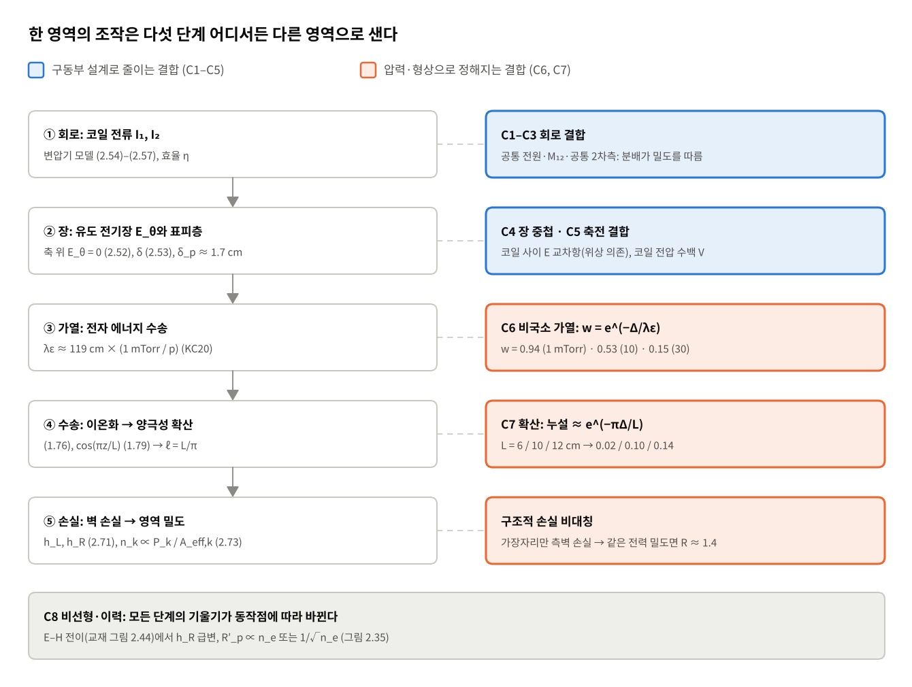
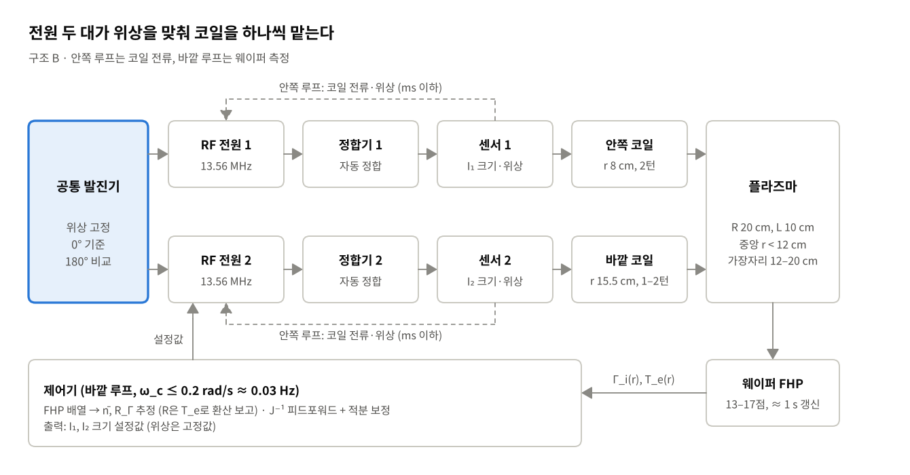
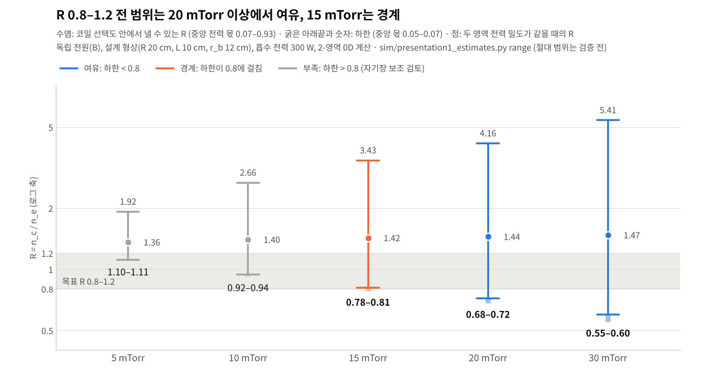

# 주제 3 밀도비 독립 제어 · 1차 결정 보고서

> 원본: claude.ai 문서 (https://claude.ai/artifact/F8PAwUDy7stx3MXRgGN9qp, 비공개). 이 파일은 저장소 보관용 사본이며, 수식은 GitHub에서 렌더링되도록 math 블록으로 옮겼다.

2026-11-05 · 2026-11-05 검토 결과 반영

## 요약

1차 발표의 결론은 **동심 코일 2개를 같은 주파수의 독립 RF 전원 2대로 따로 구동하고, 위상은 0°로 고정하는 구조**다. 이 구조로 설계 챔버에서 밀도비 R 0.8–1.2 전 범위를 20 mTorr 이상에서 여유 있게(15 mTorr는 경계) 낼 수 있다고 예측했다(계산, 모델의 절대 범위는 아직 검증 전). 팀이 처음 검토한 180° 위상은 기각하지 않고 비교 조건으로 남겨, 다음 단계에서 같은 기준으로 비교한다.

| # | 결정 | 내용 | 핵심 근거 | 확신도 |
| --- | --- | --- | --- | --- |
| 1 | 제어 목표 | 출력은 평균 밀도 n̄와 밀도비 R 두 개. 독립성은 응답 행렬 J의 비대각 비율로 판정 (L2: 0.1 이하) | R만 보면 전체 밀도가 함께 움직여도 알 수 없음 | 높음 (정의) |
| 2 | 모델링 | 2-영역 0D + 코일 회로로 시작, 축대칭 2D로 검증 | 단일 영역 0D는 R을 구하지 못함. 앞선 2-영역 모델은 KC20 비공진 급전 전류만 ±9%로 재현(공진 상태와 절대 밀도는 못 맞춤) | 중간 |
| 3 | 형상 | 챔버 반지름 20 cm, 창–웨이퍼 간격 10 cm, 코일 반지름 8 / 15.5 cm (간격 Δ = 7.5 cm) | 확산 누설 e^(−πΔ/L) ≈ 0.10, 분포 제어 시작 압력 p\* ≈ 16 mTorr | 중간 |
| 4 | 구동 | 독립 전원 2대. 수동 공진(가변 C)은 기각, 자기장 보조는 선택 사항 | 공진 방식도 고압에서는 R < 1을 내지만(KC20), 커패시터 하나가 n̄와 R을 함께 움직이고 공진점이 부하에 따라 움직여 L1 | 중간 (계산) |
| 5 | 위상 | 0° 기준, 180°는 비교 조건 | 전원 간 교환 전력 ∝ sin φ → 0°·180° 근처에 고정. 180°는 위상 허용 오차 ±4–12°, 누설 0.2–0.6, 같은 전력에 코일 전류 2–3배 | 중간 (계산 가정에 민감) |
| 6 | 제어 | 코일 전류 안쪽 루프 + 웨이퍼 측정 바깥 루프, J⁻¹ 피드포워드 | 플라즈마 응답 약 0.1–0.2 ms ≪ 센서 갱신 약 1 s. VI 전력 측정은 위상 0.1°에 17% 오차 | 높음 |
| 7 | 측정 | 웨이퍼형 FHP 배열 13–17점이 주 센서, 랭뮤어·컷오프·B-dot은 보조 | 약 1 s에 전 점 측정, ln R\_Γ 불확도 약 1% | 중간 |
| 8 | 반응 | Ar 5개 (이온화, 여기, 탄성, 이온-중성, 벽 재결합) | 5–30 mTorr Ar에서 전자 온도와 에너지 손실을 정하는 반응 | 중간 (가정) |

확신도는 높음(식이나 정의에서 바로 나옴), 중간(모델 계산이나 문헌 비교), 낮음(어림)으로 나눈다. 세부 계산은 [1차 발표 정리 문서](https://claude.ai/artifact/9LvxLzWnjEhEFYNJrc9oTT), 모델 근거는 [2-영역 0D ICP 챔버 모델](https://claude.ai/artifact/EUPyuwnDHVjYPQz8cPX9wz)에 있다.

## 배경과 범위

이 보고서는 IC-PBL 주제 3(중앙·가장자리 플라즈마 밀도의 독립 제어)의 1차 발표에서 내린 결정과 그 근거를 팀이 공유하기 위한 것이다. 1차 발표는 시뮬레이션 검증 전 단계로, 수식으로 세운 근거와 검증 계획을 다룬다. 여기의 계산은 결정의 방향을 정하기 위한 것이고, 최종 판정은 검증 계획의 가설 표로 넘긴다.

**과제가 요구하는 것 (IC-PBL 주제 3).**

- 검토 사항: ① 수단 조합과 영향 영역 ② 상호 영향의 원인(전자기 결합, 확산) ③ 한쪽 영역을 유지하는 조작 순서와 보상 ④ 비율 확인과 전체/분포 변화 구분을 위한 측정
- 제출물: 영역별 소스·구동부 구성도, 조작 변수 → 밀도 응답 관계, 목표 비율 조정 절차, 측정 계획
- 공통: 가정, 대안의 장단점, 부작용, 검증 방법

팀의 질문 목록(「프로젝트에 대한 생각」의 1–4번 묶음)도 각 결정 절에서 답했다. 질문별 대응은 1차 발표 정리 문서의 대응표에 있다.

**사용한 자료.**

| 자료 | 쓴 곳 |
| --- | --- |
| 교재 「플라즈마 전자공학」 4판 1–3장 | 확산(1.10절), ICP 변압기 모델·표피 깊이·페라이트(2.3.4절), 전력·입자 균형(2.4절) |
| 교재 5장 | 랭뮤어 탐침 면적 조건, FHP, 컷오프, B-dot, VI 프로브 |
| KC20 (Kim & Chung 2020) | 수동 공진 안테나, 전자 에너지 완화 길이 λε, 앞선 모델의 검증 데이터 |
| Park et al. (2017) | E–H 전이에서의 가장자리/중앙 밀도비, 압력별 λε, FHP 측정 |
| 앞선 2-영역 0D 모델 | 수동 공진 구조의 응답 행렬, 보상 예, 모델 한계 |
| 이번 계산 (sim/presentation1\_estimates.py) | 위상 비교, 독립 전원의 응답 행렬, 도달 가능한 R 범위 |

**수치 옆 표시.** (문헌)은 출처에서 가져온 값, (계산)은 스크립트나 모델로 구한 값, (추정)은 어림, (가정)은 근거 없이 둔 값이다. 저장소 docs/03\_작업계획의 규칙을 따른다.

## 핵심 물리 근거

모든 결정은 하나의 물리 그림에서 나온다. **분포를 움직이는 힘은 두 길이 척도(전자 에너지 완화 길이 λε, 확산 퍼짐 길이 ℓ)를 코일 간격 Δ와 비교해 정해지고, 나머지 누설은 회로에서 온다.**



*그림: 밀도 분포 사슬 · 5단계와 결합 경로 C1–C8*

**밀도 분포가 정해지는 다섯 단계.** 코일 전류(①)가 유도 전기장(②)을 만들고, 표피층에서 흡수된 전력이 전자를 가열한다(③). 가열된 전자가 만든 이온은 확산으로 퍼지고(④), 벽에서 손실되며 영역 밀도가 정해진다(⑤). 단계마다 한 영역의 조작이 다른 영역으로 새는 경로가 있다(저장소 01\_배경이론의 C1–C8).

**길이 척도 1 — 전자 에너지 완화 길이 λε (단계 ③).**

```math
\lambda_\varepsilon = \sqrt{\lambda_m\lambda^*/3} \approx 119\ \mathrm{cm}\times\frac{1\ \mathrm{mTorr}}{p},\qquad w = e^{-\Delta/\lambda_\varepsilon},\qquad g_R = 1 - w
```

w는 한 영역에 넣은 전력 중 다른 영역에서 이온화에 쓰이는 몫(가정)이고, g\_R은 분배가 R을 움직이는 힘이 완전 국소일 때의 몇 배인지다. Δ = 7.5 cm에서 g\_R은 1 mTorr 0.06, 10 mTorr 0.47, 20 mTorr 0.72, 30 mTorr 0.85다(계산). λε = Δ가 되는 압력 p\* ≈ 16 mTorr가 분포 제어가 본격적으로 되는 압력의 1차 추정이다.

λε의 기준값은 KC20 Fig. 5의 계산값이다. Park 2017의 압력별 값(3, 10, 25, 50 mTorr에서 39, 12, 4.7, 2.4 cm)도 1/p를 따르지만 역시 계산값이라 독립 검증은 아니다(문헌). 앞선 모델의 제어 폭 비 0.08이 이 식의 비 g\_R(1 mTorr)/g\_R(30 mTorr) ≈ 0.07과 비슷한 것도 모델에 같은 λε 브리지가 들어 있기 때문이다. KC20 측정의 같은 비는 0.13–0.21이다. 저압에서 R이 잘 안 움직이는 것은 구동 방식과 무관한 물리적 한계다.

**길이 척도 2 — 확산 퍼짐 길이 ℓ (단계 ④).** 교재 확산 방정식(식 1.76)의 축 방향 해 cos(πz/L)(식 1.79)을 쓰면, 고리 모양 소스는 반경 방향으로 ℓ = L/π만큼 퍼진다. 다른 영역에 닿는 몫은 대략 e^(−πΔ/L)이다(추정). L = 10 cm에서 ℓ = 3.2 cm, 누설은 약 0.10이고, ℓ은 압력과 무관하다.

**응답 행렬의 삼각 구조 (단계 ⑤).** 영역마다 입자 균형(식 2.69)과 전력 균형(식 2.73)을 쓰면 영역 밀도는 그 영역의 흡수 전력에 비례한다.

```math
n_k \approx \frac{P_k}{e\,u_B\,\varepsilon_T\,A_{\mathrm{eff},k}}\ \ \Rightarrow\ \ \ln R = \ln\frac{P_c}{P_e} + \ln\frac{\varepsilon_{T,e}\,u_{B,e}\,A_{\mathrm{eff},e}}{\varepsilon_{T,c}\,u_{B,c}\,A_{\mathrm{eff},c}}
```

교재 식 2.70대로 전자 온도는 기체 밀도와 크기로 정해지고 전력과 무관하다. 그래서 분배를 고정한 채 총 전력만 바꾸면 R은 변하지 않는다(J₂₁ = 0). 2-영역 모델은 이 가정을 그대로 담고 있어, 영역 전력을 직접 지정하면 J₂₁ = 0이 된다. 계산 결과라기보다 가정의 귀결이다. 교재도 2.4.2절 끝에서 실제 T\_e는 밀도·압력·면적 대 부피 비의 함수라고 적고 있고, KC20의 50 mTorr 비공진 R도 50 → 150 W에서 3.33 → 2.54로 변했다(E–H 전이가 섞였을 가능성). 그래서 J₂₁ ≈ 0은 가설 H4로 측정해 확인한다.

결국 **누설의 대부분은 회로 단계(①, ②)에서 생기고, 구동부 설계로 줄일 수 있다.** 이것이 아키텍처 결정의 출발점이다.

**구조적 손실 비대칭.** 가장자리 영역에는 측벽 손실이 더해진다. 두 영역에 같은 전력 밀도를 주면 중앙이 높아 R = 1.36–1.47이 된다(설계 형상, 5–30 mTorr, 계산). R = 1을 만들려면 가장자리에 전력을 더 줘야 하고(중앙 몫 0.11–0.22), 그 과정에서 n̄도 조금 움직인다(∂ln n̄/∂ln R ≈ 0.10, 계산).

## 결정 1 · 제어 목표와 독립성 판정 기준

**결정.** 제어 출력은 평균 밀도 n̄와 밀도비 R = n\_e,center / n\_e,edge 두 개로 잡고, 독립 제어 여부는 응답 행렬 J의 모양으로 판정한다.

```math
\Delta\mathbf{y} = J\,\Delta\mathbf{u},\qquad \mathbf{y} = \begin{bmatrix}\ln\bar n\\ \ln R\end{bmatrix},\qquad \mathbf{u} = \begin{bmatrix}\text{조작 변수 1}\\ \text{조작 변수 2}\end{bmatrix}
```

| 수준 | 의미 | 판정 기준 (제안값) |
| --- | --- | --- |
| L0 동반 변화 | 두 영역이 함께 오르내림 | J의 두 열이 거의 평행 (조건수가 매우 큼) |
| L1 보상 가능한 독립 | 조작은 섞이지만 보상하면 한쪽을 유지할 수 있음 | J가 가역, 조건수가 측정 오차 대비 충분히 작음 |
| L2 구조적 독립 | 한 조작이 다른 출력을 거의 안 움직임 | 각 열의 비대각/대각 비 0.1 이하 |

**근거.** 과제가 요구하는 것은 밀도를 올리고 내리는 손잡이가 아니라 비율을 맞추는 손잡이다. R만 재면 전체 밀도가 같이 움직이는 경우를 놓치므로 n̄를 함께 잡는다. 로그를 쓰면 J가 상대 변화의 비가 되어, 압력과 전력이 달라도 같은 기준으로 비교할 수 있다.

**목표 (제안값, 팀 합의 필요).**

| 항목 | 제안값 | 근거 |
| --- | --- | --- |
| 기체·주파수 | Ar, 13.56 MHz | 교재·문헌 조건과 비교 가능 |
| 압력 | 5–30 mTorr (확장 1–50 mTorr) | 공정 영역이면서 국소/비국소 전이가 일어나는 구간 |
| 전력 | 수백 W 이상, H 모드 | E 모드에서는 분포가 축전 결합을 따름 (Park 2017) |
| 중앙 / 가장자리 | r ≤ 25 mm 평균 / r = 135–140 mm | 300 mm 웨이퍼의 가장자리 제외 영역 고려 |
| 측정 높이 | 웨이퍼 면 위 1–2 cm | 공정 결과와 직접 연결되는 위치 |
| 목표 범위 | R = 0.8–1.2 연속 조정, R 조정 중 n̄ 변화 ±5% 이내 | 측정 불확도(±2–3%)보다 커야 의미가 있음 |

**분석 상황 (질문 4-1).** 정상 상태 동작점에서 R 설정값을 바꾸는 준정적 문제를 기본으로 둔다. 점화, E–H 전이, 레시피 변경 같은 과도 상황은 결정 6에서 따로 다룬다.

**남은 문제.** 공정 관점에서는 밀도비보다 웨이퍼 이온 선속비 R\_Γ = R·√(T\_e,c / T\_e,e)가 더 직접적이다. 어느 쪽을 제어 출력으로 할지는 팀 합의 사항이다. 또 아래 예측대로라면 5–10 mTorr에서는 목표 범위 전체에 닿지 못하고 15 mTorr는 경계이므로, 압력 범위도 다시 정해야 한다.

## 결정 2 · 모델링 접근

**결정.** 1단계는 2-영역 0D 모델에 코일 회로 모델을 결합해 J의 모양을 본다. 축대칭 2D (r, z) 모델은 그 결과를 검증하고, 영역 평균을 측정 위치의 값으로 바꾸는 데 쓴다.

| 모델 | R 계산 | 담는 결합 경로 | 비용 | 역할 |
| --- | --- | --- | --- | --- |
| 단일 영역 0D (Lee & Lieberman) | 불가 | 없음 | 수 초 | n̄ 크기의 기준선 |
| 2-영역 0D + 회로 (M1 + M2a) | 영역 평균 R | C2, C3, C6(λε 브리지), C7(영역 간 확산) | 동작점당 수 초 | 압력별 제어 폭, J, 조작 순서 |
| 축대칭 2D 유체 + 전자기 (M2, M3) | n(r, z) 전체 | C1–C8 대부분 | 동작점당 수 분–수 시간 | 0D 검증, 측정 위치 R 환산 |

**근거.**

- **단일 영역 0D로는 부족하다.** h-factor가 압력과 치수로만 정해져, 어느 코일에 전력을 넣어도 같은 R이 나온다. Park 2017은 H 모드에서는 25–100 mTorr까지 이론 h-factor 비가 측정과 맞고, E 모드에서는 분포가 축전 결합을 따라 크게 어긋난다고 보고했다(문헌, 3·10 mTorr의 절대값 차이는 탐침 위치 때문). 단일 영역 0D의 문제는 가열 위치를 바꾸는 조작을 표현하지 못한다는 것이다.
- **영역을 나눠 h-factor를 쓰는 방법은 네 조건에서 타당하다.** 영역마다 안테나가 하나씩 있고, 벽 손실(h-factor)과 영역 간 손실(확산 플럭스)을 나눠 쓰고, 영역 간 전자 에너지 수송을 λε로 표현하고, 영역별 흡수 전력을 회로·전자기 모듈이 계산할 때다.
- **앞선 모델은 일부만 검증되었다.** KC20 수동 공진 안테나 데이터로 확인했다. 보정 파라미터는 확률적 가열 배수 κ\_ν 하나(150 W, 1 mTorr, 비공진 급전 전류 8.5 A에 맞춤)이고, 보정 밖 세 점의 비공진 급전 전류가 ±9% 안으로 맞았다. 공진 상태의 급전 전류는 74–85% 높고, 50 mTorr 공진의 R 변화(측정 2.54 → 0.39)는 모델이 5.72 → 5.17로밖에 그리지 못한다. 압력이 높을수록 R 제어 폭이 커지는 경향(모델 1 mTorr 1.05 → 30 mTorr 1.82)은 맞지만, 크기는 측정(1 mTorr 1.48배, 50 mTorr 6.5배)보다 훨씬 작다(계산).
- **회로 쪽은 해석해를 쓴다.** 코일과 플라즈마 반공간의 결합을 Dodd & Deeds(1968) 해로 구하고, 상호 인덕턴스와 포인팅 플럭스 검산 오차가 각각 0.7%, 0.3% 안이다(계산).
- **2D는 축대칭으로 충분하다 (질문 1-1).** 동심 코일에서 R은 반경 방향의 양이다. 단, 1턴 코일의 급전부·끝단이 만드는 방위각 비대칭을 막기 위해 대칭 급전을 설계 요구 조건으로 둔다.

**대안과 기각 이유.** 처음부터 2D 유체 모델로 가는 안도 있었다. 하지만 2D 유체 모델은 맥스웰 분포·국소장 근사를 쓰면 저압의 비국소 가열을 잘못 그리고, 동작점당 비용이 커서 압력·위상·분배를 훑기 어렵다. 0D로 범위를 좁히고 2D로 확인하는 순서가 이 단계에 맞다.

**한계.** 앞선 모델의 절대 밀도는 측정보다 1.4–18배 높게 나온다(조건마다 다름). 그래서 모든 판정은 절대값이 아니라 비(R, g\_R, 누설)로 한다. 코일 사이 간극의 세밀한 장 모양은 2D/3D 전자기 계산의 몫으로 남긴다.

## 결정 3 · 챔버·안테나 형상

**결정.** 동심 코일 2개를 두고, 설계의 기준 길이는 코일 간격 Δ = 7.5 cm다.

| 항목 | 값 | 근거 |
| --- | --- | --- |
| 웨이퍼 | 300 mm (반지름 15 cm) | 과제 조건 |
| 챔버 반지름 R | 20 cm | 웨이퍼 밖 5 cm는 에지 링·배기 간극. 바깥 코일과 측벽 사이를 고압 λε(2–4 cm)보다 넓게 |
| 창–웨이퍼 간격 L | 10 cm (검토 범위 6–12 cm) | 확산 누설 약 0.10. KC20(L = 10 cm)과 같아 검증 데이터와 비교 가능 |
| 안쪽 코일 | r ≈ 8 cm, 2턴, 7–9 cm 띠 | 축 위는 E\_θ = 0(식 2.52)이라 가열이 도넛 모양. 중앙 영역을 면적으로 이등분하는 반지름(8.5 cm) 근처 |
| 바깥 코일 | r ≈ 15.5 cm, 1–2턴, 15–16 cm 띠 | 웨이퍼 가장자리 바로 위. KC20처럼 측벽에서 1.5 cm만 떨어지면 가열된 전자가 이온화 전에 벽으로 빠짐 |
| 영역 경계 r\_b | ≈ 12 cm | 두 코일 반지름의 중간 |

**근거 — 창–웨이퍼 간격 L.** 확산 퍼짐 길이 ℓ = L/π와 누설 e^(−πΔ/L)은 압력과 무관하게 L로만 정해진다.

| L \[cm\] | ℓ \[cm\] | 확산 누설 |
| --- | --- | --- |
| 6 | 1.9 | 0.02 |
| 8 | 2.5 | 0.05 |
| 10 | 3.2 | 0.10 |
| 12 | 3.8 | 0.14 |

L을 줄이면 분리는 좋아지지만 영역 안 균일도가 나빠지고 창–웨이퍼 축전 결합이 커진다. 10 cm는 L2 기준(0.1)의 경계에 있고, 검증 데이터가 있는 값이다.

**근거 — 코일 간격 Δ.** λε = Δ가 되는 압력은 p\* ≈ 119/Δ\[cm\] mTorr ≈ 16 mTorr다. Δ를 키우면 p\*가 내려가지만, 안쪽 코일을 축에 붙이면 축 위에서 유도 전기장이 0이라 가열이 약해지고 바깥 코일은 측벽에 막힌다. 반지름 20 cm 챔버에서 7.5 cm가 실질적인 최대다.

**근거 — 코일별 영역 선택도 (계산).** 안쪽 코일만 켜면 흡수 전력의 0.91–0.95가 중앙에, 바깥 코일만 켜면 0.93–0.95가 가장자리에 떨어진다. 회로 상수는 L₁ ≈ 379 nH, L₂ ≈ 863 nH, M₁₂ ≈ 91 nH(결합 계수 0.16, ωM₁₂ ≈ 7.8 Ω)다. 모두 단일 턴 코일, n = 3×10¹⁰–10¹¹ cm⁻³, 10–20 mTorr 값이다.

**턴 수 (질문 2-3).** 코일 인덕턴스와 플라즈마 반사 저항은 둘 다 턴 수의 제곱(N²)에 비례한다. N을 늘리면 같은 전력에 필요한 전류가 줄어 코일 저항 손실이 줄고 효율(식 2.57)이 오른다. 대신 코일 전압 V = ωL·I가 N에 비례해 커져 축전 결합(C5)과 창 스퍼터링이 늘어난다. 정합 범위를 고려해 안쪽 2턴, 바깥 1–2턴에서 시작한다.

턴을 반경 전체에 고르게 펼치지 않고 자기 영역의 좁은 띠에 모은다. 각 코일의 장은 대략 2(z\_gap + δ) 폭으로 퍼지므로, 고르게 펼치면 두 영역의 가열이 겹쳐 누설이 커진다.

**코일 수 (질문 1-5, 2-2).** 독립으로 다룰 수 있는 영역 수는 코일을 놓을 반경 폭(약 5–16 cm)을 max(λε, ℓ)로 나눈 값 정도다. 20 mTorr에서 약 2, 30 mTorr에서 약 3이다(추정). 코일이 3개 이상이면 코일·접속 저항이 늘어 효율이 떨어지고, 상호 인덕턴스 쌍이 N(N−1)/2로 늘며, 인접 영역의 J 열이 거의 평행해져 조건수가 커진다. 출력이 중앙·가장자리 2개인 이 과제에는 2개가 최소이자 충분한 수다.

**남은 문제.** 턴 수와 띠 폭은 V1에서 다중 턴 회로 계산으로 다시 정한다. 방위각 대칭을 위한 급전 방법(분할 코일 등)도 아직 정하지 않았다.

## 결정 4 · 구동 아키텍처

**결정.** 코일마다 RF 전원과 정합기를 두는 독립 전원 구조(B)를 고른다. 수동 공진 구조(A)는 기준에서 빼되 전원이 1대일 때의 대안으로 남기고, 자기장·페라이트 보조(C)는 저압 운전이 필요할 때 더하는 선택 사항으로 둔다.



*그림: 선택 구조 B의 구동부 구성도 · 제출물 ‘영역별 소스·구동부 구성도’*

| 후보 | 구성 | 조작 변수 | 근거 자료 |
| --- | --- | --- | --- |
| A 수동 공진 | 전원 1대가 안쪽 코일을 구동. 바깥 코일은 가변 커패시터로 닫은 공진 회로 | 전원 전력 P, 커패시턴스 C | KC20, 앞선 모델 |
| B 독립 전원 | 코일마다 전원·정합기, 공통 발진기로 위상 고정 | 코일 전류 I₁, I₂의 크기 | 01\_배경이론의 C1 대책 |
| C 자기장·페라이트 보조 | A 또는 B에 약한 축 방향 자기장, 또는 코일 뒤 페라이트 | 위 + 자석 전류 | 교재 식 2.62, 가설 H5 |

**A를 기준에서 뺀 이유 — 범위가 아니라 독립성이다.** 바깥 코일 전류는 안쪽 코일 전류가 상호 인덕턴스와 플라즈마를 통해 유도한 것이다.

```math
I_2 = -\frac{j\omega M_{12} + \Delta Z_{12}}{R_2 + j\omega L_2 + \dfrac{1}{j\omega C} + \Delta Z_{22}}\,I_1
```

- **범위.** 범위는 기각 이유가 되지 못한다. 앞선 모델(KC20 형상)은 가장자리 전력 몫 최대 0.58 (1 mTorr), 0.43 (10), 0.26 (50 mTorr), R 최솟값 1.39, 1.65, 3.24로 R = 1에 못 닿는다고 냈다. 그러나 KC20 측정에서는 50 mTorr 공진 때 밀도 봉우리가 r ≈ 15 cm로 옮겨 가 R이 0.39(150 W), 1.05(50 W)까지 내려갔다(Fig. 3, 8, 웨이퍼 FHP 지도 Fig. 4, 9). 공진 때 급전 전류가 줄어 중앙 전력도 줄어든다(150 W, 1 mTorr에서 8.5 → 4 A). 모델이 공진 상태를 재현하지 못한 것이다. KC20은 두 끝 상태만 보여 주므로, 연속 조정 가능 여부는 확인되지 않았다.
- **독립성.** 공진점이 플라즈마 부하에 따라 139 pF에서 156–180 pF로 움직이고 공진 근처 기울기가 가파르다(모델 계산). 밀도가 바뀌면 분배가 같이 바뀌어, 10 mTorr 이상에서 전력 열 누설 0.29–0.43, C 열 누설 0.14–0.19가 남는다(계산). 판정은 L1이다.
- **부작용.** 공진 코일 전압이 높다. 5 A, 170 pF이면 V₂ = I₂/(ωC) ≈ 350 V다(계산).
- **인정할 장점.** 전원이 1대이고 KC20 데이터로 검증된 구조다. 전원을 1대만 쓸 수 있다면 L1을 감수하고 A로 돌아간다. 고압에서는 KC20처럼 R < 1도 낼 수 있다.

**B를 고른 이유.**

1. 분배를 공진점이 아니라 두 전원의 설정값으로 정한다. 설계 형상에서 20–30 mTorr이면 R 0.8–1.2 전 범위를 낼 수 있다(15 mTorr는 경계, 예측과 검증 계획의 그림).
2. 플라즈마만 보면 J가 삼각형이므로, B는 회로 누설을 크게 줄인다. 위상 0°에서는 전력 열 누설 0.09 이하로 L2 수준을 기대할 수 있다(추정). 분배 열은 손실 비대칭 때문에 J₁₂/J₂₂ ≈ 0.10으로 L1/L2 경계라 총 전력으로 보상한다.
3. 기존 회로 모델에 전원 하나를 더하면 바로 계산할 수 있어 검증 경로가 짧다.

B의 대가는 전원·정합기 2벌, 공통 발진기, 코일 전류·위상 센서다. 상호 인덕턴스 때문에 두 정합기가 서로 영향을 주는 문제는 결정 6에서, 위상 선택은 결정 5에서 다룬다.

**C는 저압 전용 선택 사항이다 (질문 3-1, 3-2).**

- **약한 축 방향 정자기장.** 전자의 반경 방향 수송은 D⊥ = D/\[1 + (ω\_ce/ν\_m)²\]로 줄어든다(Lieberman & Lichtenberg 5장). λε도 같은 비율로 줄어든다고 보면(추정) 아래 식이 된다. λε⊥ = Δ가 되는 자기장은 1 mTorr에서 2.9 G, 5 mTorr에서 2.7 G, 10 mTorr에서 2.2 G다(계산, T\_e ≈ 2.5 eV 가정).

```math
\lambda_{\varepsilon\perp} \approx \frac{\lambda_\varepsilon}{\sqrt{1 + (\omega_{ce}/\nu_m)^2}},\qquad B_{\mathrm{ECR}} = \frac{m_e\omega}{e} = 4.84\ \mathrm{G}\ \ (13.56\ \mathrm{MHz})
```

- **자기장의 부작용.** 필요한 자기장이 전자 사이클로트론 공명 자기장 4.84 G 아래라 공명 면을 피할 수 있지만 여유가 작고, ω\_ce/ω ≈ 0.46–0.59라 공명 전에도 파동 전파가 바뀐다. 측벽 손실(h\_R)이 줄어 R의 기준값이 바뀌고, 웨이퍼 위 자기장은 대전 손상 위험을 키울 수 있다. 자화 수송은 0D로 거칠게만 다룰 수 있다.
- **페라이트.** 교재 식 2.62의 E ∝ ωμI에 따르면 같은 E를 1/μ의 전류로 만든다. 교재 예(400 kHz, μ ≈ 2000)에서는 전류가 약 1/60로 줄고 효율이 약 99%이며, 축전 결합이 거의 없어 점화가 어렵다(문헌). 13.56 MHz에서는 페라이트 손실이 커져 장점이 줄 것으로 본다(추정). 코일 뒤 요크로 장을 모아 상호 인덕턴스와 장 중첩(C2, C4)을 줄이는 보조 수단으로만 검토한다.
- **보조 루프 구성.** 자석 전류는 빠른 조작 변수가 아니라 J의 모양을 바꾸는 손잡이다. 압력별 고정값(피드포워드 표)으로 두고, 분배가 한계에 가까워질 때만 천천히 옮기는 밸브 위치 제어 구조가 맞다.
- **상승 효과와 복잡도 (질문 2-4).** 저압에서 g\_R을 올려 B의 분배 조작이 다시 효과를 갖게 하는 것이 상승 효과다. 대가는 자화 수송을 다루는 2D 모델과 자기장 측정이 추가된다는 것이다.

| 기준 | A 수동 공진 | B 독립 전원 | C 자기장 보조 (B에 추가) |
| --- | --- | --- | --- |
| R 0.8–1.2 도달 | KC20: 50 mTorr에서 0.39까지 (연속 조정 미확인) | 20–30 mTorr에서 전 범위, 15 mTorr 경계, 10 mTorr는 약 0.9–1.2 (계산) | 저압까지 넓힘 (추정) |
| 회로 누설 | 전력 열 0.29–0.43, C 열 0.14–0.19 → L1 | 0°: 0.09 이하, 180°: 0.2–0.6 (추정) | B와 같음 |
| 플라즈마 누설 (C6, C7) | g\_R, e^(−πΔ/L)로 정해짐 | 같음 | 저압에서 감소 (추정) |
| n̄ 유지 보상 | P와 C 동시 조정 (예: ΔC = +14.8 pF, ΔP = +3.5%) | 총 전력만 보정 (예: +2.1%) | B와 같음 + h\_R 변화 보정 |
| 부작용 | 공진 코일 고전압, 공진 근처 급경사 | 두 정합기의 상호 영향, 위상 고정 필요 | ECR 면, 웨이퍼 자기장, 측벽 손실 변화 |
| 하드웨어 | 전원 1, 정합기 1, 가변 C 1 | 전원 2, 정합기 2, 공통 발진기, 센서 2 | + 전자석·전원, 자기장 측정 |
| 검증 수단 | KC20 데이터, 앞선 모델 | 같은 회로 모델을 바로 확장 | 0D는 거친 추정, 2D 필요 |

## 결정 5 · 두 전원의 위상

**결정.** 공통 발진기로 위상을 고정하고, 기준값은 0°(동상), 비교 조건은 180°(역상)로 둔다. 팀이 처음 계획한 180°에서 기준을 바꾼 것이라 이유를 자세히 적는다. 위상을 연속 조작 변수로 쓰는 안은 기각했다.

**1단계 — 0°나 180° 근처에 고정한다 (회로식에서 바로 나옴).** 두 전원이 같은 주파수이고 I₂ = k·I₁·e^(jφ)이면 다음과 같다.

```math
P_{\mathrm{plasma}} = |I_1|^2\left[R'_{11} + k^2 R'_{22} + 2k\,R'_{12}\cos\varphi\right],\qquad P_{\mathrm{exch}} = \left(\omega M_{12} + X'_{12}\right)k\,|I_1|^2\sin\varphi
```

P\_exch는 상호 인덕턴스를 통해 한 전원이 다른 전원으로 밀어 넣는 전력이다. 두 전원의 합에서는 사라지지만, 각 전원은 이만큼 더 내거나 덜 낸다. φ = ±90°에서 최대이며, 플라즈마 상호 리액턴스 X′₁₂(≈ −4 \~ −6 Ω, ωM₁₂ = 7.8 Ω)까지 넣으면 설계 형상에서 흡수 전력의 0.2–0.7배다(계산). 위상을 연속 손잡이로 쓰기에는 크고, 과도 때 한 전원이 역전력을 받을 수 있다. P\_exch = 0인 것은 sin φ = 0인 0°와 180°이므로 그 근처에 고정한다.

**2단계 — 0°와 180°의 비교 (계산).** 중앙 영역 전력 몫이 0.20(R ≈ 1 근처)이 되도록 전류비 k를 맞춘 동작점에서 비교했다. 단일 턴 코일, 균일 반공간 플라즈마, n = 3×10¹⁰–10¹¹ cm⁻³, 10–20 mTorr 조건이다.

| 항목 | φ = 0° (동상) | φ = 180° (역상) | 유리한 쪽 |
| --- | --- | --- | --- |
| 필요한 전류비 k = I₂/I₁ | 2.0–2.1 | 0.83–1.03 | 180° |
| 같은 전류에서 흡수 전력 (90° 대비) | 1.22–1.27배 | 0.49–0.67배 | 0° |
| 효율 η (식 2.57, 두 코일 0.23 Ω 가정) | 0.95–0.96 | 0.85–0.91 | 0° |
| 영역 경계 ±3 cm 띠에 흡수되는 몫 | 0.34–0.35 | 0.20–0.22 | 180° |
| 분배 이득 ∂ln(P\_c/P\_e)/∂ln k | −0.8 \~ −1.0 | −2.9 \~ −4.0 | 180° |
| 분배의 밀도 의존 ∂ln(P\_c/P\_e)/∂ln n (전류 고정) | −0.10 \~ −0.01 | +0.41 \~ +0.73 | 0° |
| 교환 전력 ≤ 10%를 지키는 위상 허용 오차 | ±19–38° | ±4–12° | 0° |

**해석.**

- **180°가 나은 점.** 코일 사이에서 장이 상쇄되어 경계 띠 흡수가 0.34에서 0.21로 준다. 전류비에 대한 분배 이득이 3–4배 크다(그만큼 전류비 오차도 커진다). 정합 변화도 작다(안쪽 리액턴스 −7–10%, 0°는 +13–24%, X′₁₂ 포함. 코일 항만 보면 −20–25% / +47–51%). 두 코일 전압이 반대 위상이라 창을 통한 축전 결합의 공통 성분이 상쇄될 가능성도 있다(추정, 측정으로 확인).
- **0°가 나은 점 — 독립성.** 180°의 상쇄 정도는 표피 깊이를 따라 변해서, 밀도가 바뀌면 분배도 바뀐다. 이것이 전력 열 누설로 이어져 0°는 g\_R × 0.10 ≤ 0.09, 180°는 g\_R × (0.41–0.73) ≈ 0.2–0.6이다(추정). 180°로는 L2를 지키기 어렵다.
- **0°가 나은 점 — 운전 안정성.** 위상 허용 오차가 2–5배 넓다(±19–38° vs ±4–12°). 코일 전류의 위상은 정합 상태에 따라 움직이므로(결정 6), 이 차이는 곧 운전 여유의 차이다.
- **0°가 나은 점 — 효율.** 같은 300 W에 180°는 I₁ 8–12 A, I₂ 8–10 A, 0°는 3.4 A, 6.6–7.3 A다. 180°는 코일 전압·구리 손실이 늘어 효율이 0.85–0.91(0°는 0.95–0.96)이다.
- **0°의 부담.** R ≈ 1에서 바깥 코일 전류가 안쪽의 약 2배라 바깥 코일 쪽에 전압 부담이 몰린다. 다만 절대 전류는 180°보다 작다.

**결론.** 이 과제의 핵심 기준인 독립성(J 누설)과 운전 안정성에서 0°가 앞서므로 기준으로 둔다. 180°는 경계 분리와 분배 이득이 더 필요하고 위상 허용 오차(±4–12°)를 지킬 수 있을 때의 선택지다. 검증 계획의 가설 H6에서 두 위상을 같은 기준으로 비교하며, 180° 채택 조건(분배 이득이 0°의 2배 이상, 누설 0.2 이하, 위상 허용 오차 안에서 운전 가능)을 미리 정해 두었다.

**한계.** 표의 수치는 단일 턴·균일 반공간 가정에, 밀도를 고정한 계산이다. V1에서 다중 턴과 자기일관 밀도로 다시 계산한다. 다만 sin φ 결과와 “같은 전류에서 180°의 흡수 전력이 작다”는 결론은 두 코일의 장이 겹치는 한(교차 저항 R′₁₂ > 0) 바뀌지 않는다.

## 결정 6 · 제어 구조와 운전 절차

**결정.** 세 겹 루프로 제어한다. 안쪽은 코일 전류·위상(ms 이하), 가운데는 자동 정합(0.1–1 s), 바깥은 웨이퍼 측정으로 n̄와 R을 맞추는 느린 루프(0.03 Hz 안팎)다. 단계 변경은 J⁻¹ 피드포워드가 한 번에 처리하고, 피드백은 남은 오차와 드리프트만 맡는다.

**근거 — 플라즈마는 루프에서 가장 빠른 요소다.** 밀도 응답(0.1–0.2 ms)이 센서·정합기보다 세 자릿수, 코일 전류 루프보다 한 자릿수 정도 빨라, 제어 설계에서는 플라즈마를 정적 이득 J로 다루어도 된다. 정상 상태 0D 모델이 제어 설계에 충분한 이유다.

| 과정 | 시간 상수 | 출처 |
| --- | --- | --- |
| RF 주기 | 74 ns | 13.56 MHz |
| 전자 에너지 완화 | 1 μs 이하 | 추정 |
| 확산 감쇠 Λ²/D\_a | 약 20 μs (10 mTorr) | 교재 식 1.88, 계산 |
| 입자 손실 V/(u\_B A\_eff) | 90–200 μs (10–30 mTorr) | 교재 식 2.72, 계산 |
| 코일 전류·위상 루프 | ms 이하 | 전원 사양 (추정) |
| 자동 정합 (가변 커패시터 모터) | 0.1–1 s | 장비 사양 확인 필요 (추정) |
| FHP 배열 전체 갱신 | 약 1 s | 교재 5장 (문헌) |
| 기체 가열·중성 고갈 | ms–s | 추정 |
| 창·벽 온도, 벽 상태 | 분–시간 | 추정 |

**근거 — 안쪽 루프는 전력이 아니라 코일 전류를 기준으로 한다.** 교재 식 5.33에 따르면 VI 프로브로 잰 전력의 상대 오차는 tan φ\_Z · δφ다. ICP 안테나(tan φ\_Z ≈ 100)에서는 위상 0.1° 오차가 전력 오차 17%가 된다. 그래서 코일 전류의 크기와 위상을 직접 재고 맞춘다.

**근거 — 바깥 루프의 대역폭은 측정 지연이 정한다 (질문 2-5).** 적분 제어기와 지연 T\_d만 있는 루프의 위상 여유는 다음과 같다.

```math
L(s) = \frac{\omega_c}{s}\,e^{-sT_d}\ \Rightarrow\ \mathrm{PM} = 90^\circ - \omega_c T_d\cdot\frac{180^\circ}{\pi}\ \ge 60^\circ\ \Longleftrightarrow\ \omega_c \le \frac{\pi}{6\,T_d}
```

T\_d = 1–2 s(FHP 갱신과 평균)이면 ω\_c ≤ 0.26–0.52 rad/s다. 정합기보다 5배 이상 느리게 두려면 ω\_c ≈ 0.2 rad/s가 상한이고, 설정 시간은 약 4/ω\_c ≈ 20 s다(계산). 레시피 단계가 수십 초 이상이면 충분하다.

**근거 — 두 단일 루프로 나눌 수 있다.** 상대 이득 배열(RGA)이 1에 가까우면 2×2 다변수 루프를 두 단일 루프로 나눠도 된다.

```math
\lambda_{11} = \left(1 - \frac{J_{12}J_{21}}{J_{11}J_{22}}\right)^{-1}
```

독립 전원(0°)은 J₂₁ ≈ 0이라 λ₁₁ ≈ 1이고, 수동 공진도 λ₁₁ = 1.04–1.09다(계산). 수동 공진의 진짜 문제는 결합이 아니라 공진 근처에서 이득이 크게 변하는 비선형성이다.

**목표 비율 조정 절차 (제출물, 검토 사항 3).** 플라즈마만 보면 J는 (총 전력, 중앙 전력 몫 x) 좌표에서 위 삼각형이다. 총 전력을 바꿔도 R은 움직이지 않으므로, 분배로 R을 맞추고 총 전력으로 n̄를 되돌리는 순서가 자연스럽다.

```math
\Delta x = \frac{\Delta\ln R^*}{J_{22}},\qquad \Delta\ln P = \frac{\Delta\ln\bar n^* - J_{12}\,\Delta x}{J_{11}}
```

1. **점화.** 안쪽 코일(2턴)로 점화하고 H 모드 진입을 확인한다(Park 2017에서 E 모드 20 W, H 모드 40 W 이상). 그다음 바깥 전원을 올리고 위상 고정을 확인한다.
2. **동작점 선택.** 현재 압력의 J 표에서 J₁₁, J₁₂, J₂₂를 읽는다.
3. **피드포워드.** 목표 R\*, n̄\*로 위 식의 Δx와 Δln P를 구해 두 설정값을 동시에 낸다.
4. **안쪽 루프·정합.** 전류 루프가 코일 전류·위상을 맞추고, 정합기는 전류비 k의 함수로 미리 정한 위치로 옮긴다. 두 정합기를 동시에 크게 움직이지 않는다.
5. **바깥 루프.** FHP 배열로 전체 변화 a₀와 분포 변화 a₁을 재고(결정 7), 남은 오차를 적분 동작으로 지운다(ω\_c ≤ 0.2 rad/s).
6. **판정.** |Δln R\_Γ| ≤ 0.02이고 n̄가 ±5% 안이면 완료다. 분배가 한계(코일 선택도 한계, 중앙 몫 약 0.07 또는 0.93)에 닿으면 압력을 올리거나 자기장 보조(C)를 검토한다.

설계 형상 20 mTorr에서 J₁₁ = 1, J₁₂ = 0.25, J₂₂ = 2.44다(계산). R을 ln 기준 0.2 낮추려면 중앙 몫을 0.082 줄이고 총 전력을 2.1% 올린다. 보상하지 않으면 n̄가 2.1% 내려간다. 같은 변경을 수동 공진 구조로 하면 ΔC = +14.8 pF와 ΔP = +3.5%를 함께 움직여야 했다(앞선 모델).

**과도 상황과 대응 (질문 4-3).**

| 상황 | 무엇이 바뀌나 | 대응 |
| --- | --- | --- |
| 점화와 E→H 전이 | E 모드에서는 분포가 축전 결합을 따르고, 전이 때 h\_R이 급변한다. 흡수·손실 곡선의 교점이 두 개라 이력이 있다(교재 그림 2.44) | 절차 1단계. 바깥 루프는 H 모드 확인 뒤에 닫는다 |
| 레시피 변경 (압력·기체) | λε, h, T\_e가 바뀌어 J 자체가 바뀐다 (g\_R 0.27 → 0.85) | 압력별 J 표로 이득 스케줄링, 압력 안정 뒤 루프 재개 |
| 한쪽 전원 변경 | 상호 인덕턴스로 다른 쪽 정합이 틀어져 반사 전력이 잠시 늘어난다 | 전류 루프가 먼저 잡고, 정합기는 피드포워드 위치로 |
| 위상 드리프트 | 정합 상태에 따라 코일 전류 위상이 움직여 교환 전력이 생긴다 | 코일 전류 위상을 직접 재서 보정 (0°에서 약 ±19° 안, 계산) |
| 분배를 극단으로 보냄 | 약한 쪽 영역의 가열이 축전 결합 쪽으로 기울 수 있다 | 분배 하한을 실험으로 정함 (추정) |
| 느린 드리프트 | 창 가열, 벽 증착으로 h와 코일 저항이 변한다 | 바깥 루프의 적분 동작 |

**안테나 2개로 위상 여유를 얻고 빠른 과도 응답을 잃어도 되는가 (질문 4-2).** 괜찮다. 다만 위상 여유를 정하는 것은 안테나 수가 아니라 루프 안의 지연이다. 안테나 수는 J의 조건수를 통해 영향을 준다. 3개 이상이면 인접 열이 평행해져 측정 오차가 큰 조작으로 커지고, 이득을 낮춰야 해서 오히려 느려진다. 빠른 과도는 피드포워드와 안쪽 전류 루프가 맡으므로, 바깥 루프가 느려도 수십 초 이상의 레시피 단계에서는 손해가 없다. 레시피 단계가 수 초 이하이거나 펄스 운전을 하면 피드포워드 표의 정확도가 성능을 정한다.

## 결정 7 · 측정 계획

**결정.** 웨이퍼 모양 판에 올린 FHP(부유 고조파 탐침) 배열 13–17점을 주 센서로 쓴다. 랭뮤어 탐침, 컷오프 탐침, B-dot 탐침은 가설 검증과 교정용이고, 코일 전류·위상 센서는 안쪽 루프용이다.

| 진단 | 재는 것 | 장점 | 한계 | 역할 |
| --- | --- | --- | --- | --- |
| 웨이퍼형 FHP 배열 (교재 식 5.23–5.25) | 점별 이온 포화 전류와 T\_e | 증착 환경에서도 측정, 잡음에 강함, 여러 점을 약 1 s에 | 맥스웰 분포 가정, 웨이퍼 높이의 선속을 잰 | 바깥 루프 센서 |
| 랭뮤어 탐침 (교재 5.1절) | n\_e, T\_e, V\_p, EEPF | EEPF로 국소/비국소 판정 | RF 보상 필요, 면적 조건(식 5.1), 이동 스캔이라 느림 | λε 가설 검증, FHP 교차 확인 |
| 컷오프 탐침 (식 5.34) | 전자 밀도 절대값 | T\_e·쉬스와 무관 | 점 측정, 삽입형 | n̄ 절대값 교정 |
| B-dot 탐침 (식 5.35, 5.36) | 플라즈마 안 RF 자기장 → 표피 깊이 | 장 모델 직접 검증 | 축전 잡음 → 차동 증폭·발룬 | 회로·장 모델 검증 |
| 코일 전류·위상 센서, VI 프로브 (식 5.33) | 코일 전류·전압의 크기와 위상 | 안쪽 루프 센서 | 전력 환산은 위상 오차에 민감 | 안쪽 루프, 회로 결합 분리 |

**랭뮤어 탐침만으로는 부족하다 (질문 1-6).** EEPF를 줄 수 있는 유일한 수단이라 가설 검증에는 꼭 필요하다. 하지만 한 점씩 재고 RF 보상이 까다로워 제어용 센서로는 맞지 않는다. 탐침 면적은 아래 조건을 지켜야 하며, 교재 예대로라면 접지 금속면의 약 4만분의 1보다 작아야 한다(Ar이면 √(m\_e/M) ≈ 1/270이라 약 2.7만분의 1).

```math
A_{\mathrm{probe}} < \frac{n_s}{n_0}\sqrt{\frac{m_e}{M_i}}\,A_{GW}\quad (5.1)
```

랭뮤어 탐침은 1–2개를 웨이퍼 면 위 1–2 cm에서 반경 방향으로 이동하며 쓴다. KC20처럼 위치별 EEPF를 비교해, 총에너지(운동 + 전위) 축에서 거의 겹치면 비국소, 전력을 넣은 코일 아래에서 꼬리가 높으면 국소로 판정한다(Kolobov & Godyak 1995). 컷오프 탐침은 중앙에 1개를 두어 FHP 값을 절대 밀도로 교정한다.

**FHP 배열 배치.**

| 반경 | 점 수 | 목적 |
| --- | --- | --- |
| 0 mm | 1 | 중앙 평균 |
| 25 mm | 4 (90° 간격) | 중앙 평균 (정의: r ≤ 25 mm) |
| 75 mm | 4 | 분포 모양 확인 (중간 반경의 봉우리·골) |
| 140 mm | 4–8 (90° 또는 45° 간격) | 가장자리 평균, 급전부가 만드는 방위각 비대칭 확인 |

FHP가 재는 것은 웨이퍼로 들어오는 이온 선속이다. 선속비는 R\_Γ = R·√(T\_e,c / T\_e,e)이므로 FHP가 함께 주는 T\_e로 R을 복원한다. 점마다 잡음이 2%라면(가정) 중앙 5점·가장자리 8점에서 ln R\_Γ 불확도는 약 1.1%다(계산). T\_e 비로 R을 환산하면 T\_e 오차 5%(가정)에서 약 3.7%로 커진다.

**전체 변화와 분포 변화의 구분 (검토 사항 4).** 기준 상태에 대한 점별 로그 변화를 두 성분과 나머지로 나눈다.

```math
\Delta\ln n(r_i) = a_0 + a_1\,\psi(r_i) + \varepsilon_i,\qquad \psi = +\tfrac12\ (\text{중앙}),\ -\tfrac12\ (\text{가장자리}),\ \text{보간}\ (75\ \mathrm{mm})
```

a₀는 전체 변화(≈ Δln n̄), a₁은 분포 변화(= Δln R), ε는 두 성분으로 설명되지 않는 모양 변화다. a₁이 약 2% 안이면 전체 변화만 있었다고 본다. 75 mm 점의 ε가 크면 코일 2개로는 보정할 수 없는 모양 변화이므로 따로 기록한다.

**응답 행렬 J를 재는 실험.** 동작점마다 총 전류 ±5%, 중앙 전력 몫 ±0.05를 각각 3번씩 바꿔 중앙 차분으로 J를 구한다(동작점당 12회). 동작점은 압력 4개(5, 10, 20, 30 mTorr) × 총 전력 2개 × 위상 2개(0°, 180°)로 총 약 190회, 회당 약 1분이면 반나절 분량이다. 코일 전류를 고정한 채 남는 R 변화를 보면 회로 결합과 플라즈마 결합을 나눌 수 있다(가설 H3).

## 결정 8 · 반응 범위

**결정.** 1차 모델은 Ar의 반응 5개만 쓴다. 속도 계수는 맥스웰 분포를 가정한 Lieberman & Lichtenberg 표 3.3의 식이며 저장소 코드(sim/two\_zone\_icp.py)와 같다(T\_e는 eV).

| # | 반응 | 문턱 \[eV\] | 속도 계수 \[m³/s\] | 모델에서의 역할 |
| --- | --- | --- | --- | --- |
| R1 이온화 | e + Ar → Ar⁺ + 2e | 15.76 | 2.34×10⁻¹⁴ T\_e^0.59 exp(−17.44/T\_e) | 입자 균형(식 2.69, 2.70) → T\_e |
| R2 여기 (합산) | e + Ar → Ar\* + e | 12.14 | 2.48×10⁻¹⁴ T\_e^0.33 exp(−12.78/T\_e) | 충돌 에너지 손실 ε\_c(식 2.63) |
| R3 탄성 | e + Ar → e + Ar | – | 2.336×10⁻¹⁴ T\_e^1.609 exp\[0.0618(ln T\_e)² − 0.1171(ln T\_e)³\] | ε\_c의 탄성 항, 충돌 주파수 ν\_m |
| R4 이온-중성 (전하 교환 포함) | Ar⁺ + Ar → Ar + Ar⁺ | – | σ\_i ≈ 1×10⁻¹⁸ m², λ\_i ≈ 1/(330 p\[Torr\]) cm | h-factor(식 2.71), 양극성 확산(식 1.68) |
| W1 벽 재결합 | Ar⁺ + e → Ar (벽) | – | 선속 h·n·u\_B | 입자·에너지 손실(식 2.66, 2.69) |

**근거.** 5–30 mTorr의 Ar에서 전자 온도와 에너지 손실을 정하는 것은 R1–R3이고, 이온 수송을 정하는 것은 R4다(가정). T\_e = 2.5 eV에서 ε\_c ≈ 81 V, ε\_T ≈ 99 V로, 교재 그림 2.43의 값(T\_e = 2 V에서 약 90 V)과 같은 크기다(계산). 이 범위에서는 교재 식 2.70대로 T\_e가 전력과 무관하다고 두므로 핵심 물리 근거의 ‘J₂₁ = 0’이 나온다(가정의 귀결, H4로 확인).

**확장 후보와 넣을지 판정하는 기준.** 아래 확장은 모두 J₂₁ = 0을 깨뜨리는 방향으로 작용한다.

| 확장 | 반응 | 왜 중요한가 | 넣는 기준 |
| --- | --- | --- | --- |
| 준안정 Ar^m(11.55 eV)과 단계 이온화 | e + Ar → Ar^m + e, e + Ar^m → Ar⁺ + 2e (문턱 약 4.2 eV) | 고밀도에서 이온화 경로가 늘어 밀도가 전력에 비선형이 됨 | 단계 이온화 비중이 10%를 넘는 동작점이 있을 때 |
| 준안정 소멸 | 벽 충돌, 초탄성 충돌, 복사 가둠 | 준안정 밀도를 정함 | 위와 함께 |
| 기체 가열·중성 고갈 | (중성 에너지 균형) | 고전력에서 기체 밀도가 줄면 λε가 늘고 g\_R이 줌 | 고전력 동작점의 기체 온도를 추정·측정한 뒤 |
| 공정 기체 (Cl₂, CF₄, O₂ 등) | 해리 부착 e + X₂ → X⁻ + X 등 | 음이온이 생기면 T\_e가 오르고 전력에 따라 바뀜(교재 2.4.2절) | 과제 범위를 공정 기체로 넓힐 때 |

**남은 문제.** 비국소 영역(대략 10 mTorr 아래)의 EEPF는 꼬리가 맥스웰과 달라 이온화 속도 계수에 오차가 생긴다. 랭뮤어 탐침으로 잰 EEPF를 적분한 속도 계수와 표의 값을 비교해 확인한다.

## 예측과 검증 계획

**가장 먼저 확인할 예측은 목표 범위에 닿는 압력이다.** 독립 전원으로 분배를 끝까지(중앙 몫 0.02) 바꿔도 5 mTorr에서는 R이 1.07 아래로, 10 mTorr에서는 0.88 아래로 내려가지 않는다. 실제 코일은 바깥 코일만 켜도 전력의 5–7%가 중앙에 떨어지므로, 이 선택도를 넣은 하한은 5 mTorr 1.10–1.11, 10 mTorr 0.92–0.94, 15 mTorr 0.78–0.81, 20 mTorr 0.68–0.72다. R = 0.8은 15 mTorr에서 경계, 20 mTorr 이상에서 여유 있게 닿고, λε = Δ가 되는 p\* ≈ 16 mTorr 추정과 맞는다.



*그림: 2-영역 0D 계산 · sim/presentation1\_estimates.py range, 설계 형상(R 20 cm, L 10 cm, r\_b 12 cm), 흡수 전력 300 W, 영역 전력 직접 지정 · 코일 선택도 하한 포함 (`sim/presentation1_figures.py range`)*

점(약 1.4)은 두 영역에 같은 전력 밀도를 줄 때의 R이다. 목표대가 점보다 아래에 있어, 운전은 항상 가장자리에 전력을 더 주는 쪽에서 이뤄진다. R을 1.2에서 0.8로 옮길 때 총 전력을 고정해도 n̄ 변화는 −4%로 ±5% 안이다(계산).

**검증은 비로 판정한다.** 모든 주장을 ‘수식 → 예측값 → 판정 기준’의 꼴로 바꿔 두었다. 절대 밀도는 모델이 1.4–18배 높게 내므로 판정에 쓰지 않는다.

| 가설 | 수식 예측 | 계산 단계 | 측정 | 판정 기준 |
| --- | --- | --- | --- | --- |
| H1 압력이 높을수록 분배가 R을 움직이는 힘이 크다 | g\_R = 1 − e^(−Δ/λε). g\_R = 0.5인 압력 ≈ 11 mTorr | V1: 1–50 mTorr 스윙의 J₂₂(p) | 분배 ±0.05 섭동으로 J₂₂(p) | 반값 압력이 5.5–22 mTorr (예측의 0.5–2배) |
| H2 L이 작을수록 확산 누설이 작다 | e^(−πΔ/L) = 0.02–0.14 (L = 6–12 cm) | V2: 2D 확산, L 스윙 | L 고정 장비면 2D·문헌으로 대신 | 2D 누설이 식의 0.5–2배 |
| H3 저압 동반 변화의 주원인은 확산이 아니라 비국소 가열과 회로 결합 | 코일 전류 고정 시 남는 결합 ≈ 1 − g\_R | V1 | 코일 전류 고정 상태의 R 변화 | 식과 ±30% 안 |
| H4 (총 전류, 분배) 좌표에서 J가 삼각형 | 식 2.70 → J₂₁ = 0, 회로 포함 0°에서 0.09 이하 | V1: 독립 전원 회로 확장 | 총 전류 ±5% 섭동 | 0°에서 J₂₁/J₁₁ ≤ 0.1 (L2) |
| H5 약한 축 방향 자기장이 저압 독립성을 높인다 (선택) | 5 mTorr에서 약 2.7 G이면 λε⊥ = Δ | V2: 자화 수송 2D | 자기장 0–3 G에서 J₂₂ | 5 mTorr에서 g\_R ≥ 0.5 |
| H6 위상 0°가 더 독립적이고 180°는 분배 이득이 크다 | P\_exch ∝ sin φ, 결정 5의 비교표 | V1: 두 위상의 자기일관 동작점 | 두 위상에서 J, 효율, 반사 전력, 위상 허용 오차 | 180° 채택: 분배 이득 0°의 2배 이상, 누설 0.2 이하, 위상 허용 오차 안 운전 |
| H7 독립 전원으로 R 0.8–1.2를 n̄ ±5% 안에서 맞춘다 | 위 그림: 20 mTorr 이상 (15 경계) | V1 → V2 | R 설정값 0.8 / 1.0 / 1.2 계단 응답 | 20–30 mTorr에서 R 오차 0.02 이하, n̄ 변화 ±5% 안 |

**단계.**

| 단계 | 내용 | 도구 | 산출물 |
| --- | --- | --- | --- |
| V0 (1차 발표) | 길이 척도, g\_R, 누설 식, 위상 회로식, RGA, 위상 여유, 반응 테이블 | 교재 식, 단발 계산 스크립트 | 이 보고서 |
| V1 | 회로 모델을 전원 2개·위상으로 확장하고 다중 턴을 넣어 자기일관 동작점을 구함 | sim/two\_zone\_icp.py 확장 | J(p, φ) 표, 제어 지도, H1·H3·H4·H6·H7 판정 |
| V2 | 축대칭 2D 확산과 장 계산, 영역 평균을 측정 위치 값으로 환산 | Python 유한차분 또는 COMSOL | H2·H5 판정, 0D 결과 확인 |
| V3 | 측정 (장비가 있을 때) | FHP 배열, 랭뮤어, 컷오프, B-dot, 코일 센서 | J 측정값, 가설 최종 판정 |

## 가정과 위험

결정에 걸린 가정은 열 가지이고, 그중 결정의 방향을 바꿀 수 있는 것은 1번(압력 범위), 3번(위상 선택), 7번(구동 방식)이다. 4번은 방향보다 범위의 절대값에 걸린다. 0D 모델이 KC20의 고압 공진 측정을 재현하지 못했으므로 R 범위는 V1·V2에서 다시 확인한다. 장비 가용성(7번)은 계산이 아니라 확인으로 풀리므로 가장 먼저 확인한다. 나머지는 판정 단계가 정해져 있다.

| # | 가정·한계 | 영향받는 결정 | 틀렸을 때 | 확인 방법 | 확인 시점 |
| --- | --- | --- | --- | --- | --- |
| 1 | λε 브리지 w = e^(−Δ/λε) (가정) | 3, 4, 예측 | p\*와 목표 도달 압력이 이동 | H1, 위치별 EEPF | V1, V3 |
| 2 | 확산 누설 e^(−πΔ/L)은 원거리 근사 (추정) | 3 | 창–웨이퍼 간격 선택이 바뀜 | H2, 2D 확산 | V2 |
| 3 | 단일 턴·균일 반공간 회로, 고정 밀도 (가정) | 5 | 0°/180° 비교 수치가 이동 (sin φ 결론은 유지) | 다중 턴·자기일관 계산 | V1 |
| 4 | 모델 절대 밀도 1.4–18배 과대, 공진 상태 재현 못함 (모델 한계) | 2, 예측 | 절대값으로는 판단 불가, 비로만 판정 | 컷오프 탐침 교정 | V3 |
| 5 | 맥스웰 EEPF (가정) | 8 | 저압에서 이온화 속도 계수 오차 | 랭뮤어 EEPF | V3 |
| 6 | 코일 저항을 KC20 값으로 둠 (가정) | 5의 효율 | 효율 수치만 이동 | 실제 코일 측정 | 설계 후 |
| 7 | 장비 가용성: 전원 2대, 공통 발진기, FHP 배열 (미확인) | 4, 7 | 없으면 A로 후퇴하거나 측정 계획 축소 | 팀·연구실 확인 | 즉시 |
| 8 | 자기장 보조의 여유 (필요 2.7 G vs 공명 4.84 G) | 4의 C | 공명 면이 생기면 가열이 국소적으로 교란 | 자기장 분포 계산 | C 채택 시 |
| 9 | 0°에서 바깥 코일 전류가 안쪽의 약 2배 (계산) | 5 | 코일 전압이 커져 축전 결합·스퍼터링 증가 | 다중 턴 코일 전압 계산, 패러데이 차폐 검토 | V1 |
| 10 | 정합기·전원 응답 시간 0.1–1 s (추정) | 6 | 바깥 루프 대역폭을 다시 잡아야 함 | 장비 사양 | 즉시 |

1, 3, 7번을 빼면 수치를 옮기지만 방향을 바꾸지는 않는다.

## 팀 합의가 필요한 사항과 다음 단계

발표 전에 팀이 정해야 할 것은 일곱 가지다. 가장 큰 것은 위상 기준을 팀 원안(180°)에서 0°로 바꾸는 것과, 운전 압력을 20–30 mTorr(15 mTorr는 경계)로 좁히는 것이다.

| # | 항목 | 선택지 | 이 보고서의 제안 |
| --- | --- | --- | --- |
| 1 | 위상 기준 | 0° 기준 / 180° 기준 | 0° 기준, 180°는 H6에서 비교 (결정 5) |
| 2 | 운전 압력 범위 | 15–30 mTorr로 좁힘 / 5–30 mTorr 유지 + 자기장 보조 | 20–30 mTorr를 1차 목표로(15 mTorr는 경계), 5–15 mTorr는 자기장 보조 검토 대상 |
| 3 | 목표 수치 | R 0.8–1.2, n̄ ±5% / 다른 값 | 제안값 유지 (측정 불확도보다 충분히 큼) |
| 4 | 제어 출력 | 밀도비 R / 이온 선속비 R\_Γ | FHP가 직접 재는 R\_Γ로 제어하고, R은 환산해 함께 보고 |
| 5 | 장비 | 전원 2대·공통 발진기·FHP 배열 사용 가능 여부 | 확인 후 결정. 전원이 1대뿐이면 구조 A로 후퇴 |
| 6 | 2D 도구 | COMSOL / 자체 Python 유한차분 | 학교 COMSOL 사용 가능 여부를 확인한 뒤 결정 |
| 7 | 저장소 반영 | topic/two-zone-model 브랜치 push 여부 | push 완료 (2026-11-05), 이후 작업도 계속 push |

**다음 단계.**

- [ ] 장비 확인: 전원·정합기 수, 공통 발진기, FHP·랭뮤어·컷오프 탐침 가용 여부, 정합기 응답 시간
- [ ] V1: 회로 모델에 전원 2개·위상을 넣어 자기일관 동작점을 구하기
- [ ] V1: 다중 턴 코일(안쪽 2턴, 바깥 1–2턴)의 회로 상수와 코일 전압 계산
- [ ] V1: 압력·위상별 J 표와 제어 지도, 가설 H1·H3·H4·H6·H7 판정
- [ ] V2: 축대칭 2D 확산 모델로 확산 누설 e^(−πΔ/L) 확인 (H2)
- [ ] 발표: 1차 발표 정리 문서의 20장 구성안으로 슬라이드 제작
- [x] 저장소: topic/two-zone-model 브랜치 push 완료 (2026-11-05)

## 부록

**A. 용어**

| 기호·용어 | 뜻 |
| --- | --- |
| R, n̄ | 중앙/가장자리 밀도비, 평균 밀도 |
| J | 조작 변수의 상대 변화에 대한 (ln n̄, ln R)의 응답 행렬 |
| 누설 | J의 한 열에서 비대각/대각 비. 한 조작이 엉뚱한 출력을 움직이는 정도 |
| λε | 전자 에너지 완화 길이. 전자가 에너지를 잃기 전에 움직이는 거리 |
| ℓ | 확산 퍼짐 길이 L/π |
| Δ | 두 코일의 반지름 차 (7.5 cm) |
| g\_R | 분배가 R을 움직이는 힘이 완전 국소일 때의 몇 배인가 (1 − e^(−Δ/λε)) |
| p\* | λε = Δ가 되는 압력 (≈ 16 mTorr) |
| x | 중앙 영역이 받는 전력 몫 |
| FHP | 부유 고조파 탐침. 교재 5장의 이온 선속·T\_e 측정법 |
| RGA | 상대 이득 배열. 다변수 루프를 단일 루프로 나눌 수 있는지 판정 |

**B. 주요 식과 쓴 곳**

| 식 | 내용 | 쓴 곳 |
| --- | --- | --- |
| 교재 1.68 | 양극성 확산 계수 | 핵심 근거, 결정 8 |
| 교재 1.76, 1.79 | 확산 방정식과 축 방향 해 → ℓ = L/π | 핵심 근거, 결정 3 |
| 교재 1.88 | 확산 감쇠 시간 | 결정 6 |
| 교재 2.52, 2.53 | 유도 전기장 E\_θ ∝ r, 표피 깊이 | 결정 3 |
| 교재 2.54–2.57 | 변압기 모델, 효율 η | 결정 4, 5 |
| 교재 2.62 | 페라이트 ICP의 E ∝ ωμI | 결정 4 |
| 교재 2.63–2.66 | 충돌 에너지 손실, 전력 손실 | 결정 8 |
| 교재 2.69, 2.70 | 입자 균형, T\_e가 전력과 무관 | 핵심 근거 (J₂₁ = 0) |
| 교재 2.71–2.73 | h\_L, h\_R, 원통형 전력 균형 | 핵심 근거, 결정 2 |
| 교재 5.1 | 랭뮤어 탐침 면적 조건 | 결정 7 |
| 교재 5.23–5.25 | FHP의 T\_e와 이온 포화 전류 | 결정 7 |
| 교재 5.33 | VI 전력의 위상 오차 | 결정 6 |
| 교재 5.34–5.36 | 컷오프 밀도, B-dot | 결정 7 |
| KC20 Fig. 5 | λε ≈ 119 cm (1 mTorr) | 핵심 근거 |
| Lee & Lieberman (1995) | h-factor 보간식 | 결정 2 |

**C. 수치 재현 방법.** 저장소 브랜치 topic/two-zone-model에서 아래처럼 실행한다. 결과는 figures/presentation1\_\*.csv에 저장된다.

```bash
python -m pip install -r requirements.txt
python sim/presentation1_estimates.py scales     # λε, w, g_R, 확산 누설, 자기장 기준값, 속도 계수
python sim/presentation1_estimates.py phase      # 결정 5의 0°/180° 비교표
python sim/presentation1_estimates.py jacobian   # 독립 전원의 J, 같은 전력 밀도에서의 R
python sim/presentation1_estimates.py range      # 예측 그림의 R 범위
python sim/run_two_zone.py validate             # 앞선 모델의 KC20 검증 (sweep, jacobian, sensitivity도 있음)
```

**D. 참고문헌**

- [KC20\] J.-H. Kim and C.-W. Chung, “Effect of electron kinetics on plasma density in inductively coupled plasmas using a passive resonant antenna,” Phys. Plasmas 27, 063511 (2020). [doi:10.1063/5.0006698](https://doi.org/10.1063/5.0006698)
- [Park 2017\] I.-S. Park, H.-J. Kang, K.-H. Kim, and C.-W. Chung, “Experimental investigation of edge-to-center density ratio in E-H mode transition of an inductively coupled plasma,” Phys. Plasmas 24, 123506 (2017). [doi:10.1063/1.5001961](https://doi.org/10.1063/1.5001961)
- 「플라즈마 전자공학」 4판, 1–3장과 5장
- M. A. Lieberman and A. J. Lichtenberg, *Principles of Plasma Discharges and Materials Processing*, 2nd ed. (Wiley, 2005). 표 3.3, 5장
- C. Lee and M. A. Lieberman, “Global model of Ar, O2, Cl2, and Ar/O2 high-density plasma discharges,” J. Vac. Sci. Technol. A 13, 368 (1995).
- C. V. Dodd and W. E. Deeds, “Analytical solutions to eddy-current probe-coil problems,” J. Appl. Phys. 39, 2829 (1968).
- V. I. Kolobov and V. A. Godyak, “Nonlocal electron kinetics in collisional gas discharge plasmas,” IEEE Trans. Plasma Sci. 23, 503 (1995).
- E. H. Bristol, “On a new measure of interaction for multivariable process control,” IEEE Trans. Autom. Control 11, 133 (1966).
- [1차 발표 정리 문서](https://claude.ai/artifact/9LvxLzWnjEhEFYNJrc9oTT): 질문별 답, 20장 발표 구성안, 질문 대응표
- [2-영역 0D ICP 챔버 모델](https://claude.ai/artifact/EUPyuwnDHVjYPQz8cPX9wz): 모델 근거와 KC20 검증
