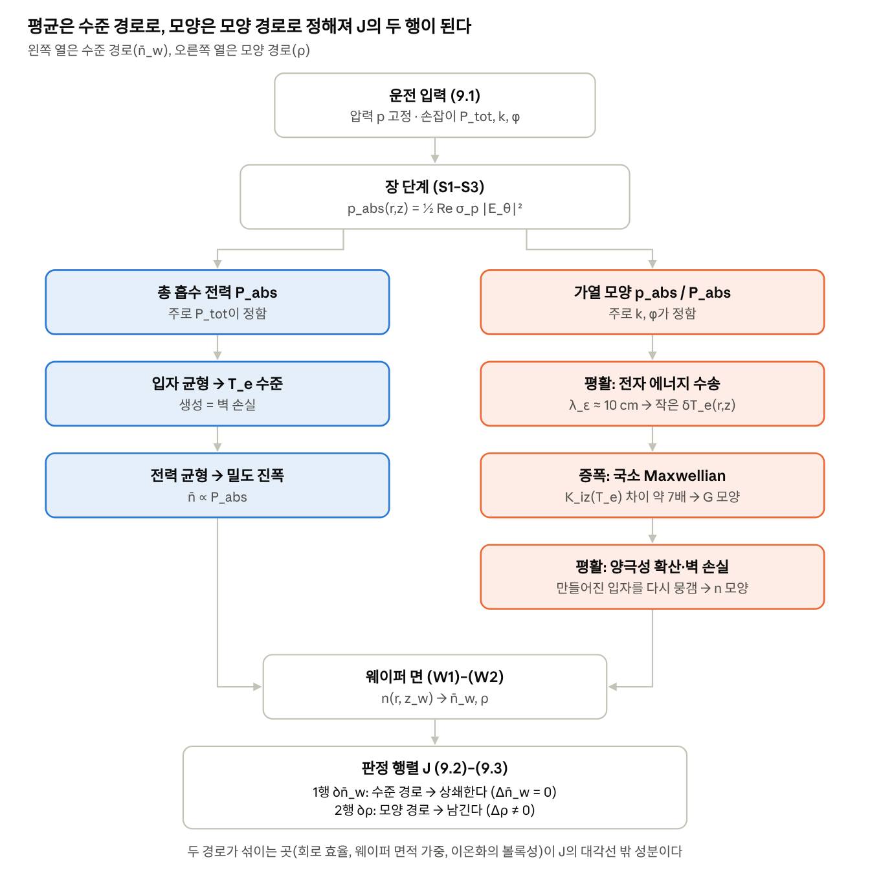

# 1차 발표 구성 가이드 — 문제에서 판정 행렬까지

2026-11-10 · 주제 3 팀

## 발표의 뼈대

한 줄 메시지는 이것이다. **두 코일은 가열 분포를 바꾼다. 그것이 밀도 모양으로 얼마나 전달되는지는 전자 에너지 수송과 확산이 정한다. 이 전달을 담는 가장 간단한 모델이 국소 Maxwellian이고, 그 모델로 구한 감도 행렬 J로 독립 제어를 판정한다.**

발표는 질문 하나에서 출발해 판정 행렬 J로 끝난다. 1막에서 바꾸려는 것과 손잡이를 정의하고, 2막과 3막에서 비를 계산할 수 있는 모델을 고르고, 4막에서 그 모델의 계산 흐름을 따라가 마지막에 J를 세우고 읽는다. J는 4막 끝에서 처음 등장하고, 그 전까지는 "평균"과 "비"라는 말만 쓴다.

| 막  | 질문                                  | 답                                                                                                                                                                       |
|-----|---------------------------------------|--------------------------------------------------------------------------------------------------------------------------------------------------------------------------|
| 1   | 무엇을 바꾸려는가?                    | 출력은 둘(웨이퍼 위 평균 밀도 n̄\_w, 중앙·가장자리 비 ρ), 손잡이는 셋(P_tot, k, φ)이다. 손잡이를 섞어 평균은 두고 비만 바꿀 수 있는지가 질문이다                          |
| 2   | 0D 모델로 답할 수 있는가?             | 평균은 근사로 주지만 비는 못 준다. 0D에는 공간 변수가 없기 때문이다. 제어가 불가능하다는 뜻이 아니라, 0D로는 판정할 수 없다는 뜻이다                                     |
| 3   | 비를 계산하려면 어떤 모델이 필요한가? | 위치마다 T_e를 푸는 국소 Maxwellian 모델이 필요하다. 교재 확산식과 이전 팀 모델은 이 모델의 두 극한일 뿐이고, 10 mTorr는 어느 극한에도 해당하지 않는다                   |
| 4   | 어떻게 판정하는가?                    | 입력 → 장 → 에너지·입자 → 웨이퍼 면 순서로 풀고, 손잡이마다 두 출력의 변화를 모아 판정 행렬 J를 만든다. 평균의 변화가 상쇄되는 손잡이 조합에서 남는 비의 변화로 판정한다 |

### 막과 막을 잇는 문장

슬라이드에는 연결을 직접 쓰지 않고, 말로 넘긴다.

- **1 → 2:** "평균과 비를 계산할 모델이 필요합니다. 먼저 교재에서 배운 0D 모델이 어디까지 답하는지 보겠습니다."

- **2 → 3:** "0D가 못 주는 비를 구하려면 공간을 넣고, 위치마다 전자온도를 풀어야 합니다. 그 모델부터 보겠습니다."

- **3 → 4:** "이 모델을 실제로 어떤 순서로 풀고, 그 결과를 어떻게 판정으로 정리하는지 보겠습니다."

## 전체 슬라이드 순서

본편 14장, 14분이다. 막별 시간은 1막 3:00, 2막 2:00, 3막 2:45, 4막 6:15이고, 1분은 여유로 둔다.

| \#  | 제목                             | 핵심 메시지                                                        | 화면 요소                             | 시간 |
|-----|----------------------------------|--------------------------------------------------------------------|---------------------------------------|------|
| 1   | 이중 코일 ICP의 밀도 독립 제어   | 핵심 질문 하나                                                     | 제목, 질문 상자                       | 0:30 |
| 2   | ICP는 코일로 전자를 데운다       | 코일이 직접 바꾸는 것은 가열까지다                                 | 과정 화살표, E_θ = −jωA_θ             | 0:45 |
| 3   | 출력 둘: 평균은 두고 비만 바꾼다 | Δn̄\_w = 0, Δρ ≠ 0                                                  | 챔버 평면도·단면도, n̄\_w와 ρ 정의     | 1:00 |
| 4   | 손잡이 세 개와 질문              | 평균은 두고 비만 바꿀 수 있는가                                    | k, φ, P_tot 정의, 질문 상자           | 0:45 |
| 5   | 0D 글로벌 모델                   | 입자 균형은 T_e, 전력 균형은 n                                     | 두 균형식 (교재 (2.68)–(2.70))        | 1:00 |
| 6   | 0D가 답하는 것과 못 하는 것      | 평균은 근사로, 비는 없다                                           | 두 열 비교                            | 1:00 |
| 7   | 국소 Maxwellian 모델             | 위치마다 T_e를 풀고 이온화율로 바꾼다                              | 에너지 방정식, 이온화율, 민감도 한 줄 | 1:30 |
| 8   | 두 극한과 우리 조건              | 단순한 두 모델은 이 모델의 극한이고, 10 mTorr는 어느 극한도 아니다 | 두 극한 비교 표, λ_ε 한 줄            | 1:15 |
| 9   | 전체 계산 흐름                   | 입력에서 두 출력까지                                               | 수준·모양 경로 흐름도                 | 0:45 |
| 10  | 장 단계                          | 손잡이 → 가열 분포                                                 | σ_p, p_abs, 간섭항                    | 1:00 |
| 11  | 에너지·입자 단계                 | 가열 분포 → 밀도 분포                                              | 에너지식 + 입자식                     | 1:15 |
| 12  | 판정 행렬 J                      | 평균과 비의 감도를 한 행렬로                                       | J 정의, 차분식                        | 1:30 |
| 13  | J로 판정하는 방법                | Δn̄\_w = 0 방향에서 남는 Δρ                                         | 판정식, 비교 모델                     | 1:00 |
| 14  | 결론과 2차 발표                  | 한 줄 메시지                                                       | 네 질문의 답                          | 0:45 |

마지막에 참고문헌 한 장을 두고, 백업 슬라이드는 그 뒤에 숨긴다.

## 1막. 무엇을 바꾸려는가 (슬라이드 1–4, 3:00)

1막의 일은 질문을 구체화하는 것이다. 출력 둘과 손잡이 셋을 정의하면, "독립 제어가 가능한가"는 "손잡이를 섞어 평균은 두고 비만 바꿀 수 있는가"가 된다.

### 1. 이중 코일 ICP의 밀도 독립 제어

- **화면:** 제목, 질문 상자 하나. "두 코일로 가열 분포를 바꿀 수 있다면, 최종 밀도의 모양도 따로 바꿀 수 있는가?"

- **말할 것:** 오늘은 이 질문을 판정하는 방법과 그에 필요한 이론을 정리하고, 실제 계산은 2차 발표에서 한다.

### 2. ICP는 코일로 전자를 데운다

- **화면:** 다섯 칸 화살표. RF 전류 → 시변 자기장 → 유도 전기장 E_θ → 전자 가열 p_abs → 이온화와 확산 → 밀도 n. 아래에 E_θ = −jωA_θ 한 줄.

- **말할 것:** 코일이 직접 바꾸는 것은 장과 가열까지다. 밀도는 그 뒤 이온화와 확산을 더 거쳐 정해진다. 가열 분포와 밀도 분포 사이에 무엇이 있는지가 오늘의 주제다.

- **근거:** 교재 2.3.4절, 식 (2.52), 121–122쪽.

### 3. 출력 둘: 평균은 두고 비만 바꾼다

- **화면:** 챔버 평면도(안쪽 코일 3·6·9 cm, 바깥쪽 12·15·18 cm, R = 21 cm)와 단면도(L = 6 cm, 웨이퍼 위 평가 높이 z_w). 중앙 영역(r \< 5 cm)과 가장자리 영역(12–14.5 cm)을 색으로 표시한다.

- **식:** 출력은 웨이퍼 면 평균 밀도 n̄\_w와 비 ρ = n_c/n_edge 둘이다. 목표는 Δn̄\_w = 0, Δρ ≠ 0.

- **말할 것:** 두 영역을 함께 올리는 것은 독립 제어가 아니다. 평균을 고정한 채 중앙과 가장자리의 비만 바꾸는 것이 목표다. 영역 밀도는 면적 가중 평균으로 구한다.

- **근거:** 개정 4, 8.11절 (W1)–(W3).

### 4. 손잡이 세 개와 질문

- **화면:** 손잡이 세 개. P_tot(총 공급 전력), k = \|I_out\|/\|I_in\|(전류 크기 비), φ(상대 위상). 아래에 질문 상자 "손잡이를 섞어 평균은 두고 비만 바꿀 수 있는가?"

<!-- -->

- **말할 것:**

  - k와 φ는 두 코일의 가열을 어떻게 나누고 겹치는지를, P_tot은 전체 규모를 바꾼다. k는 전력 비가 아니라 전류 크기의 비다.

  - 손잡이 하나만 돌리면 평균과 비가 함께 움직이는 것이 보통이다. 그래서 질문은 "손잡이를 섞어 평균의 변화는 상쇄하고 비의 변화만 남길 수 있는가"가 된다.

  - 이 질문에 답하려면 손잡이가 바뀔 때 두 출력이 얼마나 바뀌는지를 계산할 모델이 필요하다. 남은 발표는 그 모델을 고르고, 마지막에 그 결과를 판정 도구로 정리하는 과정이다.

- **근거:** 개정 4, 9장 (9.1).

## 2막. 0D 모델로 답할 수 있는가 (슬라이드 5–6, 2:00)

2막의 결론은 "평균은 근사로 주지만 비는 못 준다"다. 제어가 불가능하다는 말이 아니라, 0D로는 판정할 수 없다는 말이다. 0D의 두 균형은 버리지 않고 4막의 수준 경로로 가져간다.

### 5. 0D 글로벌 모델

- **화면:** 두 균형식과, 각 식이 정하는 양의 꼬리표(왼쪽 식은 T_e, 오른쪽 식은 n₀).

$$
\frac{K_\mathrm{iz}(T_e)}{u_B(T_e)} = \frac{1}{n_g\, d_\mathrm{eff}}, \qquad n_0 = \frac{P_\mathrm{abs}}{e\, u_B\, A_\mathrm{eff}\, \varepsilon_T}
$$

- **말할 것:** 챔버를 하나의 상자로 본다. 만들어지는 이온 수와 벽으로 나가는 이온 수가 같다는 조건에서 밀도가 약분되므로, T_e는 기체 압력과 챔버 크기가 정한다. 이온 하나를 잃을 때 드는 에너지 ε_T를 알면, 흡수 전력이 밀도의 크기를 정한다.

- **근거:** 교재 2.4절, 식 (2.68)–(2.73), 134–138쪽. 교재는 이 두 식으로 "공간 평균된" 밀도와 전자온도를 구한다고 적는다(137쪽).

### 6. 0D가 답하는 것과 못 하는 것

- **화면:** 두 열 비교. 왼쪽 "평균 n̄\_w: 근사 가능", 오른쪽 "비 ρ: 정의되지 않음".

- **말할 것:**

  - 평균: n̄ ∝ P_abs이므로 손잡이가 평균 밀도를 얼마나 바꾸는지는 0D가 대략 준다. k와 φ는 흡수 전력을 바꾸는 만큼만 들어간다. 흡수 전력은 교재 변압기 모델(식 (2.54)–(2.57))로 구한다.

  - 비: 0D에는 공간 변수가 없어서 ρ가 아예 없다. 비의 변화는 0이 아니라 정의되지 않는다.

  - 그래서 비를 구하려면 공간을 넣은 모델이 필요하다.

## 3막. 비를 계산하려면 어떤 모델이 필요한가 (슬라이드 7–8, 2:45)

3막의 논리는 두 단계다. 위치마다 T_e를 푸는 국소 Maxwellian 모델을 세운다(7). 그다음 더 단순한 모델들이 이 모델의 극한일 뿐이고, 우리 조건은 그 극한이 아니라는 것을 보인다(8). 그러면 "왜 더 단순한 모델이 아닌가"에 "단순한 모델은 이 모델의 특수한 경우이고, 우리 조건은 그 경우가 아니다"라고 답할 수 있다.

### 7. 국소 Maxwellian 모델

- **화면:** 위에 전자 에너지 방정식과 이온화율, 아래에 한 줄 "T_e 1% → 이온화 약 7%".

$$
\nabla \cdot \mathbf{q}_\varepsilon = p_\mathrm{abs} - P_\mathrm{coll} + \mathbf{J}_e \cdot \mathbf{E}_a, \qquad G = n_e n_g K_\mathrm{iz}\big(T_e(r,z)\big)
$$

- **말할 것:**

  - 0D가 비를 못 주는 이유는 공간이 없어서다. 공간을 넣으면 전자온도도 위치마다 달라질 수 있어야 한다. 이 모델은 T_e를 위치의 함수로 두고 전자 에너지 방정식으로 푼다.

  - 열전도 항이 이웃한 위치의 T_e를 잇는다. 그래서 T_e 분포는 가열 분포를 λ_ε 정도로 뭉갠 모양이 된다. λ_ε는 데워진 전자가 에너지를 잃기 전까지 퍼지는 거리다.

  - 국소 Maxwellian은 그 위치의 T_e를 이온화율로 바꾸는 환산표다. 이온화는 15.76 eV를 넘는 소수의 빠른 전자가 만들어서 T_e에 매우 민감하다. 그래서 T_e가 거의 고르게 보여도 이온화는 고르지 않고, T_e를 균일하다고 근사할 수 없다.

- **비유(필요하면):** 방마다 온도계가 하나 있고(국소 Maxwellian), 방 사이 벽으로 열이 흐르는(열전도) 집이다. 벽이 얇으면 히터(코일)를 옮겨도 온도 지도는 거의 평평하다.

- **근거:** 개정 4, 7장 보강 (M1)–(M6). 민감도는 Lieberman & Lichtenberg 표 3.3의 K_iz 피팅식에서 d ln K_iz/d ln T_e = 0.59 + 17.44/T_e ≈ 7 (10 mTorr의 0D 기준 상태).

### 8. 두 극한과 우리 조건

- **화면:** 위에 두 극한 비교 표, 아래에 λ_ε 식과 우리 조건 한 줄.

|                            | λ_ε → ∞ (저압 쪽)                                      | λ_ε → 0 (고압 쪽)                                              |
|----------------------------|--------------------------------------------------------|----------------------------------------------------------------|
| T_e                        | 어디서나 같다                                          | 데운 자리에서만 높다                                           |
| 모델이 줄어든 꼴           | 교재 확산 방정식 ∂n/∂t − D_a∇²n = ν_iz n (교재 (1.76)) | 국소 생성 G = p_abs/(e ε_c). 이전 팀 모델(G ∝ p_abs)과 같은 꼴 |
| 밀도 모양                  | 기본 모드 J₀(2.405r/R) cos(πz/L)로 고정                | 가열 모양을 따라가되, 확산만큼 뭉개진다                        |
| 코일 배분에 대한 비의 응답 | 0                                                      | 가장 크게 나온다                                               |

$$
\lambda_\varepsilon \simeq \sqrt{\frac{\lambda_m \lambda_\mathrm{inel}}{3}}
$$

- **우리 조건:** 10 mTorr에서 λ_ε ≈ 10 cm로, 코일 간격(약 9 cm), 챔버 높이(6 cm)와 같은 자릿수다. 어느 극한으로도 볼 수 없다.

- **말할 것:**

  - 이 모델에서 λ_ε를 아주 길게 하면 T_e가 균일해져 교재 확산 방정식이 되고, 아주 짧게 하면 데운 자리에서 바로 이온화하는 이전 팀 모델과 같은 꼴이 된다. 더 단순한 두 모델은 이 모델의 특수한 경우다.

  - 두 극한은 비의 응답을 계산하지 않고 정해 버린다. 왼쪽은 0, 오른쪽은 최대다. 실제 값은 그 사이 어딘가에 있다.

  - 우리 조건의 λ_ε는 장치 크기와 같은 자릿수라 어느 극한도 쓸 수 없다. 그래서 전체 모델을 풀어야 한다.

- **화면에 밝힐 것:** 식은 Kim & Chung(2020)의 정의이고, 10 cm는 팀이 전자 에너지 방정식의 계수로 구한 값(sim/locality_check.py)이다. 두 정의는 같은 자릿수를 준다.

- **주의:** 두 극한이 가능한 모델의 전부라고 말하지 않는다. 선행연구와의 비교는 질문이 나오면 백업 B2로 답한다.

- **정직하게 말할 한계:** 10 mTorr는 λ_ε가 챔버 높이보다 길어 이 모델의 적용 범위 경계에 있다. 실제 전자는 모델보다 더 멀리 에너지를 나르므로, 이 모델이 주는 비의 응답은 상한에 가깝다고 본다.

- **근거:** 교재 1.10절, 식 (1.76)–(1.83), 62–64쪽. 교재 2.4절, 식 (2.68), 134–135쪽. Kim & Chung(2020) 식 (5). λ_ε 개념은 교재에 없다.

## 4막. 계산 흐름과 판정 행렬 J (슬라이드 9–14, 6:15)

4막은 흐름도 하나를 두고 그 위를 따라 내려가, 마지막에 판정 행렬 J에 닿는다. 입력에서 두 출력까지의 계산 한 번이 J의 재료이고, 그것을 손잡이마다 반복해 모은 것이 J다. J는 12번에서 처음 등장한다.

### 9. 전체 계산 흐름

- **화면:** 아래 흐름도를 그대로 쓴다.

*입력에서 판정 행렬까지 · 수준 경로와 모양 경로*

왼쪽 열은 n̄\_w를, 오른쪽 열은 ρ를 만들고, 두 열이 웨이퍼 면에서 만나 J의 두 행이 된다.

- **말할 것:** 입력은 장 단계에서 흡수 전력 분포가 되고, 그다음 두 갈래로 나뉜다. 총량은 평균 밀도로, 모양은 ρ로 간다. 왼쪽 열은 2막의 0D 균형이고, 오른쪽 열은 3막의 모델이다. 다음 세 장에서 이 그림을 위에서부터 따라간다.

### 10. 장 단계: 손잡이 → 가열 분포

- **화면:** 식 두 줄.

$$
\sigma_p = \frac{n_e e^2}{m_e\left(\nu_m(T_e) + j\omega\right)}, \qquad p_\mathrm{abs} = \tfrac{1}{2}\,\mathrm{Re}\,\sigma_p\,|E_\theta|^2
$$

$$
\frac{|E_\theta|^2}{\omega^2 I_0^2} = |\mathcal{A}_\mathrm{in}|^2 + k^2 |\mathcal{A}_\mathrm{out}|^2 + 2k\,|\mathcal{A}_\mathrm{in}||\mathcal{A}_\mathrm{out}|\cos(\phi + \psi)
$$

- **말할 것:**

  - k는 두 코일이 각각 데우는 비율을, φ는 두 장이 겹치는 곳의 간섭을 바꾼다. 둘 다 가열의 모양을 바꾸는 손잡이다.

  - 모든 전류를 a배 하면 p_abs는 a²배가 되고 모양은 그대로다. 그래서 P_tot은 주로 수준을 바꾸는 손잡이다.

  - 밀도와 T_e가 σ_p를 바꾸므로 이 구분은 근사다. 그래서 장 단계는 다음 단계와 함께 반복해서 푼다.

- **근거:** 개정 4, 5–6장. 표피 깊이는 교재 식 (2.53), 변압기 모델은 교재 식 (2.54)–(2.57).

### 11. 에너지·입자 단계: 가열 분포 → 밀도 분포

- **화면:** 함께 푸는 두 식과, 그 아래 띠 하나 "에너지 수송이 뭉갬다 → 이온화가 민감하게 반응한다 → 확산이 다시 뭉갬다".

$$
\nabla \cdot \mathbf{q}_\varepsilon = p_\mathrm{abs} - P_\mathrm{coll} + \mathbf{J}_e \cdot \mathbf{E}_a, \qquad \nabla \cdot \left[\mu_i \nabla(n T_e)\right] + n\, n_g K_\mathrm{iz}(T_e) = 0
$$

- **말할 것:**

  - 수준: 생성률이 n에 비례하므로 입자식만으로는 밀도의 크기가 정해지지 않는다. 입자식은 T_e의 수준을 정하고(생성 = 벽 손실), 밀도의 크기는 에너지식이 정한다. 0D의 역할 분담이 그대로다.

  - 모양: 가열 모양이 λ_ε만큼 뭉개져 작은 T_e 차이가 되고, 그 차이가 이온화의 차이를 만들고, 만들어진 입자가 양극성 확산과 벽 손실로 다시 뭉개져 밀도 모양이 된다.

  - 이온화의 민감한 반응은 첫 뭉개짐을 일부 되돌릴 뿐이다. 가열 모양이 밀도 모양으로 전달되는 정도는 λ_ε → 0 극한(국소 생성)의 값을 넘지 못한다.

  - 벽 조건은 이온이 봄 속도로 빠지는 조건이다. 벽 밀도를 0으로 두지 않는다.

- **근거:** 개정 4, 7장 보강 (M1)–(M4), 8장 (Γ2)–(Γ3), 8.9절.

### 12. 판정 행렬 J

- **화면:** 위에 판정 행렬 J의 정의(1행에 "평균", 2행에 "비" 꼬리표), 아래에 J의 한 열을 얻는 차분식.

$$
\begin{bmatrix} \Delta \bar{n}_w \\ \Delta \rho \end{bmatrix} \simeq \underbrace{\begin{bmatrix} \partial_P \bar{n}_w & \partial_k \bar{n}_w & \partial_\phi \bar{n}_w \\ \partial_P \rho & \partial_k \rho & \partial_\phi \rho \end{bmatrix}}_{J} \begin{bmatrix} \Delta P_\mathrm{tot} \\ \Delta k \\ \Delta \phi \end{bmatrix}
$$

$$
J_{\cdot j} \simeq \frac{\mathbf{y}(\mathbf{u}_0 + \delta u_j \mathbf{e}_j) - \mathbf{y}(\mathbf{u}_0)}{\delta u_j}, \qquad \mathbf{y} = (\bar{n}_w,\ \rho), \quad \mathbf{u} = (P_\mathrm{tot},\ k,\ \phi)
$$

- **말할 것:**

  - 푼 밀도 분포를 웨이퍼 위 평가 높이에서 읽어 n̄\_w와 ρ를 구한다. 여기까지가 계산 한 번이다.

  - 운전점 근처에서 손잡이를 조금 바꿀 때 두 출력이 얼마나 변하는지를 모은 것이 J다. 지금까지 "평균"과 "비"로 따라온 두 경로가 J의 1행과 2행이 된다.

  - 기준 운전점에서 한 번 풀고, 손잡이를 하나씩 조금 바꿔 다시 푼다. 출력의 변화를 손잡이의 변화로 나누면 J의 열 하나가 나온다. 계산 네 번으로 J 전체를 얻는다.

  - 두 경로는 완전히 나뉘지 않는다. k와 φ가 회로 효율을 바꿔 흡수 전력이 변하고, n̄\_w는 웨이퍼 면적 평균이라 모양이 바뀌면 함께 변한다. 이것이 J의 교차 항(∂n̄\_w/∂k, ∂n̄\_w/∂φ, ∂ρ/∂P)이고, J를 어림하지 않고 직접 계산해야 하는 이유다.

- **근거:** 개정 4, 8.11절 (W1)–(W3), 9장 (9.1)–(9.2).

### 13. J로 판정하는 방법

- **화면:** J를 두 행 J₁, J₂로 나눠 쓴 판정식.

$$
J_1 \cdot \Delta\mathbf{u} = 0 \quad (\Delta \bar{n}_w = 0), \qquad \Delta\rho = J_2 \cdot \Delta\mathbf{u}
$$

- **말할 것:**

  - 첫 식을 만족하는 손잡이 조합은 3차원 입력 공간 안의 평면 하나다. 그 평면 위에서 둘째 식이 주는 Δρ가 0이 아니면 독립 제어가 원리적으로 가능하다. 두 행이 나란하지 않다는 것(rank 2)과 같은 말이다.

  - 가능하다는 것만으로는 부족하다. 실제 입력 한계(전력, 전류 비, 위상 범위) 안에서 얻는 Δρ의 크기를 함께 본다. 작으면 손잡이를 크게 돌려도 조금밖에 안 바뀌므로 실용적이지 않다.

  - 같은 계산을 λ_ε → 0 극한인 국소 생성 모델로도 해서 두 J를 비교한다. 그 차이가 전자 에너지 수송이 독립 제어를 얼마나 줄이는지를 숫자로 보여 준다.

- **근거:** 개정 4, 9장 (9.2)–(9.3). J는 2 × 3이라 역행렬과 행렬식이 없다.

### 14. 결론과 2차 발표

- **화면:** 네 질문과 답을 한 줄씩, 맨 아래에 2차 발표에서 할 일 세 가지(모델 구현과 검증, J 계산, 비교 모델과의 대조).

- **말할 것:** "코일은 가열 분포를 바꿉니다. 그것이 밀도 모양으로 얼마나 전달되는지는 전자 에너지 수송과 확산이 정합니다. 2차에서는 국소 Maxwellian 모델로 J를 계산해, 평균을 고정한 채 비를 얼마나 바꿀 수 있는지 판정하겠습니다."

- **주의:** 수치 결론은 아직 없다. 수행 예정임을 화면에 명시한다.

## 백업 슬라이드

질의응답용으로 숨겨 둔다.

| \#  | 제목                  | 담을 것                                                                                                                                                                                                        | 뒷받침 |
|-----|-----------------------|----------------------------------------------------------------------------------------------------------------------------------------------------------------------------------------------------------------|--------|
| B1  | 모델의 적용 범위      | RF 전류 응답, 에너지 수송, 에너지 분포 모양의 세 가지 국소성 비교 (개정 4, 2장 보강)                                                                                                                           | 7, 8   |
| B2  | 선행연구와의 정합     | Kim & Chung(2020) Fig. 8의 1 mTorr·50 mTorr 밀도 분포. 바깥 코일을 강화했을 때 50 mTorr는 최대 위치가 바깥으로, 1 mTorr는 크기만 변함. 두 극한의 설명과 일치하는 사례이며, 수동 공진 코일 장치라 증거는 아니다 | 8      |
| B3  | 전역 T_e가 맞는 경우  | 저압 비국소 영역에서는 에너지 분포가 총에너지의 함수가 되어 T_e가 균일해진다 (Kolobov & Godyak 1995). 그때 코일 배분에 대한 비의 응답은 0에 가깝다                                                             | 8      |
| B4  | 계산 반복과 보존 점검 | 0D 초기값 → 장 → 에너지·입자 → 갱신, 입자·에너지·회로 보존 점검 (8.9–8.10절)                                                                                                                                   | 9–12   |

## 예상 질문과 답

답은 한두 문장으로 한다.

1.  **0D 모델로는 왜 안 되나?**

    - 0D에는 공간 변수가 없어 ρ가 정의되지 않는다. 제어가 안 된다는 것이 아니라 비를 줄 수 없다는 것이다. 평균은 0D가 근사로 준다.

2.  **그냥 전역 전자온도를 쓰면 안 되나?**

    - T_e를 균일하게 두면 밀도 모양이 챔버 모양으로 고정되어 코일 배분에 대한 비의 응답이 가정에 의해 0이 된다. 저압에서는 그것이 실제로 맞는 극한이지만, 우리 조건이 그 극한인지는 가정할 수 없다. (슬라이드 8, B3)

3.  **10 mTorr에서 국소 Maxwellian이 맞나?**

    - 적용 범위의 경계에 있다. 그래서 이 모델이 주는 비의 응답을 상한에 가까운 값으로 읽고, 압력을 바꿔 경향을 확인한다. (B1)

4.  **이온화가 T_e에 7배로 민감하면 모양 차이가 더 커지나?**

    - 아니다. 민감도는 작은 T_e 차이로도 이온화 차이가 생긴다는 뜻이고, 전체 전달은 "데운 자리에서 바로 이온화"하는 경우를 넘지 못한다. (슬라이드 11)

5.  **φ = π이면 가장 잘 나뉘는 것 아닌가?**

    - 한 점에서 완전히 상쇄되려면 크기 조건과 위상 조건이 함께 필요하고, 플라즈마 안의 위상 ψ는 위치마다 다르다. 최적 위상은 J의 φ 열을 계산해서 찾는다. (슬라이드 10)

6.  **왜 J의 역행렬이나 행렬식을 보지 않나?**

    - J는 2 × 3이라 둘 다 없다. Δn̄\_w = 0인 방향에서 남는 Δρ와 입력 한계를 본다. (슬라이드 13)

7.  **결국 독립 제어가 가능하다는 것인가?**

    - 아직 수치 결론은 없다. 이번 발표는 판정하는 방법을 정의한 단계이고, 2차에서 J를 계산해 답한다.

## 제작 규칙과 근거

### 슬라이드 제작 규칙

- **템플릿:** 수업 양식 4:3(저장소 presentations/template/발표양식_4x3.pptx).

- **글자:** 본문 12 pt 이상, 각주 10.5 pt. 번호는 원문자 대신 굵은 숫자.

- **인용 순서:** 교재(절·쪽·식 번호)를 먼저 적고, 교재에 없는 내용만 논문을 적는다. 팀이 계산한 값에는 "팀 계산"을 붙인다.

- **발표자 노트:** \[대본 · 시간 / N초\]과 \[근거(읽지 않음)\] 두 부분으로 나눈다. 이 가이드의 "말할 것"은 대본에, "근거"는 근거에 넣는다.

- **J의 등장:** J는 12번에서 처음 띄우고 13번, 14번에서 같은 모양으로 다시 쓴다. 앞 막에서는 "평균"과 "비"라는 말만 쓰고, 12번에서 두 말이 J의 두 행이 된다고 묶는다.

- **식:** 한 슬라이드에 핵심 식은 두 줄까지. 유도는 넣지 않는다.

### 하지 말아야 할 주장

- 0D로는 제어가 불가능하다. (판정할 수 없다가 맞다.)

- 독립 제어가 가능하다는 것이 입증되었다.

- 10 mTorr에서 국소 Maxwellian이 타당하다.

- 우리 조건이 두 극한의 정확히 중간이다, 또는 특정 압력이 임계 압력이다. λ_ε와 간격의 비교는 방향만 준다.

- 이온화의 민감도가 모양 차이를 7배로 키운다.

- 선행연구의 결과가 우리 장치에서의 결과를 증명한다.

### 참고문헌

1.  정진욱, 『플라즈마 전자공학』 4판, 교문사, 2026. 1.10절(59–66쪽), 2.3.4절(121–125쪽), 2.4절(133–138쪽).

2.  6조, 「이중 코일 ICP의 중앙·가장자리 전자 밀도 독립 제어 — 1차 발표: 이론적 배경과 상세 수식 유도」 개정 4, 2026-11-10.

3.  M. A. Lieberman and A. J. Lichtenberg, *Principles of Plasma Discharges and Materials Processing*, 2nd ed., Wiley, 2005.

4.  J.-H. Kim and C.-W. Chung, Phys. Plasmas 27, 063511 (2020). [doi:10.1063/5.0006698](https://doi.org/10.1063/5.0006698)

5.  V. I. Kolobov and V. A. Godyak, IEEE Trans. Plasma Sci. 23, 503 (1995).

### 팀 자료 (저장소)

- 학부생용 재구성본: docs/19_개정4_학부생용_재구성.md

- 국소 Maxwellian 계산 방식과 전역 T_e 문제: docs/16_국소Maxwellian_전역계산.md

- 0D·교재 식으로 본 독립 제어: docs/17_0D_독립제어_가능성.md

- 수식 흐름과 J: docs/18_수식흐름_목표연결.md

- 10 mTorr의 λ_ε 계산: sim/locality_check.py

---

원본: Claude Docs 「1차 발표 구성 가이드 — 문제에서 판정 행렬까지」의 내보내기.
