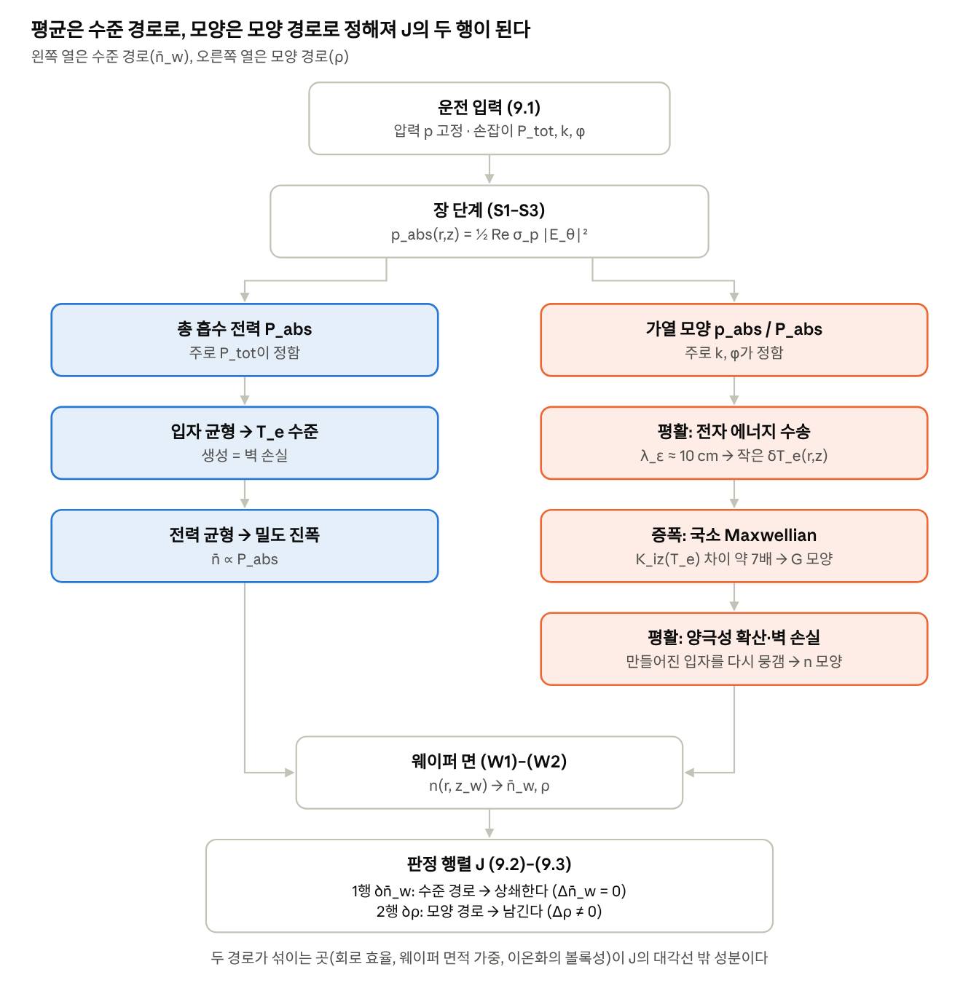

# 이 문서의 쓰임

이 문서는 12분 발표의 슬라이드 12장을 한 장씩 설명한다. 각 장에 화면 구성, 핵심 식, 대본, 근거를 적었다. 그대로 따라 만들면 발표 자료와 발표자 노트가 함께 완성된다.

두 자료를 엮었다.

| 약칭 | 자료 | 이 문서에서 맡는 역할 |
|------|----------------------|--------------------|
| **가이드** | 「1차 발표 구성 가이드 — 문제에서 판정 행렬까지」(주제 3 팀, 11쪽) | 발표의 논리, 대본, 하지 말아야 할 주장 |
| **재구성본** | 「이중 코일 ICP 1차 발표 이론적 배경 재구성」 A4 본문 + Appendix(6조, 22쪽) | 슬라이드 순서(7개 절), 식 번호, 그림 1–9, 백업용 부록 A–H |

엮은 원칙은 세 가지다.

- **순서는 재구성본의 7개 절을 따른다.** 문제 정의 → ICP와 이중 코일 → 0D와 2D → 2D 모델의 물리 → 계산 과정과 판정 → 한계와 2차 계획이다. 이 순서는 가이드의 흐름(문제 → 0D → 국소 Maxwellian → 계산과 J)과 그대로 겹친다.
- **논리는 가이드의 수정 사항을 따른다.** 0D는 "판정할 수 없다"이지 "제어가 불가능하다"가 아니다. 단순한 두 모델은 국소 Maxwellian 모델의 두 극한으로 보인다. 판정 행렬 J는 11번에서 처음 등장한다.
- **식과 그림은 재구성본에서 가져온다.** 슬라이드에는 재구성본의 식 번호를 근거로 달고, 교재에 있는 식은 교재 번호를 먼저 적는다.

# 한눈에 보기

## 한 줄 메시지

**두 코일은 가열 분포를 바꾼다. 그것이 밀도 모양으로 얼마나 전달되는지는 전자 에너지 수송과 확산이 정한다. 이 전달을 담는 가장 간단한 모델이 국소 Maxwellian이고, 그 모델로 구한 판정 행렬 J로 독립 제어를 판정한다.**

## 슬라이드 순서와 시간

본편은 12장, 11분 15초다. 남는 45초는 슬라이드 전환과 여유로 둔다.

| # | 제목 | 핵심 메시지 | 재구성본 출처 | 시간 |
|--|------------|----------------|-----------------|----|
| 1 | 제목과 연구 질문 | 가열을 바꾸면 밀도 모양도 바뀌는가 | 표지 연구 질문 | 0:30 |
| 2 | 출력 둘: 평균은 두고 비만 | Δn̄_w ≃ 0, Δρ ≠ 0 | 1.2–1.3절, 식 (1)–(6), 그림 1 | 0:45 |
| 3 | ICP는 코일로 전자를 데운다 | 코일이 바꾸는 것은 가열까지 | 2.1절, 식 (7)–(8), 그림 2 | 0:45 |
| 4 | 이중 코일과 손잡이 셋 | k, φ는 가열 분포를 섞는다 | 2.2–2.4절, 식 (11)–(14), 그림 3–4 | 1:00 |
| 5 | 0D 글로벌 모델 | 평균은 주지만 비는 없다 | 3.1–3.2절, 식 (15)–(22) | 0:45 |
| 6 | 공간 모델이 필요한 이유 | 균일 생성 ≠ 균일 밀도 | 3.3–3.4절, 식 (23)–(25), 그림 6 | 0:45 |
| 7 | 국소 Maxwellian 모델 | 위치마다 T_e를 풀어 이온화율로 | 4.1·4.3절, 5.6–5.7절, 식 (26)–(28), (40)–(42), 그림 7 | 1:15 |
| 8 | 두 극한과 우리 조건 | 단순한 모델은 극한이고, 10 mTorr는 극한이 아니다 | 4.4절, 부록 C | 1:00 |
| 9 | 계산 흐름과 장 단계 | 입력 → 장 → 흡수 전력, 그리고 반복 | 5.1–5.5절, 식 (31)–(38) | 1:00 |
| 10 | 에너지·입자 연립과 반복 | 미지수를 함께 풀고, 짐작하고 고친다 | 5.8–5.12절, 식 (43)–(51), 그림 9 | 1:15 |
| 11 | 판정 행렬 J | 평균을 되돌린 뒤 남는 비의 변화 | 5.13–5.14절, 식 (52)–(54) | 1:15 |
| 12 | 한계와 2차 계획 | 상한에 가까운 답, 2차에서 검증 | 6–7장, 표 1 | 1:00 |

파트별 시간은 다음과 같다.

| 파트 (재구성본 절) | 슬라이드 | 시간 |
|---|---|---|
| 1. 문제 정의 | 1–2 | 1:15 |
| 2. ICP와 이중 코일 | 3–4 | 1:45 |
| 3. 0D와 2D | 5–6 | 1:30 |
| 4. 2D 모델의 물리 | 7–8 | 2:15 |
| 5. 계산 과정과 판정 | 9–11 | 3:30 |
| 6–7. 한계와 2차 계획 | 12 | 1:00 |

## 파트를 잇는 말

화면에는 쓰지 않고 말로 넘긴다. 각 파트의 마지막 장 대본 끝에 넣어 두었다.

- **1 → 2:** "그러면 코일이 실제로 무엇을 바꾸는지부터 보겠습니다."
- **2 → 3:** "가열 분포를 바꾸는 것까지는 이 식으로 설명됩니다. 그것이 밀도까지 가는지 보려면 모델이 필요하니, 교재의 0D 모델부터 보겠습니다."
- **3 → 4:** "공간 모델에서 가장 중요한 것은 이온화가 어디서 일어나느냐입니다."
- **4 → 5:** "이 모델을 실제로 어떤 순서로 풀고, 결과를 어떻게 판정하는지 보겠습니다."
- **5 → 6:** "마지막으로 이 모델의 한계와 2차 계획입니다."

# 슬라이드별 가이드

각 장은 같은 순서로 적었다. **핵심 메시지**는 그 장이 남겨야 할 한 문장이다. **화면**은 슬라이드에 올릴 것, **식**은 화면에 띄울 핵심 식(두 줄까지)이다. **대본**은 발표자 노트의 [대본 · 시간 / N초] 칸에, **근거**는 [근거(읽지 않음)] 칸에 그대로 옮긴다.

## 파트 1. 문제 정의

### 1. 제목과 연구 질문 · 0:30

::: {custom-style="Message"}
핵심 메시지: 두 코일로 가열 분포를 바꾸면, 평균 밀도는 유지한 채 밀도의 모양도 바꿀 수 있는가?
:::

**화면**

- 제목 "이중 코일 ICP의 중앙·가장자리 전자 밀도 형상 제어", 부제 "문제 정의에서 2D 자기일관 모델과 제어 가능성 판정까지".
- 질문 상자 하나: "전류비와 위상차로 가열 분포를 바꾸면, 평균 밀도는 유지한 채 중앙/가장자리 밀도비를 바꿀 수 있는가?"

**대본** [대본 · 0:30 / 30초]

::: {custom-style="Script"}
안녕하십니까, 6조입니다. 저희 주제는 이중 코일 ICP에서 중앙과 가장자리의 밀도를 따로 조절할 수 있는가입니다. 오늘은 이 질문에 답하는 데 필요한 이론과 답을 판정하는 방법을 설명드리고, 실제 계산은 2차 발표에서 하겠습니다.
:::

**근거** [근거(읽지 않음)]

::: {custom-style="Basis"}
재구성본 표지 "이 문서의 연구 질문". 교수 안내: 1차 발표는 2차 수행에 필요한 이론적 배경, 실제 설계는 2차.
:::

### 2. 출력 둘: 평균은 두고 비만 · 0:45

::: {custom-style="Message"}
핵심 메시지: 출력은 웨이퍼 위 평균 밀도 n̄_w와 중앙·가장자리 비 ρ 두 개이고, 목표는 평균을 두고 비만 바꾸는 것이다.
:::

**화면**

- 왼쪽: 챔버 평면도와 단면도. 반경 R = 21 cm, 높이 L = 6 cm, 안쪽 코일 3·6·9 cm, 바깥쪽 코일 12·15·18 cm, 웨이퍼 위 관측면 z_w. 중앙 영역(r < 5 cm)과 가장자리 영역(12–14.5 cm)을 색으로 칠한다.
- 오른쪽: 재구성본 **그림 1**(평균이 같고 모양이 다른 세 곡선). 각주로 "개념 함수, 계산 결과 아님".

**식**

$$\rho \equiv \frac{n_c}{n_\mathrm{edge}}, \qquad \Delta \bar{n}_w \simeq 0, \quad \Delta\rho \neq 0$$

**대본** [대본 · 0:45 / 45초]

::: {custom-style="Script"}
전체 밀도를 올리는 것과 밀도의 모양을 바꾸는 것은 다른 일입니다. 그래서 출력을 두 개로 정했습니다. 웨이퍼 위 평균 밀도와, 중앙 영역과 가장자리 영역의 밀도 비 ρ입니다. 두 영역의 밀도는 면적 가중 평균으로 구합니다. 목표는 평균은 그대로 두고 비만 바꾸는 것입니다. 한쪽을 완전히 고정하는 것이 아니라, 오른쪽 그림처럼 평균이 같으면서 모양이 다른 상태로 옮겨 가는 것입니다. 그러면 코일이 실제로 무엇을 바꾸는지부터 보겠습니다.
:::

**근거** [근거(읽지 않음)]

::: {custom-style="Basis"}
재구성본 1.2절 식 (1)–(5): 관측면 단면 n_w(r), 면적 가중 n_c, n_edge, n̄_w, ρ. 1.3절 식 (6): 목표. 그림 1은 개념 함수. 개정 4, 8.11절 (W1)–(W3).
:::

::: {custom-style="Caution"}
주의: "중앙 밀도를 완전히 고정하고 가장자리만 바꾼다"로 말하지 않는다(재구성본 1.3절).
:::

## 파트 2. ICP와 이중 코일

### 3. ICP는 코일로 전자를 데운다 · 0:45

::: {custom-style="Message"}
핵심 메시지: 코일이 직접 바꾸는 것은 유도 전기장과 가열 분포까지이고, 밀도는 그 뒤의 수송과 벽 손실이 정한다.
:::

**화면**

- 재구성본 **그림 2**(코일 → 유도장 → 흡수 전력 → 수송 → 밀도의 다섯 칸).
- 그 아래에 식 두 개.

**식**

$$\tilde{E}_\theta(r,z) = -j\omega\, \tilde{A}_\theta(r,z), \qquad p_\mathrm{abs} = \tfrac{1}{2}\,\mathrm{Re}(\sigma_p)\,|E_\theta|^2$$

**대본** [대본 · 0:45 / 45초]

::: {custom-style="Script"}
코일에 RF 전류가 흐르면 시간에 따라 변하는 자기장이 생기고, 패러데이 법칙에 따라 원주 방향의 유도 전기장이 생깁니다. 전자는 이 전기장에서 에너지를 얻고, 충돌하면서 그 에너지를 열로 바꿉니다. 중요한 점은 코일이 직접 바꾸는 것이 전기장과 가열 분포까지라는 것입니다. 밀도는 그 뒤에 이온화와 확산, 벽 손실을 더 거쳐 정해집니다. 이 사이에 무엇이 있는지가 오늘의 주제입니다.
:::

**근거** [근거(읽지 않음)]

::: {custom-style="Basis"}
교재 2.3.4절, 식 (2.52), 121–122쪽. 재구성본 2.1절, 식 (7)–(8), 그림 2. 흡수 전력 식은 재구성본 식 (38).
:::

### 4. 이중 코일과 손잡이 셋 · 1:00

::: {custom-style="Message"}
핵심 메시지: 단일 코일은 가열의 크기를, 이중 코일은 서로 다른 공간 응답의 가중치(k)와 간섭(φ)까지 바꾼다.
:::

**화면**

- 왼쪽: 재구성본 **그림 3**(단일 코일 대 이중 코일). 오른쪽: **그림 4**(복소 중첩과 위치마다 다른 위상).
- 손잡이 정의 한 줄: P_tot(총 공급 전력), k = |I_out|/|I_in|(전류 크기 비), φ = arg I_out − arg I_in(상대 위상).

**식**

$$E_\theta = -j\omega I_0\left[A_\mathrm{in} + k\,e^{j\phi} A_\mathrm{out}\right]$$

$$\frac{|E_\theta|^2}{\omega^2 I_0^2} = |A_\mathrm{in}|^2 + k^2|A_\mathrm{out}|^2 + 2k\,|A_\mathrm{in}||A_\mathrm{out}|\cos\left[\phi+\psi(r,z)\right]$$

**대본** [대본 · 1:00 / 60초]

::: {custom-style="Script"}
단일 코일은 전류를 바꾸면 가열 패턴의 크기가 주로 바뀌고, 모양을 따로 고를 수단이 거의 없습니다. 이중 코일은 안쪽과 바깥쪽 코일이 만드는 서로 다른 공간 응답을 섞습니다. 그래서 손잡이가 셋이 됩니다. 전체 전력, 두 전류의 크기 비 k, 상대 위상 φ입니다. 장을 제곱하면 세 번째 항인 간섭항이 생기고, 여기에 위상이 들어갑니다. 다만 ψ는 위치마다 다른 플라즈마 내부의 위상이라서, φ를 π로 둔다고 어디서나 상쇄되지는 않습니다. 또 k는 전력 비가 아니라 전류 비입니다. 가열 분포를 바꾸는 것까지는 이 식으로 설명됩니다. 그것이 밀도까지 가는지 보려면 모델이 필요하니, 교재의 0D 모델부터 보겠습니다.
:::

**근거** [근거(읽지 않음)]

::: {custom-style="Basis"}
재구성본 2.2–2.4절, 식 (9)–(14), 그림 3–4(개념도). 개정 4, 6장. 선행연구 Kim & Chung(2020)은 백업 B8.
:::

::: {custom-style="Caution"}
주의: "φ = π가 최적", "k는 전력 비"라고 말하지 않는다. 두 코일은 같은 플라즈마를 통해 결합되므로 내측·외측 전력을 단순히 나눠 더할 수 없다(재구성본 2.3절).
:::

## 파트 3. 0D와 2D

### 5. 0D 글로벌 모델 · 0:45

::: {custom-style="Message"}
핵심 메시지: 0D는 T_e 수준과 평균 밀도의 크기를 주지만, 공간이 없어서 비 ρ는 정의되지 않는다.
:::

**화면**

- 두 균형식과 꼬리표(왼쪽 식 → T_e, 오른쪽 식 → 밀도 크기).
- 아래 상자: "0D의 역할: 2D 계산의 초기값과 교차 점검. ρ는 구할 수 없음."

**식**

$$\frac{K_\mathrm{iz}(T_{e0})}{u_B(T_{e0})} = \frac{A_\mathrm{eff}}{h_V\, n_g V}, \qquad n_* \simeq \frac{P_\mathrm{abs}}{e\,\varepsilon_T\, u_B\, A_\mathrm{eff}}$$

**대본** [대본 · 0:45 / 45초]

::: {custom-style="Script"}
챔버를 하나의 상자로 보면, 만들어지는 이온 수와 벽으로 나가는 이온 수가 같다는 조건에서 밀도가 약분되어 전자온도가 정해집니다. 이온 하나를 잃을 때 드는 에너지 ε_T를 알면 흡수 전력이 밀도의 크기를 정합니다. 그래서 0D는 평균 밀도를 대략 줄 수 있습니다. 하지만 공간 변수가 없으니 비 ρ는 아예 정의되지 않습니다. 제어가 불가능하다는 뜻이 아니라, 0D로는 판정할 수 없다는 뜻입니다.
:::

**근거** [근거(읽지 않음)]

::: {custom-style="Basis"}
교재 2.4절, 식 (2.68)–(2.73), 134–138쪽. 교재는 이 두 식으로 "공간 평균된" 밀도와 전자온도를 구한다고 적는다(137쪽). 재구성본 3.1–3.2절, 식 (15)–(22), 부록 B 식 (63)–(65).
:::

::: {custom-style="Caution"}
주의: ε_T는 벽 손실까지 포함한 전역 비용이다. G = p_abs/(eε_T)를 위치별 생성률로 쓰면 안 된다(재구성본 3.2절). 질문이 나오면 백업 B2.
:::

### 6. 공간 모델이 필요한 이유 · 0:45

::: {custom-style="Message"}
핵심 메시지: 균일한 가열, 균일한 생성, 균일한 밀도는 서로 다른 상태이고, 반경 방향 제어와 높이 방향 벽 손실이 얽혀 있어서 r–z 2D 모델이 필요하다.
:::

**화면**

- 재구성본 **그림 6**(균일 생성과 포물선 밀도). 각주 "무한 원통·일정 D_a·Dirichlet 경계의 해석해, 실제 챔버 계산 아님".
- 아래 한 줄: "가열 위치 ≠ 이온화 위치 ≠ 밀도 최고점".

**식**

$$n(r) = \frac{G_0}{4D_a}\left(R^2 - r^2\right)$$

**대본** [대본 · 0:45 / 45초]

::: {custom-style="Script"}
공간을 넣으면 무엇이 달라지는지 가장 간단한 예로 보겠습니다. 원통 전체에서 똑같은 비율로 이온을 만들어도 밀도는 가운데가 높은 포물선이 됩니다. 벽 근처에서 만든 입자는 곧바로 빠져나가기 때문입니다. 게다가 저희 챔버는 높이가 6 cm로 낮아서 위아래 벽 손실이 반경 방향 모양에 영향을 줍니다. 그래서 반경과 높이를 함께 푸는 2D 축대칭 모델을 택했습니다. 이 공간 모델에서 가장 중요한 것은 이온화가 어디서 일어나느냐입니다.
:::

**근거** [근거(읽지 않음)]

::: {custom-style="Basis"}
교재 1.10절, 식 (1.76)–(1.83), 62–64쪽(양극성 확산과 기본 모드). 재구성본 3.3–3.4절, 식 (23)–(25), 그림 6. 벽 밀도가 0이 아닌 Bohm–Robin 해는 백업 B5(부록 E).
:::

## 파트 4. 2D 모델의 물리

### 7. 국소 Maxwellian 모델 · 1:15

::: {custom-style="Message"}
핵심 메시지: 위치마다 T_e를 전자 에너지 방정식으로 풀고 그 T_e로 이온화율을 정한다. 이것이 가열 모양이 밀도 모양으로 가는 통로다.
:::

**화면**

- 위: 재구성본 **그림 7** 또는 식 (26)의 화살표 한 줄 (I₀, k, φ) → E_θ → p_abs → T_e → K_iz → G → n_e(r, z).
- 가운데: 식 두 줄.
- 아래 한 줄: "T_e 1% → 이온화 약 7%".

**식**

$$\nabla\cdot\mathbf{q}_\varepsilon = p_\mathrm{abs} + \mathbf{J}_{e,\mathrm{dc}}\cdot\mathbf{E}_a - P_\mathrm{coll}, \qquad P_\mathrm{coll} = e\,n_e n_g K_\mathrm{iz}(T_e)\,\varepsilon_c(T_e)$$

$$G_\mathrm{iz}(r,z) = n_e(r,z)\, n_g\, K_\mathrm{iz}\big(T_e(r,z)\big)$$

**대본** [대본 · 1:15 / 75초]

::: {custom-style="Script"}
공간 모델에서 핵심은 이온화가 어디서 일어나느냐입니다. 저희는 위치마다 전자 에너지 분포를 Maxwellian으로 두되, 그 온도 T_e가 위치마다 달라질 수 있게 했습니다. 이것이 국소 Maxwellian입니다. T_e는 전자 에너지 방정식으로 구합니다. 받은 가열, 충돌로 잃는 에너지, 이웃으로 흘러가는 에너지가 균형을 이루는 온도입니다. 열이 이웃으로 흐르기 때문에 온도 분포는 가열 분포를 조금 뭉갠 모양이 됩니다. 그 온도로 교재의 이온화율을 계산합니다. 이온화는 문턱을 넘는 빠른 전자가 만들기 때문에 온도에 매우 민감해서, 온도가 1% 달라지면 이온화는 약 7% 달라집니다. 그래서 온도를 하나로 두면 가열 위치의 정보가 밀도로 가는 통로가 사라집니다.
:::

**근거** [근거(읽지 않음)]

::: {custom-style="Basis"}
재구성본 4.1절 식 (26), 4.3절 식 (27)–(28), 5.6–5.7절 식 (39)–(42), 그림 7. 개정 4, 7장 보강 (M1)–(M6). 민감도: Lieberman & Lichtenberg 표 3.3의 K_iz 피팅식에서 d ln K_iz/d ln T_e = 0.59 + 17.44/T_e ≈ 7(10 mTorr 0D 기준 상태, 팀 계산).
:::

::: {custom-style="Caution"}
주의: 국소 Maxwellian은 새 방정식이 아니라, 반응계수(K_iz, ε_c, ν_m, κ_e, u_B)를 그 위치의 T_e로 정하는 닫힘 가정이다. 10 mTorr에서 실제 EEDF가 Maxwellian임을 입증한 것은 아니다(재구성본 4.3절).
:::

### 8. 두 극한과 우리 조건 · 1:00

::: {custom-style="Message"}
핵심 메시지: 교재 확산식과 이전 팀 모델은 이 모델의 두 극한이고, 10 mTorr는 어느 극한도 아니어서 전체 모델을 풀어야 한다.
:::

**화면**

- 위: 두 극한 비교 표(아래 표를 그대로).
- 아래: λ_ε 식과 한 줄 "10 mTorr: λ_ε ≈ 10 cm ~ 코일 간격 약 9 cm, 챔버 높이 6 cm".

| | λ_ε → ∞ (저압 쪽) | λ_ε → 0 (고압 쪽) |
|----------|--------------------|--------------------|
| T_e | 어디서나 같다 | 데운 자리에서만 높다 |
| 모델이 줄어든 꼴 | 교재 확산 방정식 ∂n/∂t − D_a∇²n = ν_iz n (교재 (1.76)) | 국소 생성 G ≈ p_abs/(eε_c), 이전 팀 모델(G ∝ p_abs)과 같은 꼴 |
| 밀도 모양 | 기본 모드 J₀(2.405r/R) cos(πz/L)로 고정 | 가열 모양을 따라가되 확산만큼 뭉개진다 |
| 코일 배분에 대한 비의 응답 | 0 | 가장 크다 |

**식**

$$\lambda_\varepsilon \sim \sqrt{\frac{\lambda_m\, \lambda_\mathrm{inel}}{3}} \;\propto\; \frac{1}{p}$$

**대본** [대본 · 1:00 / 60초]

::: {custom-style="Script"}
데워진 전자가 에너지를 잃기 전까지 퍼지는 거리를 λ_ε라고 하겠습니다. 이 길이가 아주 길면 온도가 어디서나 같아져 교재의 확산 방정식이 되고, 밀도 모양은 챔버 모양으로 고정되어 코일 배분으로 비를 바꿀 수 없습니다. 아주 짧으면 데운 자리에서 바로 이온화하는 이전 저희 모델과 같은 꼴이 되고, 비가 가장 크게 바뀝니다. 더 단순한 두 모델은 이 모델의 특수한 경우입니다. 그런데 10 mTorr에서는 λ_ε가 약 10 cm로 코일 간격, 챔버 높이와 같은 자릿수라 어느 극한도 쓸 수 없습니다. 그래서 전체 모델을 풀어야 합니다. 이 모델을 어떤 순서로 풀고 어떻게 판정하는지 보겠습니다.
:::

**근거** [근거(읽지 않음)]

::: {custom-style="Basis"}
교재 1.10절, 식 (1.76), 63쪽(ν_iz 균일 = T_e 균일). 교재 2.4절, 식 (2.68), 134–135쪽. Kim & Chung(2020) 식 (5). 재구성본 4.4절, 부록 C 식 (66)–(70). 10 cm는 개정 4의 전자 에너지식으로 구한 유체 정의 값(팀 계산, sim/locality_check.py). 무작위 보행 정의와 같은 자릿수지만 같은 값으로 두지 않는다(부록 C).
:::

::: {custom-style="Caution"}
주의: 국소 생성 극한은 ε_c를 쓰고 ε_T를 쓰지 않는다(부록 C). 두 극한이 가능한 모델의 전부라고 말하지 않는다. "우리 조건이 정확히 중간"이나 "임계 압력"이라고 말하지 않는다.
:::

## 파트 5. 계산 과정과 판정

### 9. 계산 흐름과 장 단계 · 1:00

::: {custom-style="Message"}
핵심 메시지: 한 운전점에서 입력 → 장 → 흡수 전력 → 에너지·입자 → 밀도 지도 순서로 풀고, 밀도가 다시 장을 바꾸므로 반복한다.
:::

**화면**

- 팀 흐름도(아래 그림). 맨 아래 "판정 행렬 J" 상자는 가려 두었다가 11번에서 드러낸다.
- 오른쪽 작은 상자: "전력 세 가지: P_tot(공급) ≠ P_port(코일 단자) ≠ P_abs(흡수)".

{width=55%}

**식**

$$\left[\frac{\partial}{\partial r}\frac{1}{r}\frac{\partial (r\,\cdot)}{\partial r} + \frac{\partial^2}{\partial z^2} - j\omega\mu_0\,\sigma_p(r,z)\right] A_\theta = -\mu_0 J_{\mathrm{coil},\theta}$$

$$\sigma_p(r,z) = \frac{n_e(r,z)\,e^2}{m_e\left[\nu_m\big(T_e(r,z)\big) + j\omega\right]}$$

**대본** [대본 · 1:00 / 60초]

::: {custom-style="Script"}
계산이 실제로 어떻게 흘러가는지 보겠습니다. 운전 조건 하나를 정하면, 먼저 현재의 밀도와 온도로 플라즈마의 전도도를 계산합니다. 그 전도도로 두 코일의 장을 풀어 합성하면 흡수 전력 분포가 나옵니다. 이 흡수 전력이 다음 단계인 에너지와 입자 방정식의 입력입니다. 그런데 밀도와 온도가 바뀌면 전도도가 바뀌고, 장이 들어가는 깊이도 바뀝니다. 그래서 한 번에 끝나지 않고 반복해야 합니다. 그리고 공급 전력, 코일 단자 전력, 플라즈마가 흡수한 전력은 서로 다른 값이라 구분해서 다룹니다.
:::

**근거** [근거(읽지 않음)]

::: {custom-style="Basis"}
교재 2.3.4절, 식 (2.53) 표피 깊이 122–123쪽, 식 (2.54)–(2.57) 변압기 모델 123–125쪽. 재구성본 5.1–5.5절, 식 (30)–(38), 2포트 임피던스와 전력 식 (35)–(37). 국소 RF 전도도의 조건은 백업 B1(부록 A).
:::

### 10. 에너지·입자 연립과 반복 · 1:15

::: {custom-style="Message"}
핵심 메시지: 밀도와 온도는 미리 아는 값이 아니라 함께 푸는 미지수이고, 짐작하고 고치기를 반복해 수렴시킨다.
:::

**화면**

- 위: 함께 푸는 두 식(잔차 형태).
- 아래: 재구성본 **그림 9**(한 운전점의 내부 자기일관 반복). 옆에 보존 점검 두 줄 "만든 이온 = 나간 이온", "받은 에너지 = 쓴 에너지".

**식**

$$R_n \equiv \nabla\cdot\left[\mu_i\nabla(n_e T_e)\right] + n_e n_g K_\mathrm{iz}(T_e) = 0$$

$$R_\varepsilon \equiv -\nabla\cdot\mathbf{q}_\varepsilon + p_\mathrm{abs} + \mathbf{J}_{e,\mathrm{dc}}\cdot\mathbf{E}_a - P_\mathrm{coll} = 0$$

**대본** [대본 · 1:15 / 75초]

::: {custom-style="Script"}
에너지 방정식과 입자 방정식은 함께 풀어야 합니다. 이온화율은 온도로 정해지지만 생성량은 밀도에도 비례하기 때문입니다. 입자 방정식은 생성과 벽 손실이 맞는 온도의 수준을, 에너지 방정식은 밀도의 크기를 정합니다. 0D의 역할 분담이 그대로 남는 것입니다. 벽에서는 이온이 봄 속도로 빠져나가는 조건을 쓰고, 벽 밀도를 0으로 두지 않습니다. 푸는 방법은 짐작하고 고치기입니다. 0D 값으로 고르게 채운 지도에서 시작해 장을 풀고, 온도와 밀도를 풀고, 다시 장을 푸는 과정을 지도가 바뀌지 않을 때까지 반복합니다. 이온화가 온도에 민감해서 한 번에 크게 고치면 진동하므로 조금씩 고칩니다. 마지막으로 만든 이온과 나간 이온, 받은 에너지와 쓴 에너지가 맞는지 확인합니다.
:::

**근거** [근거(읽지 않음)]

::: {custom-style="Basis"}
교재 1.10절, 식 (1.67)–(1.72), 59–66쪽(양극성 확산). 재구성본 5.8–5.12절, 식 (43)–(51), 그림 9. 부록 D(온도 구배 항, 식 (76)–(78)), 부록 E(Bohm–Robin, 식 (79)–(83)), 부록 F(유한체적과 Newton, 식 (84)–(88)), 부록 G(보존 검사, 식 (89)–(91)). 개정 4, 8.9–8.10절.
:::

::: {custom-style="Caution"}
주의: 수렴은 해를 찾았다는 뜻이지 가정이 맞다는 뜻이 아니다. 재구성본 식 (50)의 Newton 블록 행렬은 판정 행렬 J와 다른 행렬이므로 본편에 띄우지 않는다(백업 B6).
:::

### 11. 판정 행렬 J · 1:15

::: {custom-style="Message"}
핵심 메시지: 수렴한 밀도 지도에서 평균과 비를 읽고, 손잡이마다 그 변화를 모은 것이 J다. 평균의 변화를 전력으로 되돌린 뒤에도 비가 바뀌면 독립 제어가 가능하다.
:::

**화면**

- 위: 한 줄 (p, P_tot, k, φ) → 2D 자기일관 해석 → (n̄_w, ρ).
- 가운데: J를 크게. 1행에 "평균", 2행에 "비" 꼬리표. 9번 흐름도의 가려 둔 J 상자를 여기서 드러낸다.
- 아래: 전력 보정식.

**식**

$$\begin{bmatrix}\Delta\bar{n}_w\\ \Delta\rho\end{bmatrix} \simeq \begin{bmatrix}\partial_P\bar{n}_w & \partial_k\bar{n}_w & \partial_\phi\bar{n}_w\\ \partial_P\rho & \partial_k\rho & \partial_\phi\rho\end{bmatrix}\begin{bmatrix}\Delta P_\mathrm{tot}\\ \Delta k\\ \Delta\phi\end{bmatrix}$$

$$\Delta P_\mathrm{tot} \simeq -\frac{(\partial_k\bar{n}_w)\,\Delta k + (\partial_\phi\bar{n}_w)\,\Delta\phi}{\partial_P\bar{n}_w}$$

**대본** [대본 · 1:15 / 75초]

::: {custom-style="Script"}
수렴한 밀도 지도에서 웨이퍼 위 한 줄을 읽으면 평균 밀도와 비가 나옵니다. 운전 조건 하나가 출력 두 개로 바뀌는 것입니다. 기준 운전점에서 손잡이를 하나씩 조금 바꿔 다시 풀면 평균과 비가 얼마나 변하는지가 나오고, 이것을 모은 것이 판정 행렬 J입니다. 지금까지 평균과 비로 따라온 두 경로가 J의 두 행이 됩니다. 판정은 이렇게 합니다. k나 φ를 바꿀 때 평균이 변한 만큼을 전력으로 되돌리는 것이 아래 식입니다. 이렇게 보정한 뒤에도 비가 바뀌면, 그 운전점 근처에서 평균을 유지하면서 모양을 바꿀 수 있습니다. J는 2 곱하기 3이라 역행렬이나 행렬식으로 판정하지 않고, 랭크와 특잇값, 실제 구동 한계를 함께 봅니다. 마지막으로 이 모델의 한계와 2차 계획입니다.
:::

**근거** [근거(읽지 않음)]

::: {custom-style="Basis"}
재구성본 5.13–5.14절, 식 (52)–(54). 부록 G(수치 미분의 섭동 크기, φ 단위 통일, 정규화한 특잇값). 개정 4, 9장 (9.1)–(9.3), 8.11절 (W1)–(W3). 기준 1회와 손잡이별 1회씩, 계산 네 번으로 J의 세 열을 얻는다.
:::

::: {custom-style="Caution"}
주의: 두 경로는 완전히 나뉘지 않는다. k, φ가 회로 효율을 바꾸고 n̄_w가 면적 평균이라 모양 변화에 따라 함께 움직인다. 이 교차 항(∂n̄_w/∂k, ∂n̄_w/∂φ, ∂ρ/∂P) 때문에 J는 어림하지 않고 직접 계산한다.
:::

## 파트 6–7. 한계와 2차 계획

### 12. 한계와 2차 계획 · 1:00

::: {custom-style="Message"}
핵심 메시지: 지배방정식과 판정 방법을 정립했고, 실제 제어 가능성은 2차 수치해석에서 검증한다. 이 모델의 답은 상한에 가깝다.
:::

**화면**

- 왼쪽: 한계 세 줄. **1** 검증 전 가정(국소 RF 전도도, 국소 Maxwellian, 에너지 유체 닫힘). **2** 생략한 물리(중성 고갈, 복수 반응, 상세 쉬스). **3** 미완료 단계(2D 수치해, 전력 결합, 코일 구동 범위, J의 정량값).
- 오른쪽: 2차 단계 다섯 줄. 0D·전자기장 기준선 → 1D 축소 모형 → 2D 연립 계산 → 보존·기준 문제 검증 → 운전점 탐색과 J.
- 맨 아래: 한 줄 메시지.

**대본** [대본 · 1:00 / 60초]

::: {custom-style="Script"}
한계도 말씀드리겠습니다. 국소 Maxwellian과 에너지 유체 닫힘은 아직 검증 전 가정이고, 10 mTorr에서는 고에너지 전자 꼬리와 전자의 장거리 이동이 가장 큰 불확실성입니다. 실제 전자는 에너지를 더 멀리 나르므로, 이 모델이 주는 형상 제어 폭은 상한에 가깝다고 봅니다. 또 계산하는 것은 벌크 전자 밀도이지 웨이퍼의 이온 플럭스나 식각률이 아닙니다. 2차에서는 1D 축소 모델에서 2D 연립 계산으로 넓혀 J를 구하고, 같은 계산을 국소 생성 모델로도 해서 에너지 수송이 독립 제어를 얼마나 줄이는지 보이겠습니다. 감사합니다.
:::

**근거** [근거(읽지 않음)]

::: {custom-style="Basis"}
재구성본 6장(6.1–6.5절, 식 (55) K_iz[F_e]), 7장(7.1–7.3절), 4.2절 표 1. Kolobov & Godyak(1995). 2차 결과물 형식: 단위장과 p_abs 분포, T_e·n_e 분포, n̄_w·ρ, k·φ 민감도, 보존 잔차(재구성본 7.3절).
:::

# 백업 슬라이드

본편 뒤에 숨겨 두고 질문이 나오면 띄운다. 대부분 재구성본 부록을 한 장으로 줄인 것이다.

| # | 제목 | 담을 것 | 출처 | 뒷받침 |
|---|----------|----------------------|-------------|----|
| B1 | 국소성 세 가지 | RF 전류 응답(η_RF ≪ 1), 에너지 수송(λ_ε/L), EEDF 모양은 서로 다른 질문이다 | 재구성본 4.4절, 부록 A 식 (56)–(62) | 8, 9 |
| B2 | 0D 수지와 비용 ε_c, ε_T | h_V, A_eff 정의, ε_c(T_e) 구성, ε_T는 체적 적분 후 전역 균형 | 부록 B 식 (63)–(65) | 5 |
| B3 | λ_ε의 두 정의 | 무작위 보행 λ_ε,rw와 유체 선형화 λ_ε,fluid = √(κ_e/α_ε). 같은 값으로 두지 않는다 | 부록 C 식 (66)–(70) | 8 |
| B4 | 양극성 확산과 온도 구배 항 | Γ = −μ_i∇(nT_e) = −D_a∇n − μ_i n∇T_e | 교재 1.10절; 부록 D 식 (71)–(78) | 10 |
| B5 | Bohm–Robin 경계 | 벽 밀도가 0이 아닌 해, 높이 모드 k_z tan(k_zL/2) = u_B/D_a | 부록 E 식 (79)–(83) | 6, 10 |
| B6 | 유한체적과 Newton 블록 | 셀 보존식, 2N × 2N 블록 행렬. 판정 행렬 J와 다른 행렬임을 적는다 | 본문 식 (49)–(50), 그림 8; 부록 F | 10 |
| B7 | 보존·일관성 검사 | 입자, 전자 에너지, 코일 포트 수지와 J 수치 미분의 섭동 크기 | 부록 G 식 (89)–(91) | 10, 11 |
| B8 | 선행연구와의 정합 | Kim & Chung(2020) Fig. 8: 50 mTorr는 최대 위치 이동, 1 mTorr는 크기만 변화. 수동 공진 코일이라 증거가 아니라 일치 사례 | 본문 2.5절, 그림 5 | 4, 8 |
| B9 | 채택한 가정과 제외한 효과 | 기하, 방전종, RF 가열, EEDF, 에너지, 수송, 중성기체, 경계 | 본문 4.2절, 표 1 | 12 |
| B10 | 전역 T_e가 맞는 경우 | 저압 비국소 영역에서는 EEDF가 총에너지의 함수가 되어 T_e가 균일해진다. 그때 비의 응답은 0에 가깝다 | Kolobov & Godyak(1995) | 7, 8 |

# 예상 질문과 답

답은 한두 문장으로 하고, 필요하면 백업을 띄운다.

1. **0D 모델로는 왜 안 되나?** 0D에는 공간 변수가 없어서 ρ가 정의되지 않는다. 제어가 안 된다는 것이 아니라 비를 줄 수 없다는 것이고, 평균은 0D가 근사로 준다. (5)
2. **그냥 전역 전자온도를 쓰면 안 되나?** T_e를 균일하게 두면 밀도 모양이 챔버 모양으로 고정되어, 코일 배분에 대한 비의 응답이 가정에 의해 0이 된다. 저압에서는 그것이 실제로 맞는 극한이지만, 우리 조건이 그 극한인지는 가정할 수 없다. (7, 8, B10)
3. **G = p_abs/(eε_T)를 위치마다 쓰면 안 되나?** ε_T는 벽 손실까지 포함한 전역 비용이라 체적 적분 뒤에만 성립한다. 국소 생성 극한에서도 쓰는 것은 ε_c다. (5, 8, B2)
4. **T_e(r,z)를 미리 알아야 이온화율을 쓰지 않나?** 아니다. T_e와 n_e는 함께 푸는 미지수이고, 0D 값에서 시작해 짐작하고 고치기를 반복해 얻는다. (10)
5. **10 mTorr에서 국소 Maxwellian이 맞나?** 적용 범위의 경계에 있다. 그래서 이 모델이 주는 비의 응답을 상한에 가까운 값으로 읽고, 압력을 바꿔 경향을 확인한다. (8, 12, B1, B3)
6. **이온화가 온도에 7배로 민감하면 모양 차이도 7배가 되나?** 아니다. 작은 온도 차로도 이온화 차이가 생긴다는 뜻이고, 전체 전달은 데운 자리에서 바로 이온화하는 경우를 넘지 못한다. (7, 8)
7. **φ = π이면 가장 잘 나뉘는 것 아닌가?** 완전 상쇄에는 진폭 조건과 위치마다 다른 위상 ψ 조건이 함께 필요하다. 최적 위상은 J의 φ 열을 계산해서 찾는다. (4, 11)
8. **k는 두 코일의 전력 비인가?** 아니다. 단자 전류 크기의 비다. 흡수 전력은 간섭과 전도도에 따라 달라지고, 두 코일은 플라즈마를 통해 회로로도 결합한다. (4, 9)
9. **왜 J의 역행렬이나 행렬식을 보지 않나?** J는 2 × 3이라 둘 다 없다. 평균을 되돌린 방향에서 남는 Δρ와 랭크, 특잇값, 구동 한계를 본다. (11)
10. **결국 독립 제어가 가능하다는 것인가?** 아직 수치 결론은 없다. 이번 발표는 판정하는 방법을 정의한 단계이고, 2차에서 J를 계산해 답한다. (12)
11. **측정으로는 무엇과 비교하나?** ρ는 웨이퍼 위 벌크의 전자 밀도로 정의했다. 웨이퍼형 탐침이 재는 이온 선속과 비교하려면 쉬스 모형이 더 필요하다. (12)

# 제작 규칙

## 슬라이드와 노트

- **템플릿:** 수업 양식 4:3(저장소 presentations/template/발표양식_4x3.pptx).
- **글자:** 본문 12 pt 이상, 각주 10.5 pt. 번호는 원문자 대신 굵은 숫자.
- **식:** 한 슬라이드에 핵심 식은 두 줄까지. 유도는 백업으로 보낸다. 식은 PowerPoint 수식 편집기로 넣는다(이 문서의 식을 복사하면 그대로 들어간다).
- **발표자 노트:** [대본 · 시간 / N초]와 [근거(읽지 않음)] 두 부분으로 나눈다. 이 문서의 "대본"과 "근거"를 그대로 옮긴다.
- **인용 순서:** 교재(절·쪽·식 번호) → 재구성본·개정 4 → 논문. 팀이 계산한 값에는 "팀 계산"을 붙인다.
- **재구성본 그림:** 그림 1, 3, 4, 6, 7은 개념도다. 각주로 "개념도, 계산 결과 아님"을 단다. 그림 5는 Kim & Chung(2020)의 실험 결과임을 밝힌다.
- **행렬 J:** 11번에서 처음 띄운다. 그 전에는 "평균"과 "비"라는 말만 쓴다. 9번 흐름도의 J 상자는 가려 두었다가 11번에서 드러낸다.

## 하지 말아야 할 주장

- 0D로는 제어가 불가능하다. ("0D로는 판정할 수 없다"가 맞다.)
- 독립 제어가 가능하다는 것이 입증되었다.
- 10 mTorr에서 국소 Maxwellian이 타당하다.
- 우리 조건이 두 극한의 정확히 중간이다, 또는 특정 압력이 임계 압력이다.
- 이온화의 민감도가 모양 차이를 7배로 키운다.
- φ = π가 최적이다, k는 전력 비다.
- G = p_abs/(eε_T)가 위치별 이온화 생성률이다.
- 평가면의 전자 밀도가 곧 웨이퍼 이온 선속이나 식각률이다.
- 선행연구(공진 코일, Cl₂ 방전)의 결과가 우리 Ar 이중 코일 장치에서도 성립한다.
- 재구성본의 개념 곡선이 계산 결과다.

# 참고문헌

1. 정진욱, 『플라즈마 전자공학』 4판, 교문사, 2026. 1.10절(59–66쪽), 2.3.4절(121–125쪽), 2.4절(133–138쪽).
2. 플라즈마 전자공학 6조, 「이중 코일 ICP 1차 발표 이론적 배경 재구성」 A4 본문 + Appendix, 22쪽.
3. 플라즈마 전자공학 6조, 「이중 코일 ICP의 중앙·가장자리 전자 밀도 독립 제어 — 1차 발표: 이론적 배경과 상세 수식 유도」 개정 4, 31쪽, 2026-11-10.
4. 주제 3 팀, 「1차 발표 구성 가이드 — 문제에서 판정 행렬까지」, 2026-11-10.
5. M. A. Lieberman and A. J. Lichtenberg, *Principles of Plasma Discharges and Materials Processing*, 2nd ed., Wiley, 2005.
6. J.-H. Kim and C.-W. Chung, Phys. Plasmas 27, 063511 (2020). doi:10.1063/5.0006698
7. V. I. Kolobov and V. A. Godyak, IEEE Trans. Plasma Sci. 23, 503 (1995).
