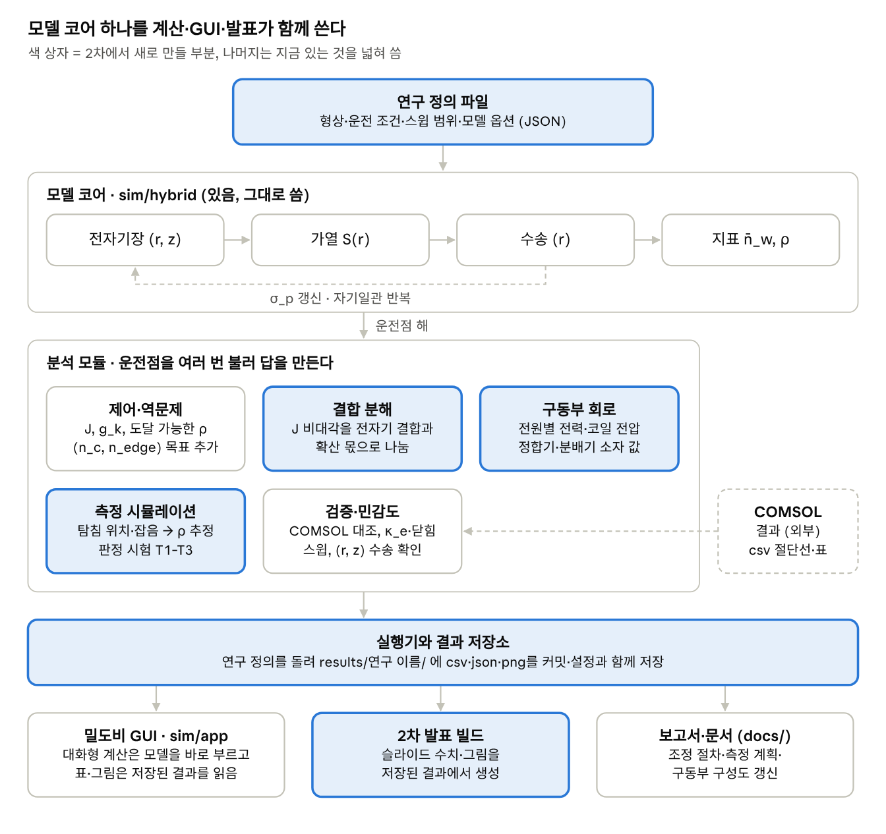
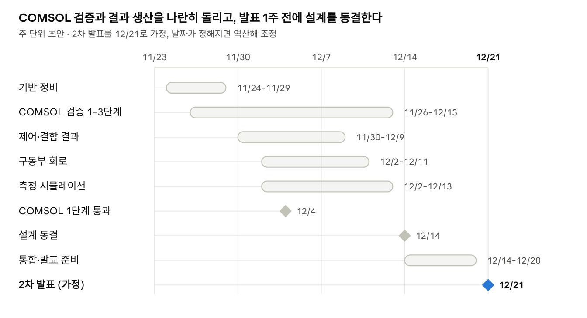

# 27. 2차 과제 진행 계획과 아키텍처

작성 2026-11-23. 1차 발표(피드백 반영판)와 밀도비 GUI(`sim/app`), 하이브리드 모델(`sim/hybrid`)을 바탕으로 2차 과제를 어떻게 진행할지 정한다. `10_후속계획.md`(11-06, 0D 2-영역 모델 기준)의 일정은 이 문서가 대신한다. 같은 내용의 Claude 문서판이 있으며, 수정은 두 곳에 함께 반영한다.

## 1. 2차에서 답할 것

2차 발표는 1차에서 세운 모델·판정·검증 방법으로 과제의 제출물 네 가지를 **결과**로 내는 자리다. 전체 완료 기준은 하나다: 발표와 보고서의 모든 수치가 저장소의 연구 정의 파일 하나로 다시 나온다.

| 과제 검토 사항 | 2차에서 낼 결과 | 완료 기준 |
| --- | --- | --- |
| 1 수단 선택과 영향 영역 | 구동부 구성도(독립 전원 2대 + 정합기 + 공통 발진기), 대안 A·C와 비교, 코일별 가열 영역 | 두 전원이 모두 양의 전력을 내는 (k, φ) 범위와 코일 전압이 표로 나옴 |
| 2 상호 영향의 원인 | J의 비대각 크기, 그중 전자기 결합 몫과 확산 몫을 나눈 계산 | 두 원인의 크기를 같은 단위로 비교한 표 |
| 3 한쪽 유지 보상 | 조정 절차(평균 유지 + 한쪽 영역 고정), 압력·위상별 도달 가능한 ρ 범위 | ρ 0.8–1.2를 n̄_w ±5% 안에서 맞추는 입력표, 못 맞추는 조건까지 명시 |
| 4 측정과 검증 | 측정 배치와 오차 예산, 측정 잡음을 넣은 판정 시험, COMSOL 교차 검증 1–3단계 | 13쪽 합격 기준(안)을 확정하고 단계별 통과 여부를 보고 |

1차 발표에서 2차로 넘긴 약속도 이 표 안에 들어간다.

- 제어 Jacobian J와 형상 이득 g_k의 값, 도달 가능한 ρ 범위(12·14쪽)
- 전원 사이 전력 이동과 위상차 범위(부록 A3)
- 되먹임에 쓸 측정 위치와 방법(4쪽)
- 가열까지 r만으로 구하는 표면 임피던스 근사(6쪽)
- 열전도·밀도 의존 과정·축전 결합 점검, 고압의 (r, z) 수송 확인(7·13쪽)

## 2. 지금 가진 것

모델과 GUI는 2차에 그대로 쓸 수 있고, 빠진 것은 대부분 "계산을 묶어 결과로 남기는 층"과 "외부 대조"다. 설계 문서 일부는 예전 0D 2-영역 모델 기준이라 하이브리드 모델에 맞게 고쳐야 한다.

| 자산 (위치) | 지금 할 수 있는 것 | 2차에 빠진 것 |
| --- | --- | --- |
| 하이브리드 모델 (`sim/hybrid`) | (P_tot, k, φ, 압력) → n̄_w, ρ, 분포. 운전점당 0.15 s, 검산 5종, (r, z) 수송 검증판 | 외부 대조 없음. 열전도·축 방향 닫힘 가정에 민감 |
| 제어·역문제 (`control.py`, `inverse.py`) | J_ctrl, 평균 유지 스캔, (k, φ) 지도, 목표 → 입력, 도달 영역 | (n_c, n_edge) 목표, 한쪽 영역 고정 시험 |
| 밀도비 GUI (`sim/app`) | 목표로 맞추기, 직접 조정, 도달 범위, 전원별 전력 경고, J | 배치 계산·결과 저장 없음. 검증·측정 화면 없음 |
| 비교 입출력 (`export.py`, `compare`) | COMSOL 절단선과 (r, z) 표를 같은 형식으로 대조 | 실제 COMSOL 결과 없음 |
| 1차 근거 계산 (`presentations/src/rev1123/calc`) | 가열 모양, 축소 오차, 겹침, 가열 고정 시험 | 발표용 일회성 스크립트라 재사용이 어려움 |
| 설계 문서 (`조정절차.md`, `측정계획.md`, 결정 보고서) | 제출물 ③·④의 초안, 구동 수단 선택(A8) | ρ 정의·집계 반경이 1차 발표와 다름 (R_Γ, 다른 반경) |
| 0D 2-영역 모델 (`two_zone_icp.py`) | 1차 결정의 근거 | 10 mTorr ρ 하한이 하이브리드와 다름(0.88 대 0.69). 정리 필요 |

## 3. 큰 틀의 아키텍처

모델 코어 `sim/hybrid`는 그대로 두고, 그 위에 분석 모듈과 실행기를 얹어 GUI·발표·문서가 같은 결과를 읽게 한다.

연구 정의 파일 하나가 계산 조건을 정하고, 실행기가 코어와 분석 모듈을 돌려 결과를 저장한다. GUI는 대화형 계산만 직접 하고, 슬라이드와 보고서의 수치는 저장된 결과에서만 나온다.

| 모듈 | 위치 (안) | 할 일 | 상태 |
| --- | --- | --- | --- |
| 연구 정의·실행기 | `sim/studies/*.json`, `sim/runner.py` | 스윕 조건을 파일로 정하고 돌려 `results/<연구>/`에 저장, 커밋·설정·시간 기록 | 신규 |
| 제어·역문제 | `hybrid/control.py`, `inverse.py` | J(p, φ) 표, 도달 범위, (n_c, n_edge) 목표와 한쪽 고정(T2·T3) | 확장 |
| 결합 분해 | `hybrid/coupling.py` | 가열을 영역 안으로 자른 계산과 비교해 전자기 결합 몫과 확산 몫을 나눔 | 신규 |
| 구동부 회로 | `hybrid/drive.py` (`port_drive` 확장) | 전원별 전력·코일 전압, 정합기·분배기 소자 값, 가능한 (k, φ) 영역 | 신규 |
| 측정 시뮬레이션 | `hybrid/measure.py` | 탐침 위치·개수·잡음으로 ρ 추정, T1–T3 판정 시험, 오차 예산 | 신규 |
| 검증·민감도 | `export.py`, `validate.py`, `compare` | COMSOL 1–3단계 대조, κ_e·닫힘 스윕, 표면 임피던스 근사 비교 | 확장 |
| GUI | `sim/app` | 결합·구동부·측정·검증 탭, 저장된 연구 불러오기 | 확장 |
| 발표 빌드 | `presentations/src/rev2` | 1차의 `build.py` 방식으로 수치·그림을 결과 저장소에서 생성 | 신규 |

## 4. 단계별 작업 계획과 일정

4주를 기반 정비 1주, 결과 생산과 검증 2주, 통합 1주로 나눈다. 관문은 세 개다: COMSOL 1단계 통과, 설계 동결, 2차 발표.

COMSOL은 준비가 길어 첫주부터 나란히 돌리고, 설계 동결 뒤에는 새 계산을 발표 수치에 넣지 않는다.

| 단계 | 할 일 | 완료 기준 |
| --- | --- | --- |
| 기반 정비 | 연구 정의 형식과 실행기, 결과 저장 규칙. 조정 절차·측정 계획을 1차 발표의 ρ 정의(중앙 0–5 cm, 가장자리 12–14.5 cm, 웨이퍼 위 1 cm)로 갱신. 0D 모델과 같은 형상으로 한 번 대조 | 기준점 연구 하나가 실행기로 돌고 1차 발표 수치와 같게 나옴 |
| 제어·결합 결과 | 5–50 mTorr × φ 0°·180° × 전력 2점의 J 표와 도달 범위, (n_c, n_edge) 목표와 T2·T3, 결합 분해, 열전도 1·3·10배 | 검토 사항 2·3의 표와 그림이 결과 저장소에서 생성됨 |
| 구동부 회로 | 두 전원이 모두 양의 전력을 내는 (k, φ) 영역, 정합기 소자 값, 전원 1대 + 분배기 대안 비교 | 구성도와 소자 값 표 |
| COMSOL 검증 | 1단계 전자기장(12/4까지), 2단계 단일 코일, 3단계 이중 코일 한두 점 | 13쪽 합격 기준으로 단계별 판정 |
| 측정 시뮬레이션 | 탐침 위치·개수·잡음에 따른 ρ 추정 오차, T1–T3를 측정으로 판정할 수 있는지 | 측정 배치와 오차 예산 표 |
| 설계 동결 | 기준 압력·위상·구동부를 확정 | 팀 합의 |
| 통합·발표 준비 | 문서 갱신, 발표 빌드로 덱·대본, GUI 탭 정리, 작업하지 않은 사람의 독립 검토 | 모든 수치가 결과 저장소에서 다시 나옴 |

## 5. 역할과 작업 방식

네 사람이 작업 갈래를 하나씩 맡고, 결과는 모두 같은 결과 저장소를 거쳐 나가는 구조를 제안한다. 누가 어느 갈래를 맡을지는 팀이 정한다.

| 역할 | 맡는 모듈 | 내는 것 |
| --- | --- | --- |
| 모델·제어 | 제어·역문제, 결합 분해, 연구 정의 파일 | J(p, φ) 표, 도달 가능한 ρ 범위, 조정 절차 |
| 검증 | COMSOL 모델, 검증·민감도 | 1–3단계 대조 결과, 열전도·닫힘 민감도 |
| 구동부·측정 | 구동부 회로, 측정 시뮬레이션 | 구성도와 소자 값, 측정 배치와 오차 예산 |
| 통합·발표 | 실행기·결과 저장소, GUI, 발표 빌드 | 2차 발표 자료·대본, 보고서, GUI 화면 |

작업 방식

- **브랜치:** `topic/two-zone-model`에서 갈래별 브랜치를 따고, 합칠 때는 다른 사람 한 명이 검토한다.
- **수치의 출처:** 발표·보고서의 숫자는 `results/<연구>/`에서만 가져온다. 손으로 옮긴 수치는 두지 않는다.
- **재현:** 연구 정의 파일과 커밋만 있으면 같은 결과가 나와야 한다. 검산(`run_hybrid.py check`)은 합치기 전에 매번 돌린다.
- **점검:** 주 2회 15분, 갈래별 막힌 것과 다음 작업만 말한다.
- **공개 저장소:** 이름·학번은 커밋과 파일에 넣지 않는다.

## 6. 위험과 팀이 정할 것

가장 큰 위험은 제어 권한이 열전도 가정에 달려 있다는 것이다. 그래서 모든 제어 결과는 열전도 1·3·10배의 범위로 내고, COMSOL 2단계를 가장 먼저 끝낸다.

| 위험 | 영향 | 대응 |
| --- | --- | --- |
| 열전도가 모델보다 크면 형상 이득이 줄어든다 | 10 mTorr에서 g_k −0.59 → −0.13(10배), 도달 범위가 좁아짐 | 결과를 범위로 보고, COMSOL 단일 코일 대조를 우선 |
| COMSOL 라이선스·숙련에 시간이 걸린다 | 검증 없이 발표하게 됨 | 1단계(전자기장만)를 둘째 주 안에 끝내고, 3단계는 한 점만 해도 됨 |
| 저장소의 두 모델이 다르게 말한다 | 결정 보고서의 압력 선택(20–30 mTorr) 근거가 흔들림 | 같은 형상으로 한 번 대조하고, 이후는 하이브리드 하나만 씀 |
| 실제 측정을 하지 못한다 | 검토 사항 4가 계획으로만 남음 | 측정 시뮬레이션(잡음·위치 오차)으로 판정 능력을 보임 |
| 위상차를 주면 한쪽 전원이 전력을 흡수한다 | φ = 90°에서 안쪽 전원 −416 W | 구동부 회로에서 가능한 (k, φ) 범위를 먼저 못박음 |

팀이 정할 것

- [ ] 2차 발표 날짜와 형식(녹화 여부, 시간). 일정표는 12월 셋째 주를 가정했다
- [ ] 갈래별 담당자와 COMSOL을 맡을 사람
- [ ] 기준 압력대 (10 mTorr 하나, 또는 10–20 mTorr)
- [ ] 13쪽 합격 기준(안) 확정: 단일 코일 ρ 5%, 이중 코일 부호 일치·g_k 30%
- [ ] 0D 2-영역 모델의 처리 (대조 후 보관만 할지)
- [ ] 구동부 기준안: 독립 전원 2대 유지, 또는 전원 1대 + 분배기 비교 추가
